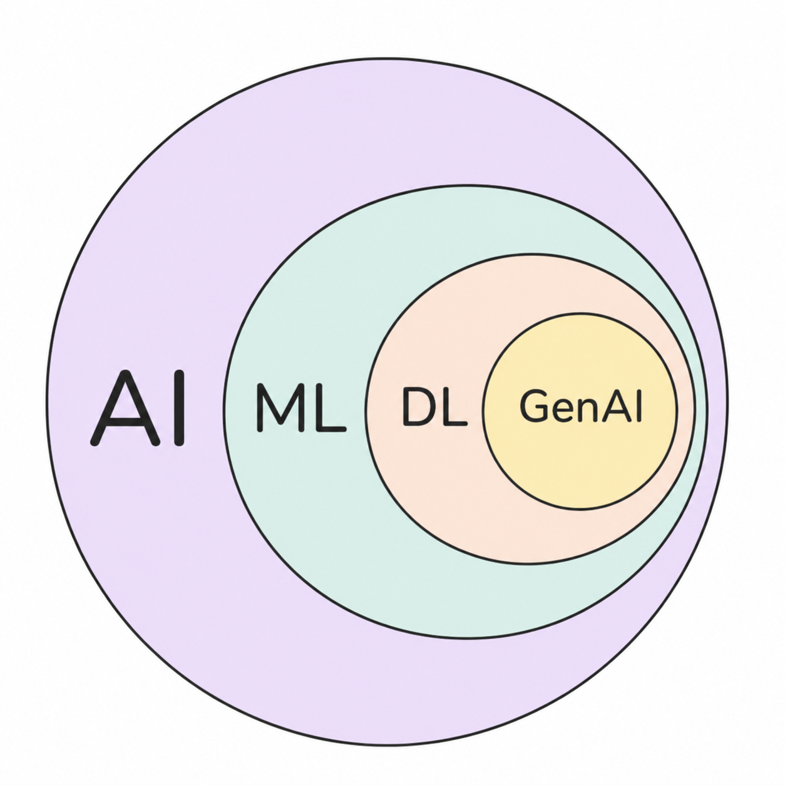
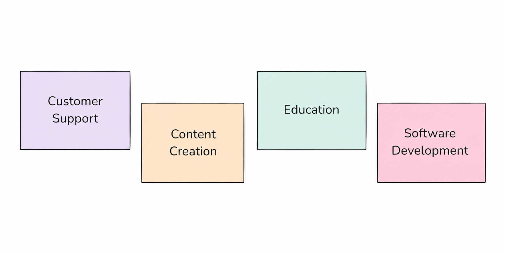
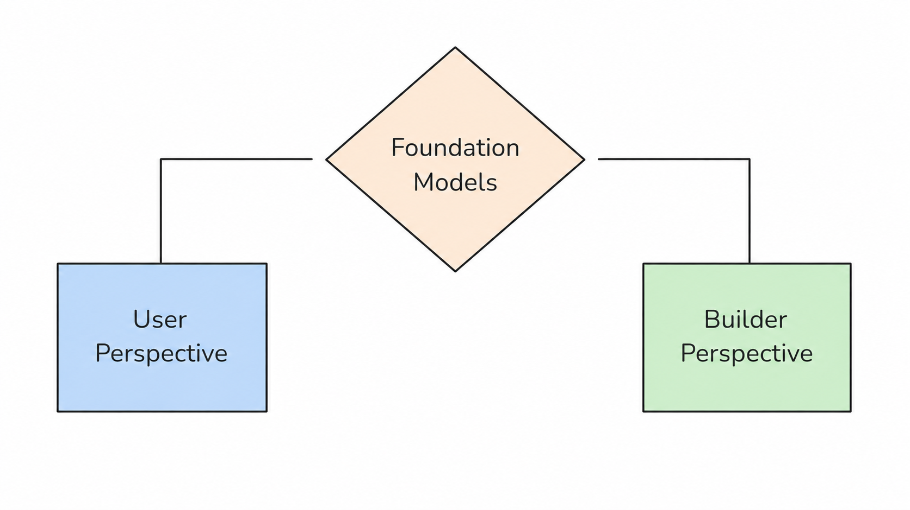
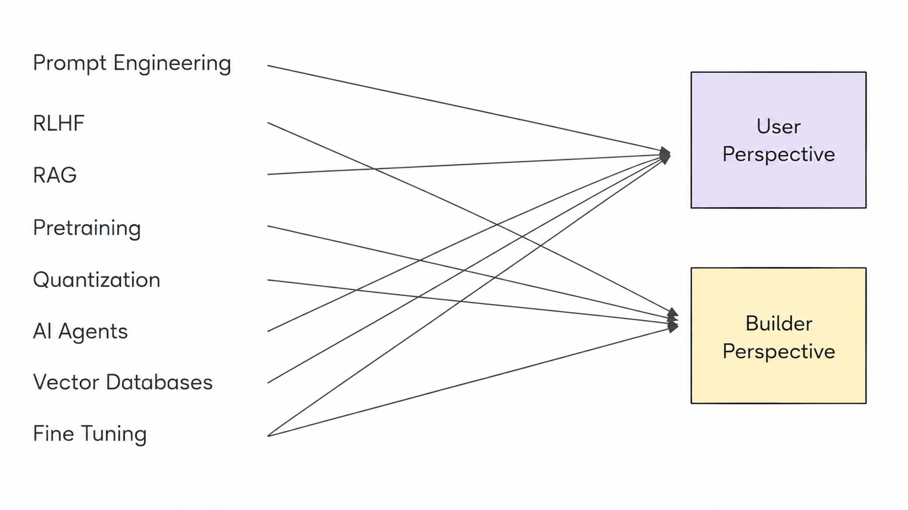
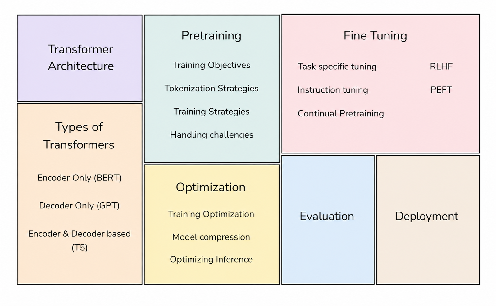
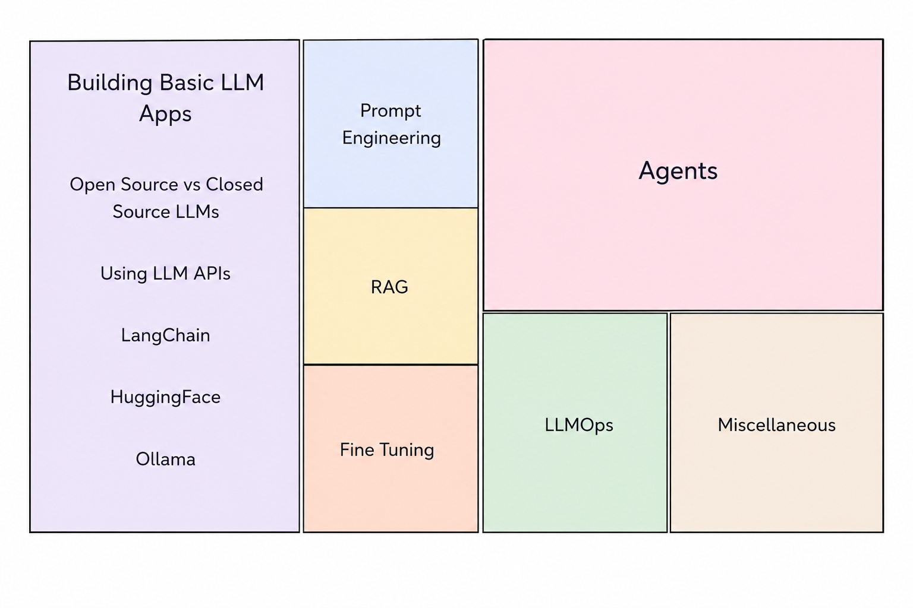
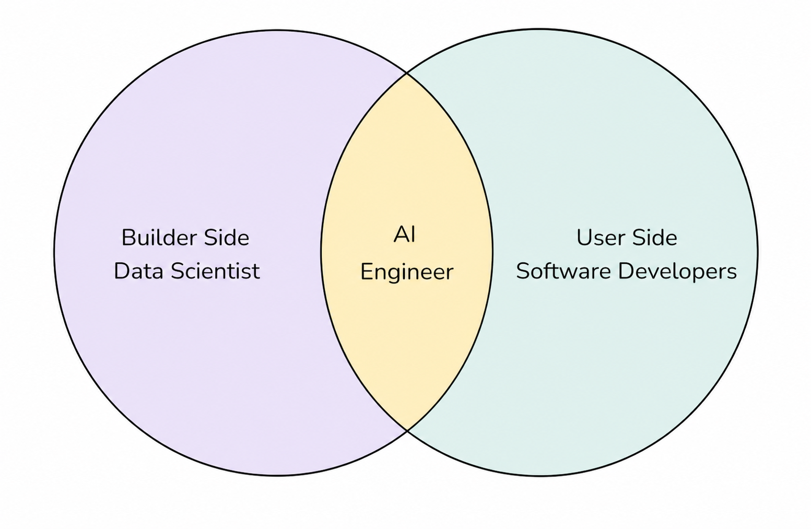

# What is GenAI?

#### Generative AI is a type of artificial intelligence that creates new content - such as text, images, music, or code - by learning patterns from existing data, mimicking human creativity.

### GenAI Impact Areas

- Customer Support
- Content Creation
- Education
- Software Development

### Is GenAI successful?

- Does it solve real world problems? **YES**
- Is it useful on a daily basis? **YES**
- Is it impacting the world economics? **YES**
- Is it creating new jobs? **YES**
- Is it accessible? **YES**

### Foundation Models

- Foundation models are large-scale AI models pre-trained on massive, diverse datasets using self-supervised learning, acting as the versatile "engine" for generative AI applications.
- They develop a broad understanding of patterns, allowing them to be adapted—via fine-tuning or prompting—to varied downstream tasks like text generation, coding, and image creation.
- There are two perspective of foundation models:

- User Perspective -> Prompt Engineering, Retrieval-Augmented Generation (RAG), AI Agents, Vector Databases and Fine Tuning.
- Builder Perspective -> Reinforcement Learning from Human Feedback (RLHF), Pretraining, Quantization and Fine Tuning.

### The Builder's Perspective

- Transformer Architecture
- Types of Transformers -> Encoder Only (BERT), Decoder (GPT) and Encoder & Decoder based (T5).
- Pretraining -> Training Objectives, Tokenization Strategies, Training Strategies and Handling Strategies.
- Optimization -> Training Optimization, Model Compression and Optimizing Inference.
- Fine Tuning -> Task specific tuning (RLHF), Instruction tuning (PEFT) and Continual Pretraining.
- Evaluation
- Deployment

### The User's Perspective

- Building Basic LLM Apps -> Open Source v/s Closed Source LLMs, Using LLMs APIs, LangChain, HuggingFace and Ollama.
- Prompt Enginnering
- Retrieval-Augmented Generation (RAG)
- Fine Tuning
- Agents
- LLMOPs
- Miscellaneous

### Do we need to learn both?

