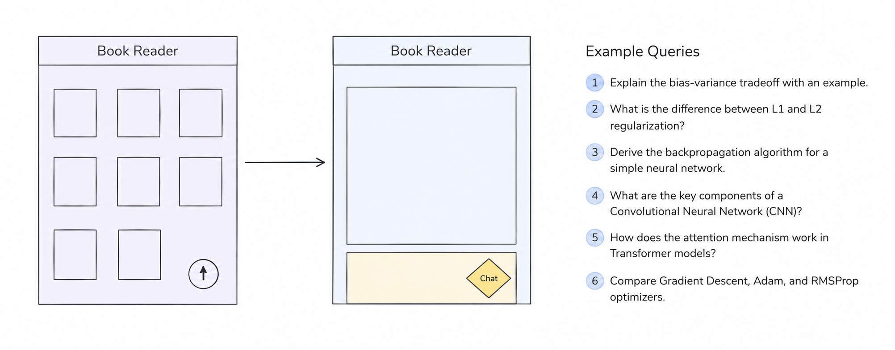
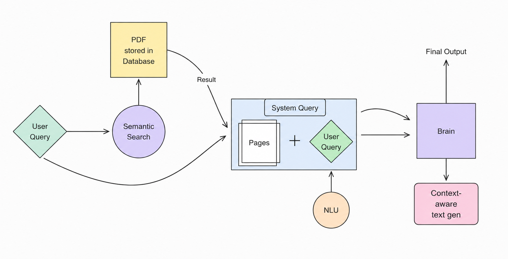
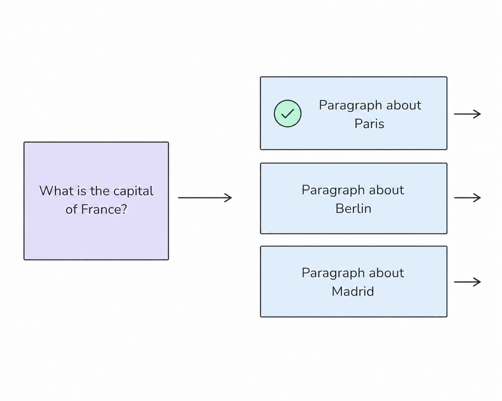
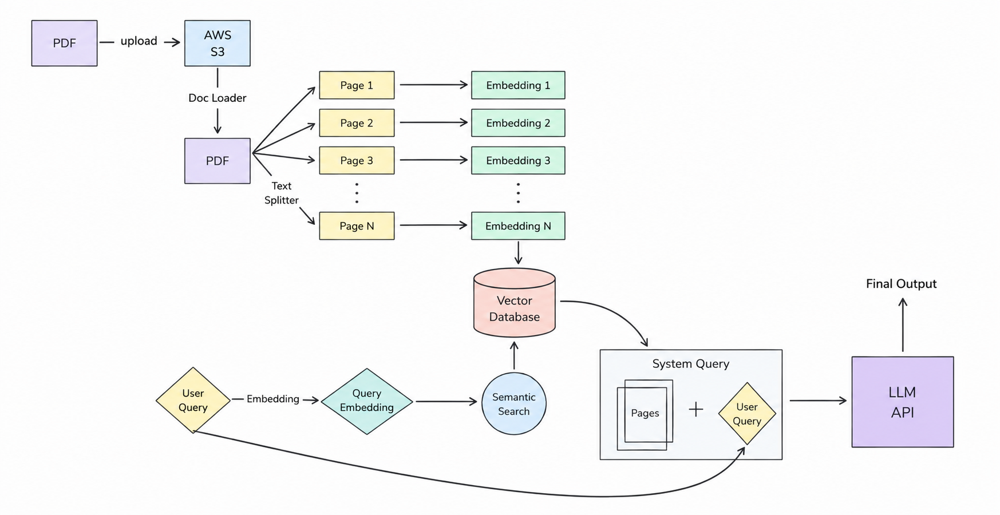

# Introduction to LangChain | LangChain for Beginners

## What is LangChain?

- **LangChain** is an **open-source framework** for developing applications powered by **Large Language Models(LLMs)**.

## Why do we need LangChain?

Modern LLM applications are much more than just sending prompts to an AI model.
To build production-ready AI systems, we need workflows for:

- Document ingestion
- Semantic search
- Embeddings
- Retrieval-Augmented Generation (RAG)
- Context management
- LLM orchestration
- Chat interfaces

LangChain helps developers connect all these components together into a complete AI pipeline.

### AI-Powered Book Reader Application

This diagram demonstrates an AI-powered Book Reader application.

#### What Happens Here?
- Users upload books or PDFs.
- The application displays documents in a reader interface.
- Users can interact with the book using an AI chat assistant.
- The system supports intelligent educational queries such as:
- Bias-variance tradeoff
- CNN architectures
- Backpropagation
- Attention mechanisms
- Optimization algorithms

#### Why LangChain?

LangChain helps by:

- Managing document loading
- Connecting chat interfaces with LLMs
- Handling prompt templates
- Maintaining conversational context
- Building intelligent retrieval pipelines

### Semantic Search + Context-Aware AI Pipeline

This diagram explains how a semantic retrieval pipeline works.

#### Workflow
Step 1 — User Query

- The user submits a natural language query.

Step 2 — Semantic Search

- Instead of keyword matching, embeddings are used to understand the meaning of the query.

Step 3 — Retrieve Relevant Pages

- Relevant document chunks/pages are fetched from the database.

Step 4 — System Query Construction

- The retrieved context + user query are combined together.

Step 5 — LLM Processing

- The final prompt is sent to the LLM.

Step 6 — Context-Aware Response

- The model generates an accurate and grounded response.

#### Why LangChain?

LangChain simplifies:

- Retrieval pipelines
- Prompt chaining
- Memory handling
- Context injection
- LLM orchestration

This is the foundation of RAG (Retrieval-Augmented Generation) systems.

### Understanding Semantic Search

- Traditional search systems rely heavily on keywords.

- Semantic search focuses on the meaning of the query.

**Example**

**User Query:**

- What is the capital of France?

- The system retrieves the most semantically relevant result:

**✅ Paragraph about Paris**

Instead of unrelated results like:

- Berlin
- Madrid

#### Why Is This Important?

- LLMs perform much better when supplied with relevant contextual information.

Semantic search enables:

- Better document retrieval
- More accurate answers
- Intelligent recommendation systems
- Context-aware AI assistants
#### Why LangChain?

LangChain integrates seamlessly with:

- Vector databases
- Embedding models
- Retrieval systems
- Similarity search pipelines

## Complete RAG Architecture Pipeline

This diagram shows the complete lifecycle of a Retrieval-Augmented Generation (RAG) system.

### Document Processing Pipeline
Step 1 — PDF Upload

- Documents are uploaded into cloud storage (AWS S3).

Step 2 — Document Loading

- The PDF is loaded into the processing pipeline.

Step 3 — Text Splitting

- Large documents are divided into smaller chunks/pages.

Step 4 — Embedding Generation

- Each chunk is converted into vector embeddings.

Step 5 — Vector Database Storage

- Embeddings are stored inside a vector database.

### Query Processing Pipeline
Step 6 — User Query Embedding

- The user query is also converted into embeddings.

Step 7 — Semantic Search

- Similarity search identifies relevant document chunks.

Step 8 — Context Retrieval

- Relevant pages are retrieved from the vector database.

Step 9 — Prompt Construction

- The retrieved context + user query are merged into a system prompt.

Step 10 — LLM API Call

- The final prompt is sent to the LLM API.

Step 11 — Final Response

- The model generates a grounded, context-aware response.

### Why LangChain Matters

Without LangChain, developers must manually handle:

- Prompt management
- Retrieval workflows
- Context injection
- Multi-step chains
- Memory systems
- Tool integrations
- LLM orchestration

LangChain provides reusable abstractions for all of these components, enabling developers to build scalable AI applications much faster.

## Benefits of LangChain

- Concept of Chains
- Model Agnostic Development
- Complete Ecosystem
- Memory and State Handling

## What can you build with LangChain?

- Conversational Chatbots
- AI Knowledge Assistants
- AI Agents
- Workflow Automation
- Summarization/Research Helpers

## Alternatives to LangChain
- LlamaIndex
- Haystack
