# LangChain Components

## Core Components of LangChain

- Models
- Prompts
- Chains
- Indexes
- Memory
- Agents

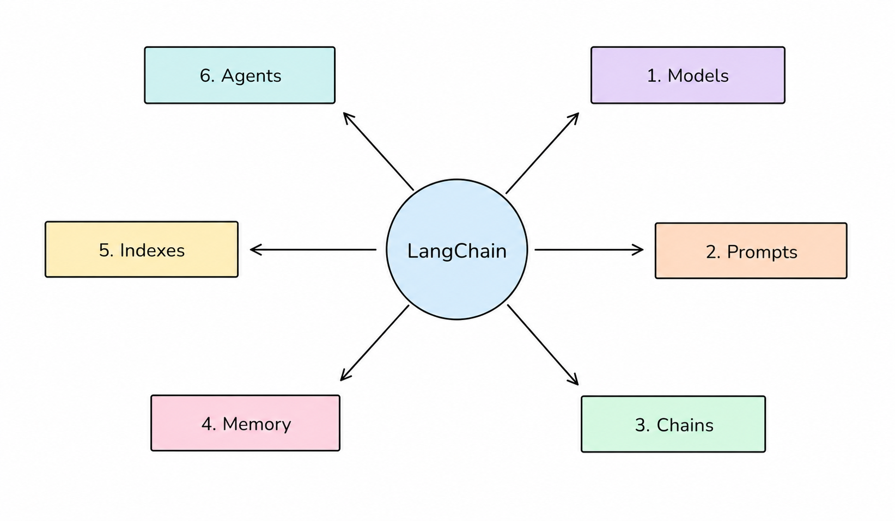

## Models

- In LangChain, **models** are the core interface through which you interact with AI models.
- The core interface that allows developers to interact with various AI models (like OpenAI, Claude, Gemini) in a standardized way, solving the issue of managing different API implementations.

### Types of Models in LangChain

In LangChain, the two most important categories are:

- Language Models (LLMs)
- Embedding Models

These models solve different problems and are often combined to build intelligent AI systems.

This diagram illustrates the two primary categories of models used in modern AI applications.

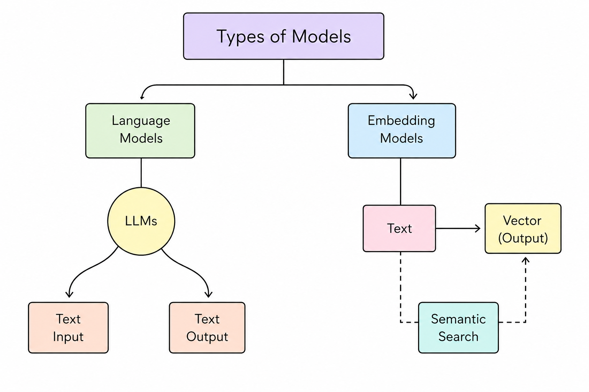

#### Language Models (LLMs)

Language Models are designed to:

- Understand natural language
- Generate text responses
- Answer questions
- Summarize content
- Write code
- Perform reasoning tasks

  **Workflow**

- Text Input → LLM → Text Output

  **Examples**

- GPT-4
- Claude
- Gemini
- Llama
- Mistral

  **Common Use Cases**

- AI chatbots
- Coding assistants
- Content generation
- AI tutors
- Question answering systems

#### Embedding Models

- Embedding models convert text into numerical vector representations.
- Instead of generating text, they capture the semantic meaning of text.

**Workflow**

- Text Input → Vector Embedding

These vectors are then used for:

- Semantic search
- Similarity matching
- Recommendation systems
- Retrieval-Augmented Generation (RAG)
- Why Embeddings Matter

Traditional search relies on keywords.

Embedding models enable:

- Meaning-based search
- Context-aware retrieval
- Better relevance matching

This is the backbone of modern RAG systems.

### Using OpenAI and Anthropic Without LangChain

This diagram demonstrates direct usage of OpenAI and Anthropic APIs.

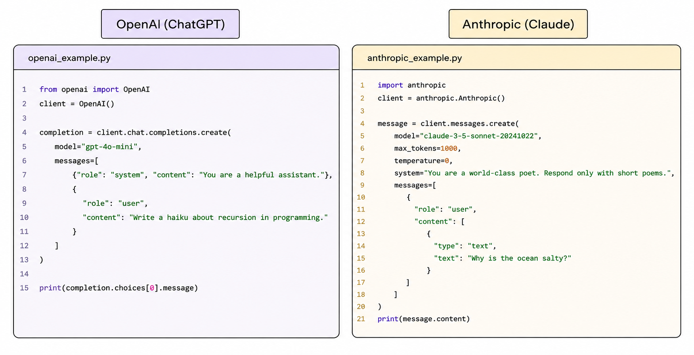

#### OpenAI Example

The OpenAI SDK allows developers to directly communicate with ChatGPT models.

**Responsibilities Handled Manually**

- API calls
- Prompt formatting
- Message structures
- Error handling
- Provider-specific syntax

#### Anthropic Example

Anthropic provides its own SDK and API structure.

**The developer must again manually manage**:

- Client setup
- Message formatting
- Model configuration
- Request structure

#### Problem Without LangChain

**Every provider has**:

- Different APIs
- Different request formats
- Different response structures

**This creates**:

- Vendor lock-in
- Repeated boilerplate code
- Harder maintenance
- Difficult provider switching

### Using OpenAI and Anthropic With LangChain

LangChain acts as a unified abstraction layer over multiple LLM providers.

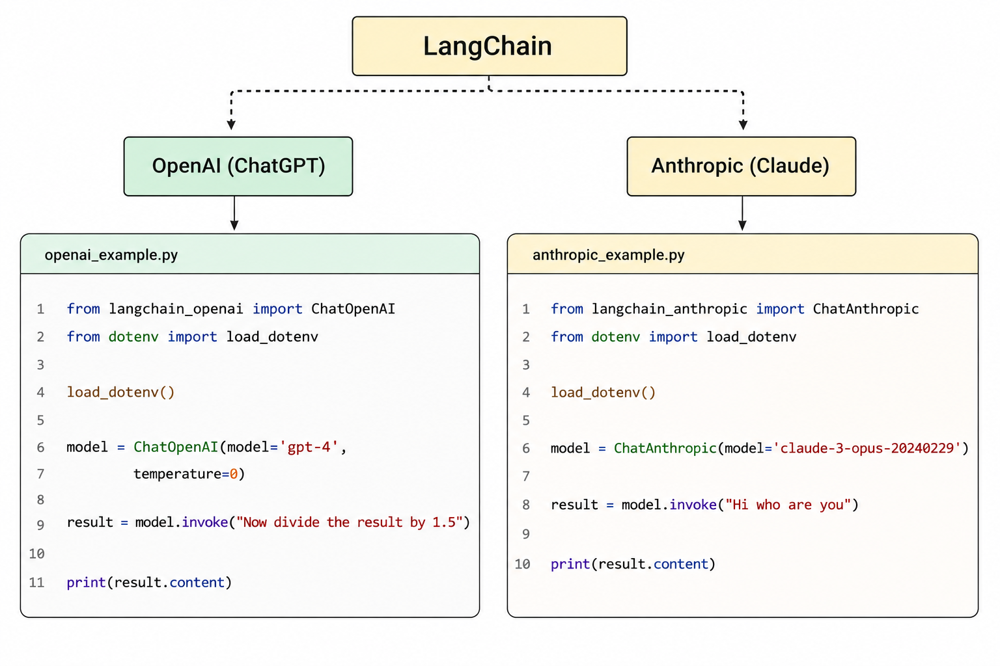

Benefits of LangChain

- Instead of learning separate SDKs for every provider, developers use a common interface.
- Unified API -> **model.invoke()**

**works consistently across**:

- OpenAI
- Anthropic
- Gemini
- Ollama
- Hugging Face
- Groq
- Together AI

**Advantages**

- Cleaner Code
  - LangChain removes repetitive boilerplate code.
- Easy Provider Switching
  - You can switch models with minimal code changes.

- Standardized Interfaces
  - Consistent APIs for:
  - Chat models
  - Embeddings
  - Memory
  - Agents
  - Retrieval systems

- Faster Development
  - Developers can focus on application logic instead of SDK differences.

## Prompts

- In LangChain, a **prompt** is the set of instructions or context provided to a Large Language Model (LLM) to guide its response.

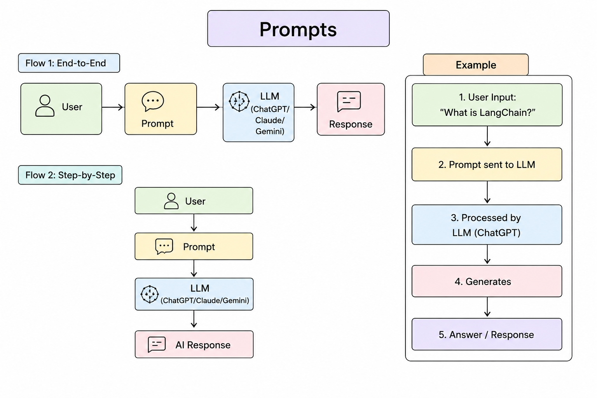

- Techniques like **dynamic/reusable prompts**, **role-based prompting**, and **few-shot prompting** to guide model behavior.

### 1. Dynamic & Reusable Prompts

- Dynamic prompting uses variables inside prompts so the same prompt template can be reused with different inputs.

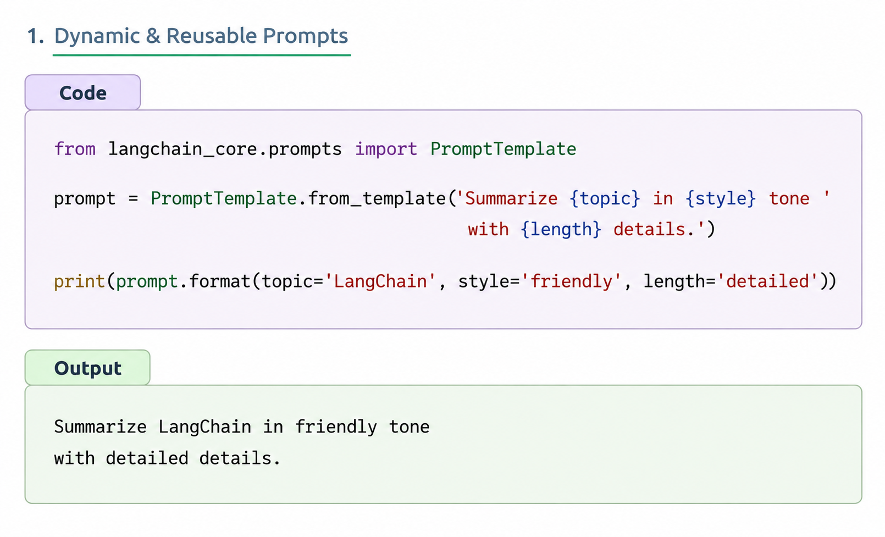

### 2. Role-Based Prompting

- Role-based prompting assigns a specific role or behavior to the AI before generating a response.

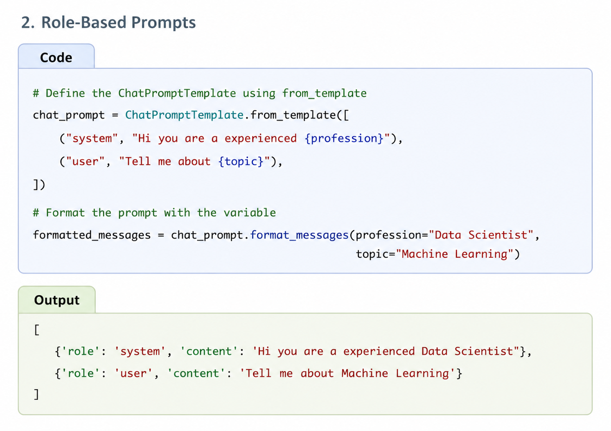

### 3. Few-Shot Prompting

- Few-shot prompting provides examples to the model before asking it to perform a task.

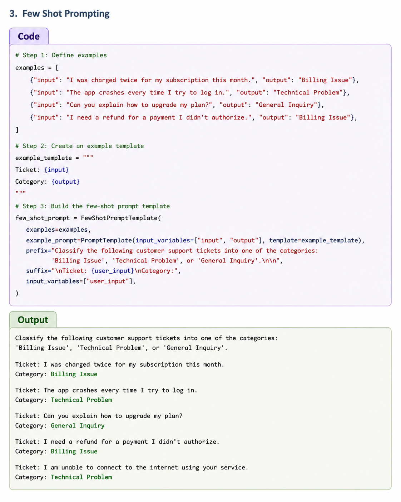

## Chains

- The namesake component of LangChain, it enables the creation of complex pipelines.
- A LangChain chain is a workflow that connects multiple AI components, where the output of one component becomes the input for the next, enabling automated sequential, parallel, and conditional data-processing pipelines.

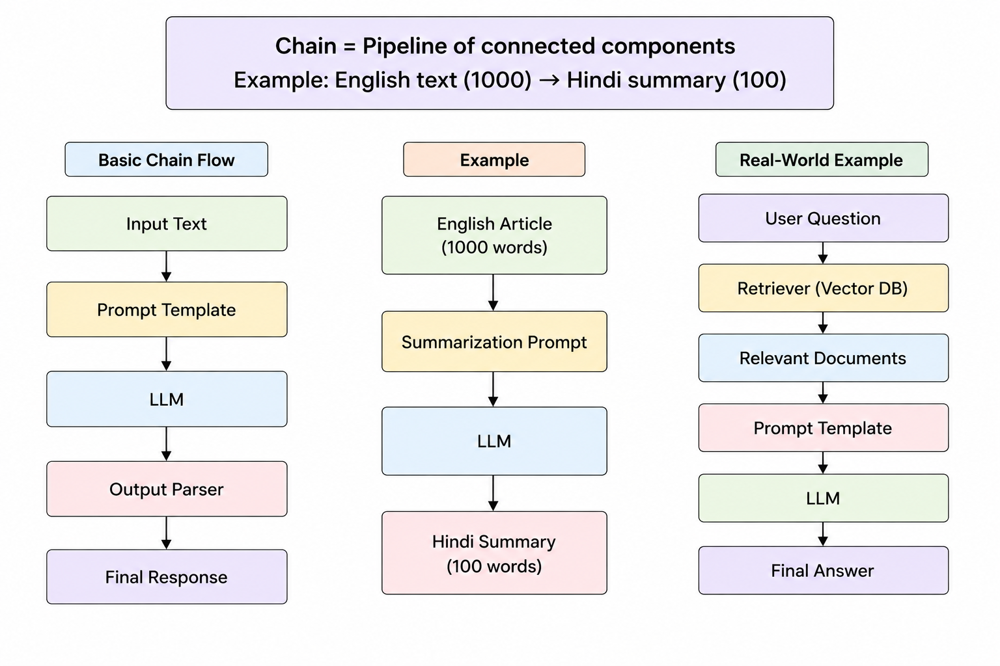

### Sequential Chains

- A Sequential Chain processes tasks step-by-step, where the output of one component becomes the input for the next component.

**Example**:

- Text → Translate → Summarize → Final Output

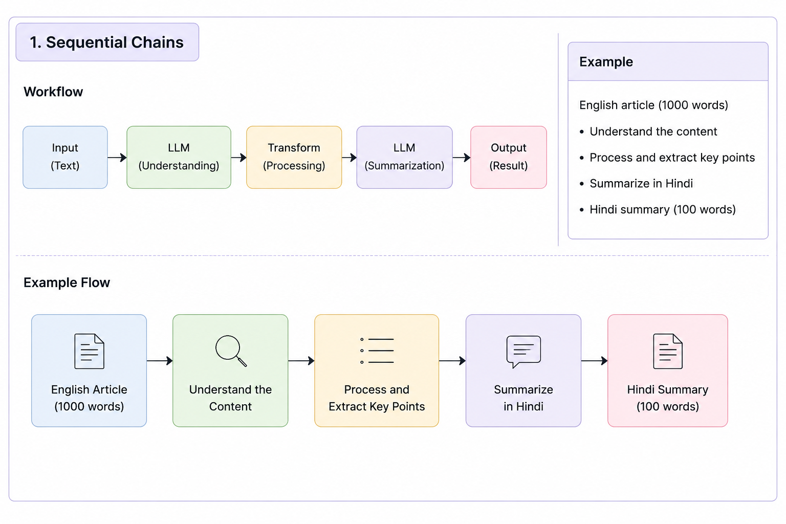

### Parallel Chains

- A Parallel Chain runs multiple tasks at the same time and then combines their results into a single output.

**Example**:

- One LLM extracts pros, another extracts cons → Results are merged

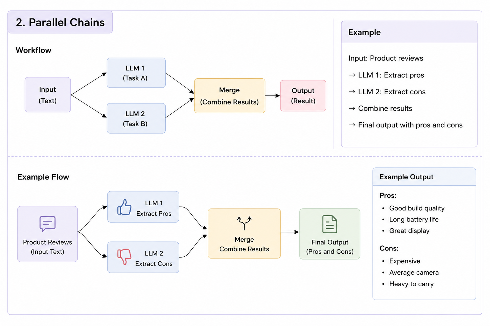

### Conditional Chains

- A Conditional Chain makes decisions based on conditions and follows different paths depending on the input or result.

**Example**:

- Positive feedback → Send Thank You Message
- Negative feedback → Send Support Email

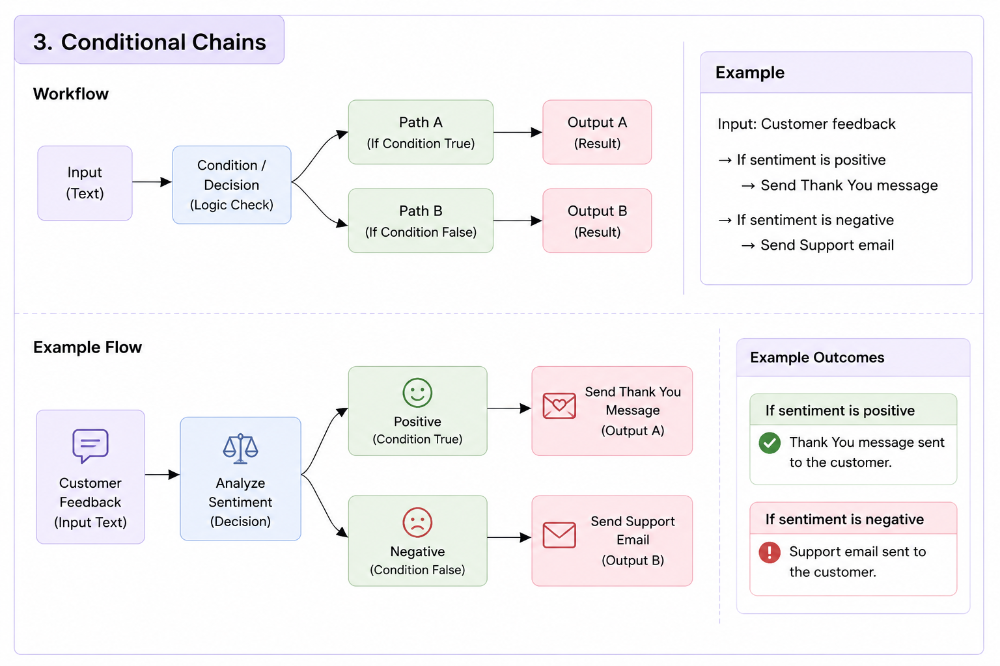

## Indexes

- Indexes connect your application to external knowledge - such as PDFs, website or databases.
- It uses **Document Loaders**, **Text Splitters**, **Vector Stores**, and **Retrievers** to enable semantic search over private data that the base model wasn't trained on.

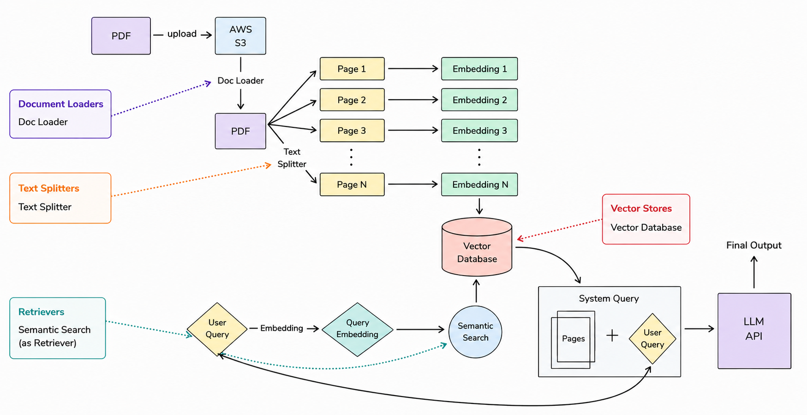

## Memory

- LLM API calls are stateless
- LangChain provides memory components (such as ConversationBufferMemory) to maintain context across multiple interactions, enabling effective conversational chatbots.

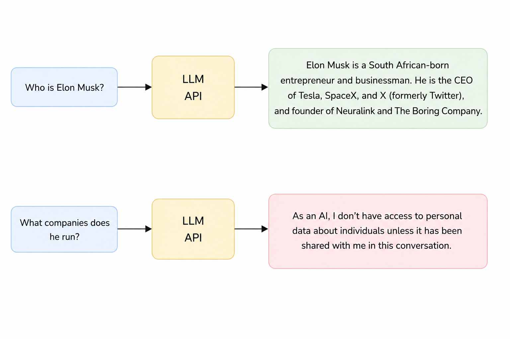

### Types of Memory

- ConversationBufferMemory: Store a transcript of recent messages. Great for short chats but can grow large quickly.
- ConversationBufferWindowsMemory: Only keeos the last N interactions to avoid excessive token usage.
- Summarizer-BasedMemory: Periodically summaries older chat segments to keep a condensed memory footprint.
- Custom Memory: For advanced use cases, you can store specialized state (e.g., the user's preferences or key facts about them) in a custom memory class.

## Agents

- Agents represent an evolution of chatbots.
- They combine reasoning capabilities with access to external tools (like calculators or web search APIs), allowing them to perform actions and solve problems step-by-step rather than just generating text.
