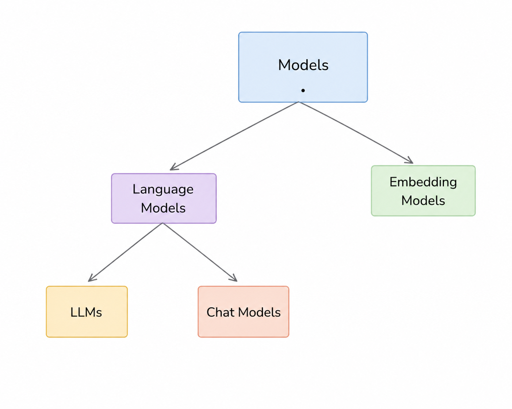
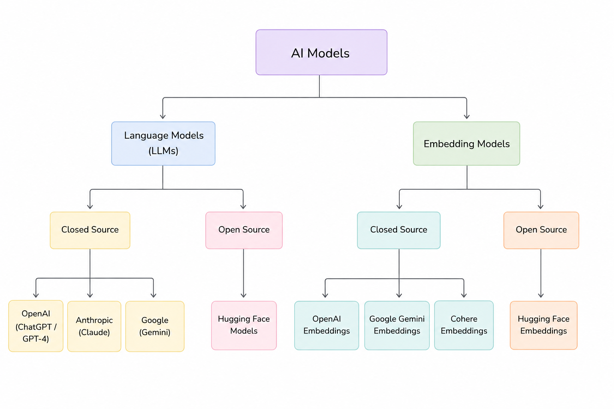
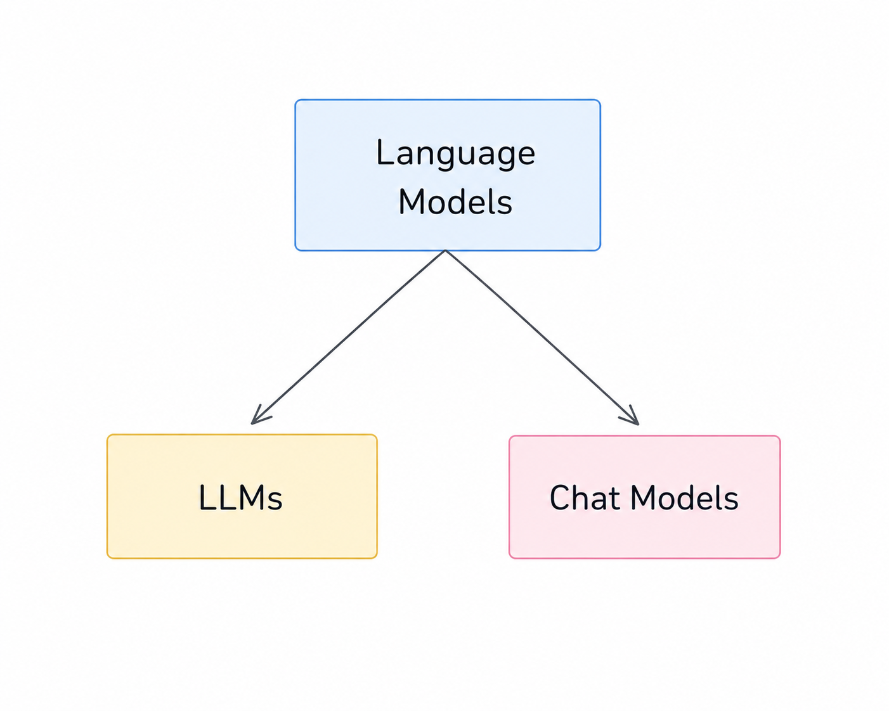
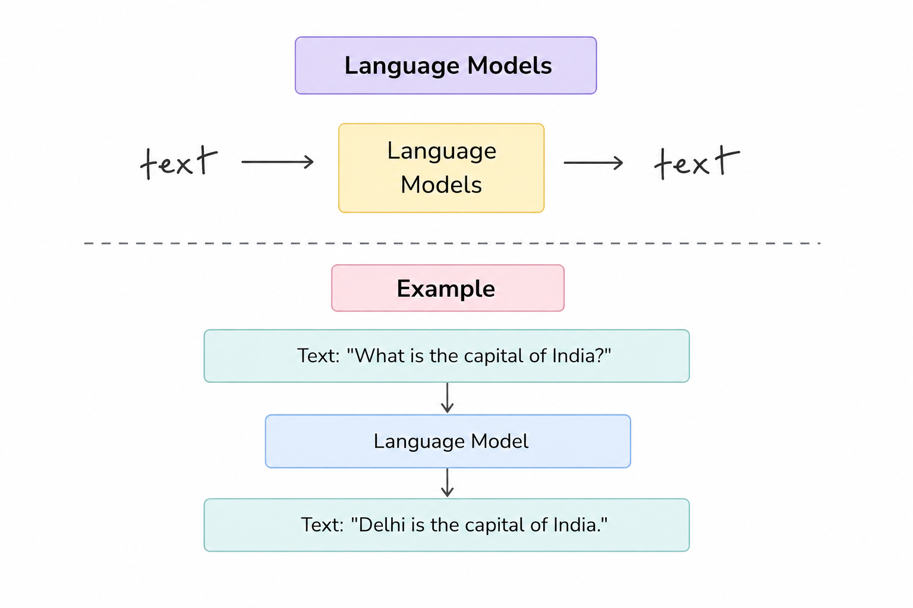
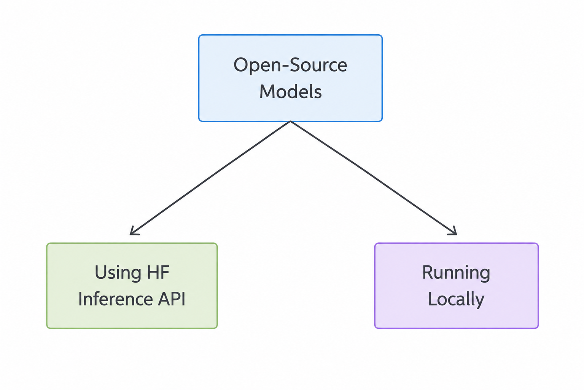
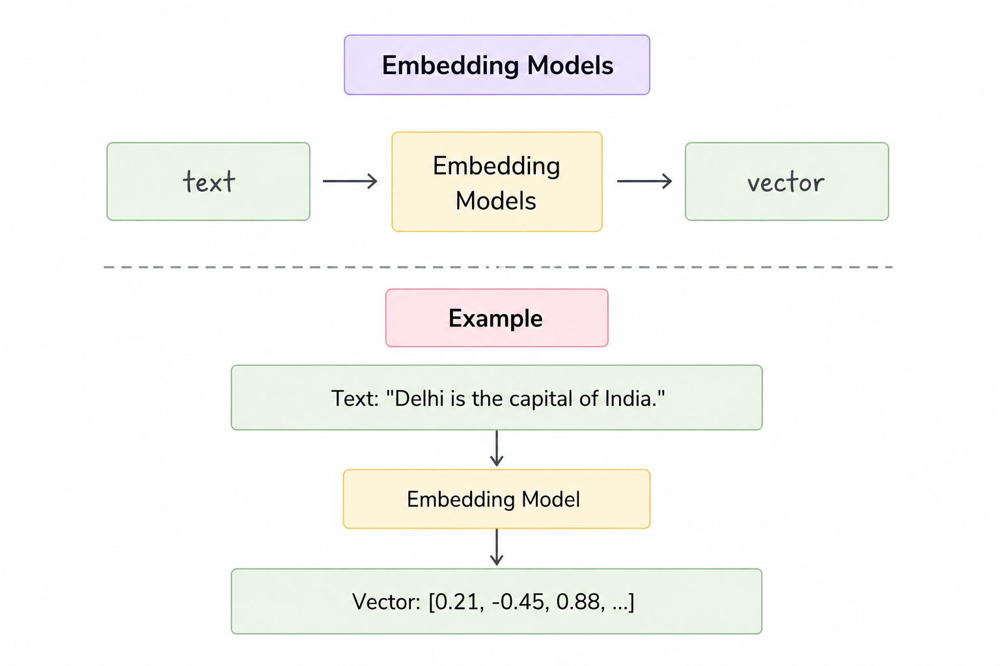

# LangChain Models

## What are Models?

- The Model Component in LangChain is a crucial part of the framework, designed to facilate interaction with various **language models** and **embedding models**.

- It abstracts the complexity of working directly with different LLMs, chat models, and enbedding models, providing a uniform interface to communicate with them.
- This makes it easier to build applications that rely on AI-generated text, text embeddings for similarity search, and retrieval-augmented generation (RAG).
  

## Plan of Action

## Language Models

- Language Models are AI systems designed to process, generate, and understand natural language text.

### Large Language Models (LLMs)

- General-purpose models that is used for raw text generation. They take a string(or plan text) as input and return a string(or plain text).
- These are traditionally older models and are not used much now.

### Chat Models

- Language models that are specialized for conversational tasks. They take a sequence of message as inputs and return chat messages as outputs (as opposed to using plain text).
- These are traditionally newer models and used more in comparison to the LLMs.

### Differnce Between LLMs and Chat Models

| Feature          | LLMs (Base Models)                                           | Chat Models (Instruction-Tuned)                                     |
| ---------------- | ------------------------------------------------------------ | ------------------------------------------------------------------- |
| Purpose          | Free-form text generation                                    | Optimized for multi-turn conversations                              |
| Training Data    | General text corpora (books, articles, web data)             | Fine-tuned on chat datasets and instruction-following conversations |
| Memory & Context | No built-in conversation memory                              | Maintains structured conversation context                           |
| Role Awareness   | No understanding of system/user roles                        | Understands system, user, and assistant roles                       |
| Example Models   | GPT-3, Llama-2, Mistral-7B, OPT-1.3B                         | GPT-4, GPT-3.5-Turbo, Claude, Gemini, Llama-2-Chat                  |
| Use Cases        | Text generation, summarization, translation, code generation | Chatbots, AI assistants, customer support, conversational AI        |
| Input Format     | Plain text input                                             | Structured messages (system, user, assistant)                       |
| Output Style     | Generic text completion                                      | Context-aware conversational responses                              |

### Code Setup

- Create a new folder
- Open it in VS Code
- Create a new venv
  - python -m venv venv or uv venv
- Activate the venv
  - venv\Scripts\activate
- Create the requirements.txt
- Install packages from requirements.txt
  - pip install -r requirements.txt
- Verify LangChain installation

### Temperature

- **temperature** is a parameter that **controls the randomness of a language model's output**.
- It affects how **creative or deterministic** the response are.
  - Lower values (e.g., 0.0 - 0.3) -> More **deterministic** and predictable.
  - Higher values (e.g., 0.7 - 1.5) -> More **random** and creative

| Use Case                                       | Recommended Temperature |
| ---------------------------------------------- | ----------------------- |
| Factual answers (math, coding, facts)          | `0.0 - 0.3`             |
| Balanced responses (general Q&A, explanations) | `0.5 - 0.7`             |
| Creative writing, storytelling, jokes          | `0.9 - 1.2`             |
| Maximum randomness (brainstorming, wild ideas) | `1.5+`                  |

## Open-Source Models

- Open-source language models are freely available AI models that can be downloaded, modified, fine-tuned, and deployed without restrictions from a central provider.
- Unlike closed source models such as OpenAI' GPT-4, Anthropic's Claude, or Google's Gemini, open-source models allow full control and customization.

### Open-Source Models v/s Closed-Source Models

| Feature              | Open-Source Models                                | Closed-Source Models                       |
| -------------------- | ------------------------------------------------- | ------------------------------------------ |
| Cost                 | Free to use (no API costs)                        | Paid API usage (charged per token/request) |
| Control              | Can modify, fine-tune, and deploy anywhere        | Locked to provider infrastructure          |
| Data Privacy         | Runs locally (data stays on your system)          | Queries sent to provider servers           |
| Customization        | Can fine-tune on custom datasets                  | Limited or no fine-tuning access           |
| Deployment           | Deployable on local servers or cloud              | Must use vendor API/platform               |
| Examples             | Llama, Mistral, Falcon, Gemma                     | GPT-4, Claude, Gemini                      |
| Internet Requirement | Can work offline after setup                      | Usually requires internet/API access       |
| Best For             | Research, privacy-focused apps, custom AI systems | Production-ready AI apps, fast integration |

### Some Famous Open-Source Models

| Model                  | Developer    | Parameters | Best Use Case                      |
| ---------------------- | ------------ | ---------- | ---------------------------------- |
| LLaMA-2-7B / 13B / 70B | Meta AI      | 7B - 70B   | General-purpose text generation    |
| Mixtral-8x7B           | Mistral AI   | 8x7B (MoE) | Efficient and fast responses       |
| Mistral-7B             | Mistral AI   | 7B         | Small-scale high-performance model |
| Falcon-7B / 40B        | TII UAE      | 7B - 40B   | High-speed inference               |
| BLOOM-176B             | BigScience   | 176B       | Multilingual text generation       |
| GPT-J-6B               | EleutherAI   | 6B         | Lightweight and efficient tasks    |
| GPT-NeoX-20B           | EleutherAI   | 20B        | Large-scale AI applications        |
| StableLM               | Stability AI | 3B - 7B    | Compact chatbot models             |

### Where to find them?

- **HuggingFace** - The largest repository of open-source LLMs.

### Ways to use Open-source Models

### Disadvantages of using Open-Source Models

| Disadvantage                      | Details                                                                                                         |
| --------------------------------- | --------------------------------------------------------------------------------------------------------------- |
| High Hardware Requirements        | Running large models (e.g., LLaMA-2-70B) requires powerful and expensive GPUs.                                  |
| Setup Complexity                  | Requires installation and configuration of tools like PyTorch, CUDA, and Transformers.                          |
| Lack of RLHF                      | Many open-source models are not heavily fine-tuned with human feedback, so instruction-following may be weaker. |
| Limited Multimodal Abilities      | Most open models have limited support for images, audio, and video compared to models like GPT-4V.              |
| Maintenance Overhead              | Users are responsible for updates, optimization, and infrastructure management.                                 |
| Slower Inference on Local Systems | Running models locally on low-end hardware can lead to slower responses.                                        |

## Embedding Models
- Embedding models turn text into numerical vectors to represent semantic meaning for search and comparison

