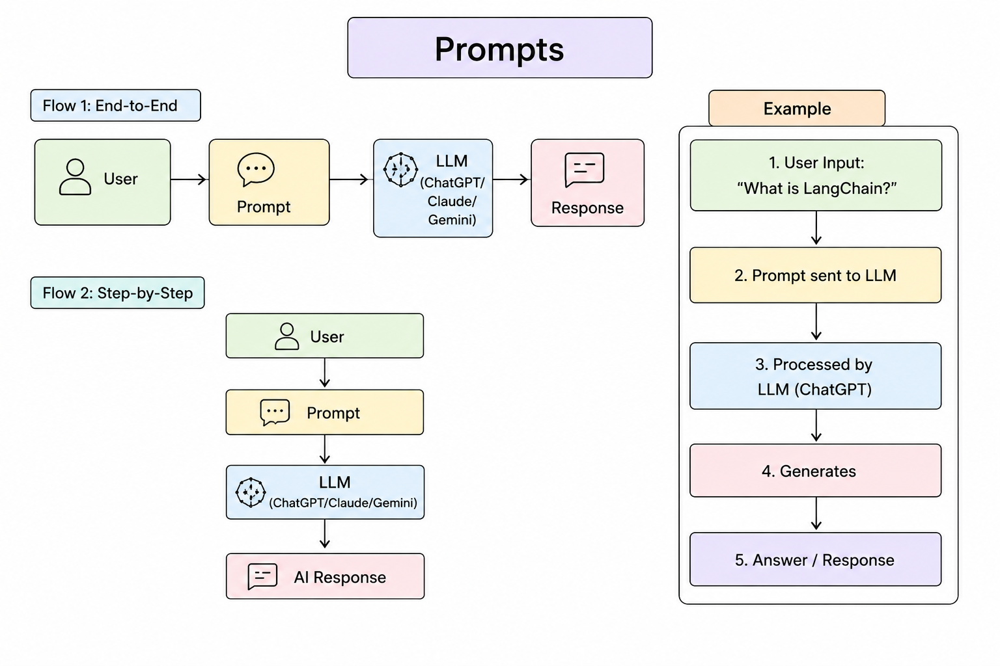
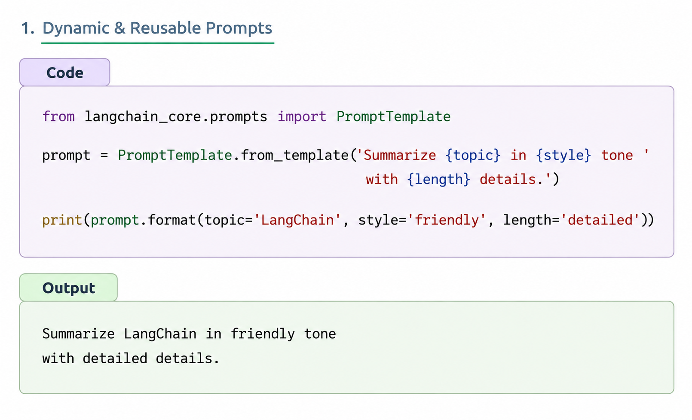
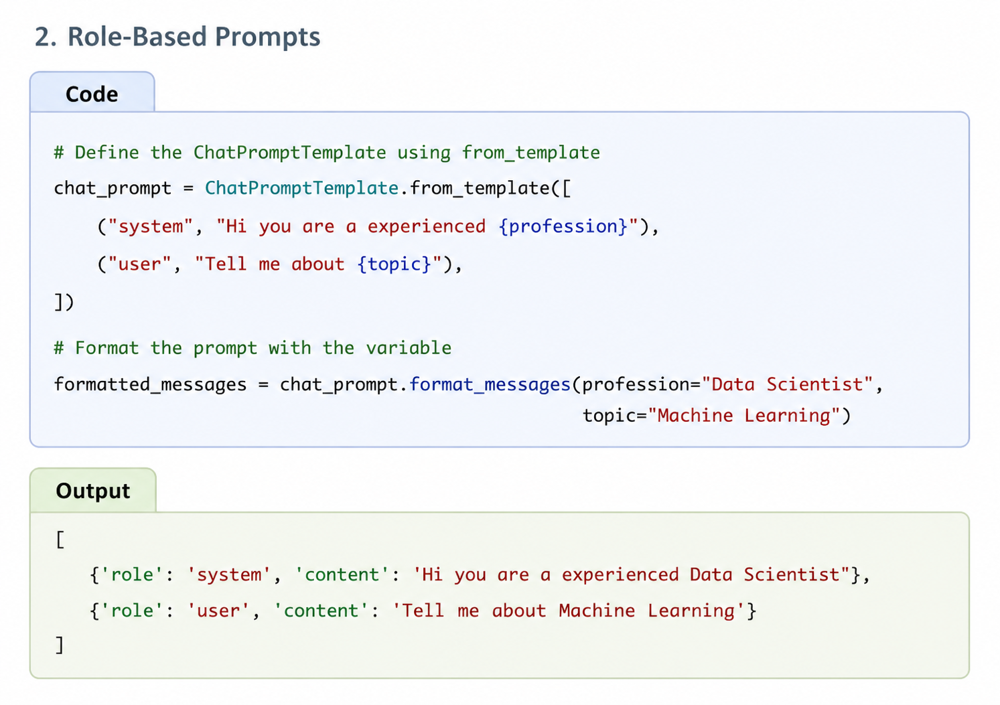
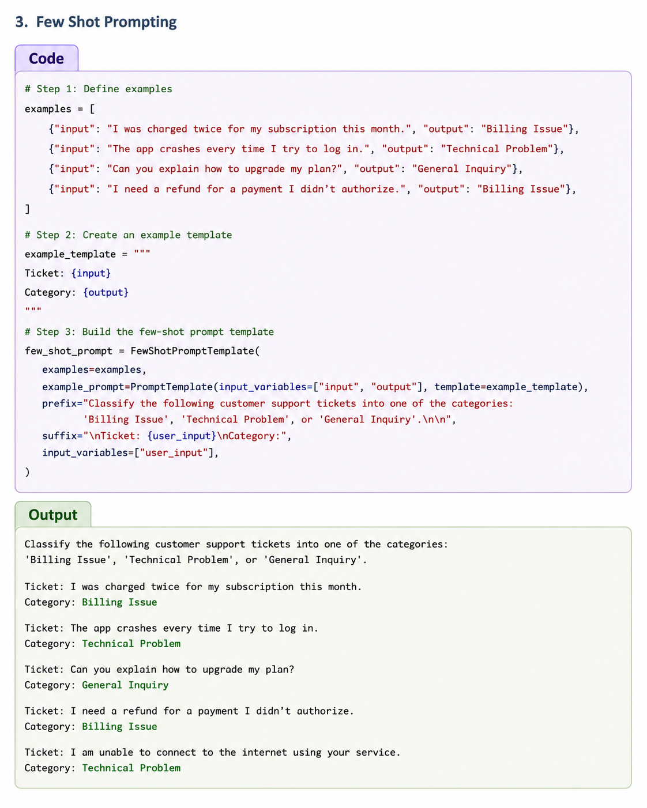
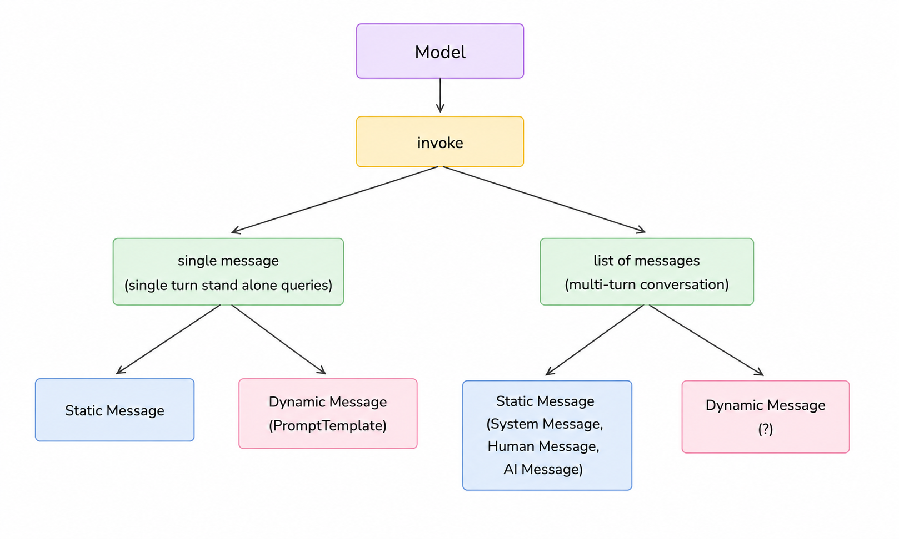

# Prompts in LangChain
## What are Prompts?
- In LangChain, a **prompt** is the set of instructions or context provided to a Large Language Model (LLM) to guide its response.

- Techniques like **dynamic/reusable prompts**, **role-based prompting**, and **few-shot prompting** to guide model behavior.

### 1. Dynamic & Reusable Prompts

- Dynamic prompting uses variables inside prompts so the same prompt template can be reused with different inputs.

### 2. Role-Based Prompting

- Role-based prompting assigns a specific role or behavior to the AI before generating a response.

### 3. Few-Shot Prompting

- Few-shot prompting provides examples to the model before asking it to perform a task.

## Prompt Template
- A **PromptTemplate** in LangChain is a structured way to create prompts dynamically by inserting variables into a predefined template. 
- Instead of hardcoding prompts, Prompt Templates allow us to define placeholders that can be filled in at runtime with different inputs.
- This makes it reusable, flexible, and easy to manage, especially when working with dynamic user inputs or automated workflows.

### Why use PromptTemplate over f strings?
- Default validation
- Reusable
- LangChain Ecosystem

## ChatPromptTemplates
- ChatPromptTemplate managing dynamic lists of messages, ensuring that multi-turn conversations are handled correctly by the model.

## Message Placeholders
- A **MessagesPlaceholders** in LangChain is a special placeholder used inside a **ChatPromptTemplate** to dynamically insert chat history or a list of messages at runtume.
- MessagesPlaceholder are dynamically inject entire chat histories into a prompt. 
- This is crucial for building customer support tools or any application requiring memory of previous interactions.