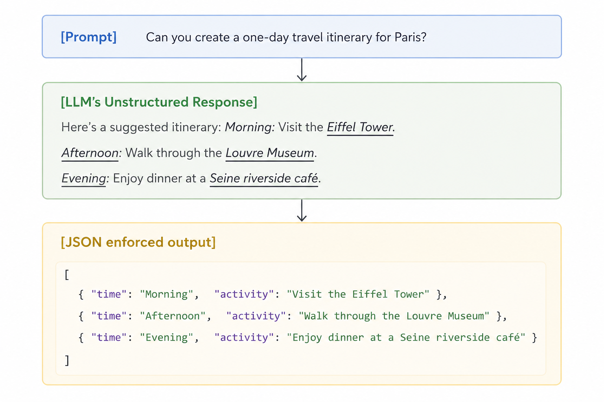
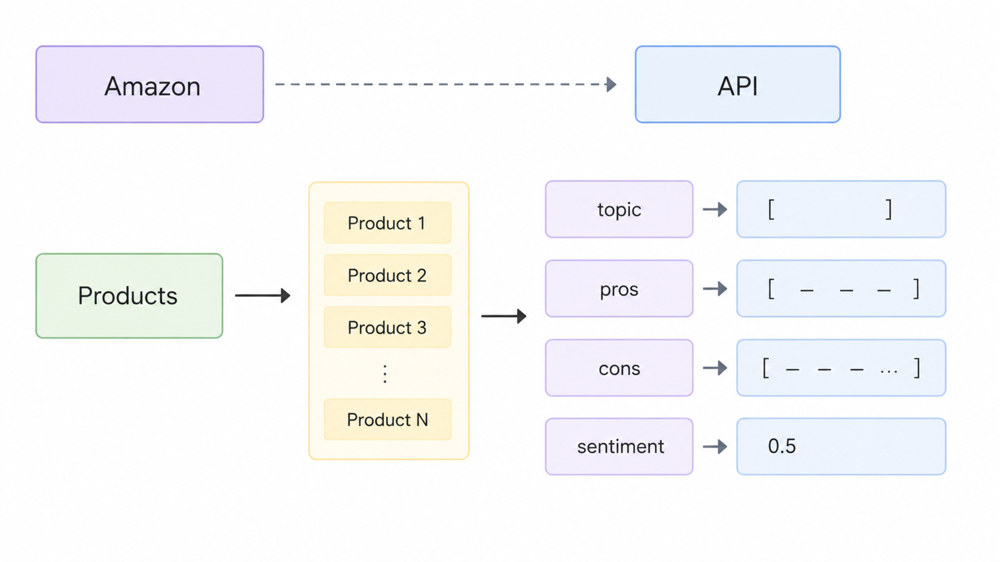
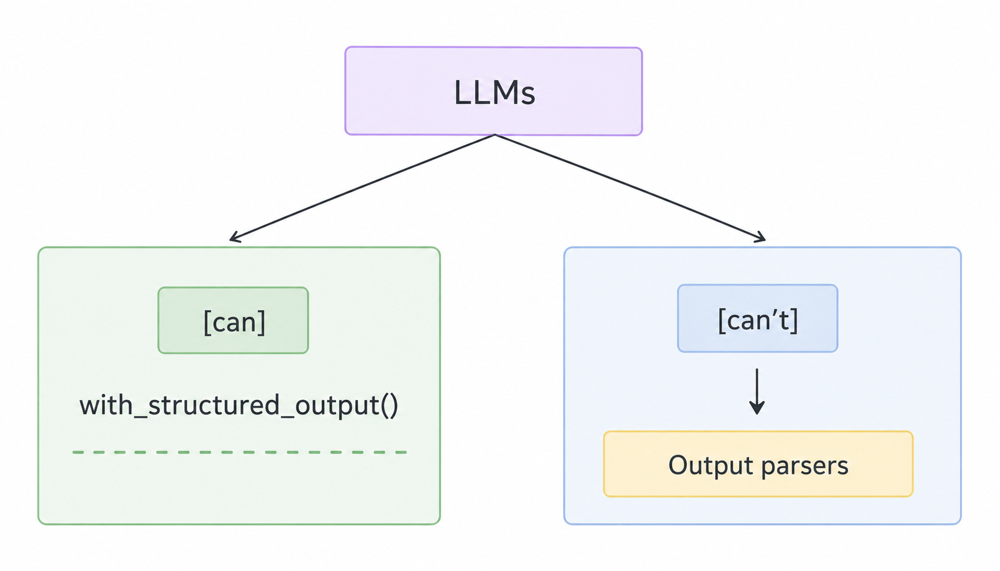
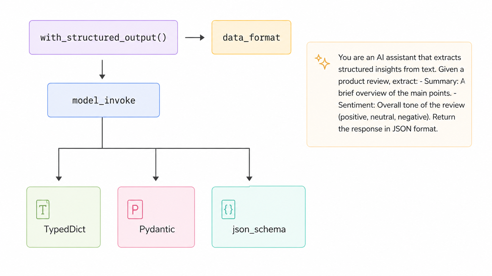
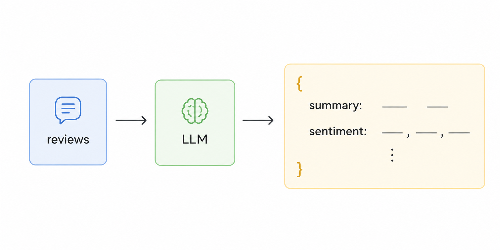
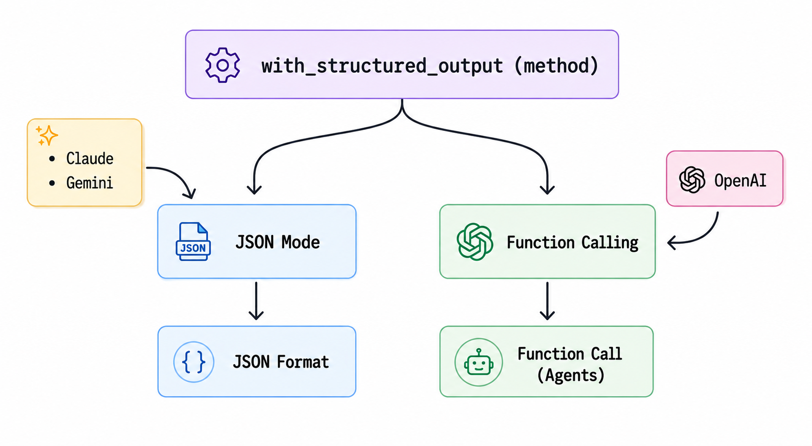

# Structured Output in LangChain

## Structured Output

- In LangChain, structured output refers to the practice of having language models return responses in a well-defined data format (for example, JSON), rather than free-form text.
- This makes the model output easier to parse and work with programatically.



## Why do we need Structured Output?

- Data Extraction
- API building
- Agents

**Example**:



- The system takes product information (e.g., Amazon products) and converts raw text into structured fields such as:
  - **topic** → Main subject of the review
  - **pros** → Positive points
  - **cons** → Negative points
  - **sentiment** → Numeric sentiment score

- This allows applications to process AI outputs without manually reading and parsing text.

### Key Takeways

- **Consistent format** → Ensures AI responses always follow a predictable structure (JSON, list, schema, etc.).
- **Easy to process programmatically** → Applications can directly extract fields like topic, pros, cons, and sentiment without extra parsing.
- **Better reliability for automation** → Makes AI outputs easier to store, validate, search, and connect with APIs or databases.

## Ways to get Structured Output



## with_structured_output



**Example**:



### TypedDict

- **TypedDict** is a way to define a dictionary in Python where you specify what keys and values shoulf exist. It helps ensure that your dictionary follows a specific structure.

**Why use TypedDict?**

- It tells Python what keys are required and what types of values they should have.
- It does not validate data at runtime (it just helps with types hints for beeter coding).
  - simple TypedDict
  - Annotated TypedDict
  - Literal
  - More complex -> with pros and cons

### Pydantic

- **Pydantic** is a data validation and data parsing library for Python.
- It ensures that the data you work with is correct, structured, and type-safe.
  - Basic example
  - Default values
  - Optional fields
  - Coerce
  - Builtin Validation
  - Field Function -> default values, constrains, description, regex expressions
  - Returns pydantic object -> convert to json/dict.

### JSON Schema

- **JSON Schema** is a standard vocabulary that allows you to annotate and validate JSON documents.
- It provides a language-agnostic way to define the exact structure, types, and constraints of the output you expect from the model.
  - Defined using standard Python dictionaries
  - Define types, arrays, and nested objects
  - Specify enums and descriptions for fields
  - Enforce required vs optional fields
  - Does not require third-party data validation libraries like Pydantic

## When to use what?

Use TypedDict if:

- You only need type hints (basic structure enforcement)
- You don't need validation (e.g., checking numbers are positive)
- You trust the LLM to return correct data.

Use Pydantic if:

- You need data validation (e.g., sentiment must be "positive", "neutral", or "negative)
- You need default values if the LLM misses fields.
- You want automatic type conversion (e.g., "100" -> 100)

Use JSON Schema if:

- You don't want to import extra Python libraries (Pydantic).
- Ypu need validation but don't need Python objects.
- You want to define structure in a standard JSON format.

| Feature                      | TypedDict ✅ | Pydantic 🚀 | JSON Schema 🌍 |
| ---------------------------- | ------------ | ----------- | -------------- |
| Basic structure              | ✅           | ✅          | ✅             |
| Type enforcement             | ✅           | ✅          | ✅             |
| Data validation              | ❌           | ✅          | ✅             |
| Default values               | ❌           | ✅          | ❌             |
| Automatic conversion         | ❌           | ✅          | ❌             |
| Cross-language compatibility | ❌           | ❌          | ✅             |

### Quick Guide

- **TypedDict** → Use for lightweight structured outputs with simple typing.
- **Pydantic** → Use when you need validation, defaults, and automatic parsing.
- **JSON Schema** → Use when sharing structured formats across APIs, systems, or multiple programming languages.

## A few things to remember!

### Structured Output Methods (`with_structured_output()`)

`with_structured_output()` allows Large Language Models (LLMs) to return responses in a predefined structure instead of free-form text. This makes outputs easier to validate, parse, and integrate into applications.

The diagram shows two common approaches:



---

### 1. JSON Mode

Used when the model directly generates structured JSON output.

**Supported by:** Claude, Gemini (and compatible models)

**Flow:**

```text
Prompt
   ↓
JSON Mode
   ↓
Structured JSON Response
```

Example Output:

```json
{
  "summary": "Customer liked the product quality",
  "sentiment": "positive"
}
```

---

### 2. Function Calling

Used when the model returns structured data by calling predefined functions or tools.

**Commonly used with:** OpenAI

**Flow:**

```text
Prompt
   ↓
Function Calling
   ↓
Execute Tool / Agent
   ↓
Structured Result
```

Example Output:

```json
{
  "action": "send_email",
  "recipient": "user@example.com"
}
```

---

### When to use which?

| Method | Best For |
|--------|----------|
| JSON Mode | Returning clean structured JSON |
| Function Calling | Calling tools, APIs, and building AI agents |

> `with_structured_output()` provides a unified interface in LangChain to enforce predictable and machine-readable outputs from LLMs.