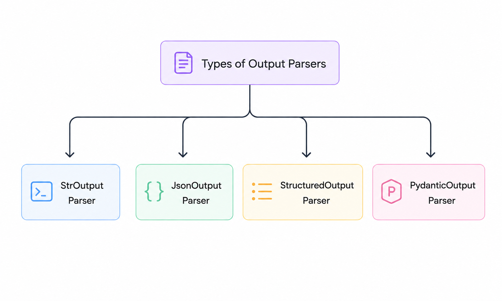
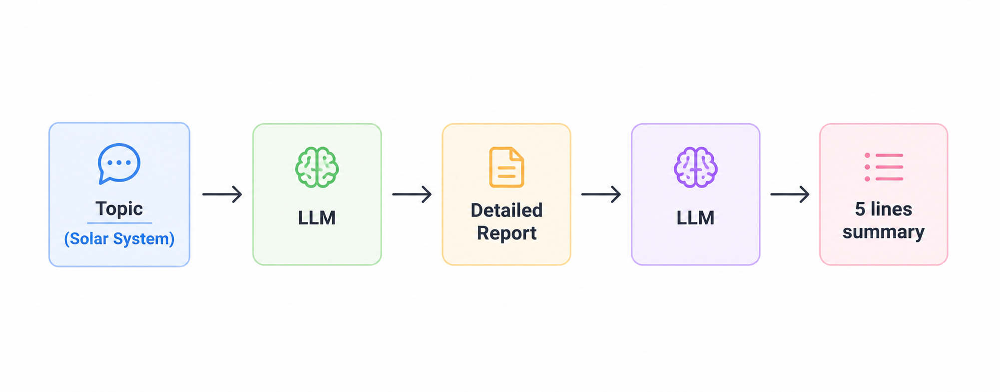
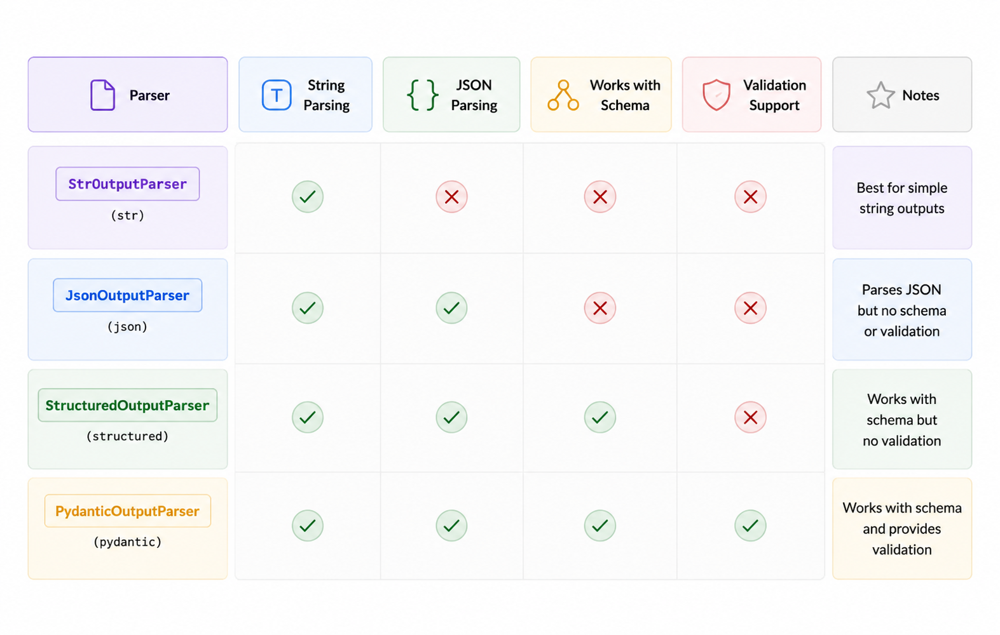

# Output Parsers in LangChain

## What are Output Parsers?

- **Output Parsers** in LangChain help convert raw LLM response into structured formats like JSON, CSV, Pydantic models, and more.
- They ensure consistency, validation, and ease of use in applications.

## Types of Output Parsers

### Example

### StrOutputParser

- The `StrOutputParser` is the simplest output parser in LangChain.
- It is used to parse the output of a Language Model (LLM) and return it as a plain string.

### JSONOutputParser

- Forces the LLM to return a `JSON` object.
- While convenient, it does not enforce a specific schema, meaning the structure can vary.

### Structured Output Parser

- `StructuredOutputParser` is an output parser in LangChain that helps extract structured JSON data from LLM responses based on predefined field schemas.
- It works by defining a list of fields (ResponsibleSchema) that the model should return, ensuring the output follows a structured format.
- In simple terms, it allows the developer to define and enforce a specific schema, ensuring the LLM returns data in a precise, predefined format.

### Pydantic Output Parser

- `PydanticOutputParser` is a structured **Output Parser** in LangChain that uses **Pydantic Models** to enforce schema validation when processing LLM responses.
- It is the most robust option, it uses Pydantic models to not only enforce a schema but also provide data validation and type safety (e.g., ensuring a field is an integer or meets specific constraints).

**Why use `PydanticOutputParser`?**

- **✅ Strict Schema Enforcement** - Ensures that LLM responses follow a well-defined structure.
- **✅ Type Safety** - Automatically converts LLM outputs into Python objects.
- **✅ Easy Validation** - Uses Pydantic's built-in validation to catch incorrect or missing data.
- **✅ Seamless Integration** - Works well with other LangChain components.

## Choosing the Right Output Parser

