# Chains in LangChain

- Chains are a core component of LangChain that allow developers to create automated pipelines by connecting multiple steps (such as prompts, models, and parsers) to execute complex tasks efficiently.
- Building LLM applications typically involves a series of small, manual steps.
- Chains streamline this process by automatically passing the output of one step as the input to the next, forming a cohesive pipeline.
- Chaining means connecting different components to build complex LLM-powered applications.
- Each component takes some input, processes it and passes the output to the next component.
- This helps in building sophisticated and complex applications. Chains help in building pipelines.

## Why do we need Chains?

- **1. Simplify Data Flow**: Chains handle how data moves between steps for you, so we don’t have to manually wire everything together. This makes our code cleaner, easier to understand, and less prone to errors.

- **2. Multi-step application logic**: Real-world applications often require multiple LLM calls and various prompt templates to handle complex tasks. Manually managing this can get messy and error-prone, but chains simplify the process by organizing it into a clear, structured flow.

- **3. Scaling Becomes Easier**: Chaining makes each component reusable, so we can easily switch between models or services without reworking your entire app. This flexibility is key when our project grows or needs to adapt quickly. For example — we can just switch between LLM models Gemini to OpenAI with a single line of code, without needing to make any modifications in other components.

## Types of Chains

- There are Four types of chains:
  - Simple Chain
  - Sequential Chain
  - Parallel Chain
  - Conditional Chain

### Simple Chains

- A Simple Chain is the most basic type of chain where the output of one component is directly passed as the input to the next.
- It’s like a straight line of steps, one after another, with no branching or conditions.

**Example** — Consider a use case wherein you have to study some topic in easy language without delving much into technical stuff.

- In this example, our simple chain is prompt | llm | parser .
- The output of the prompt is input to LLM and similarly output of LLM to output parser.
- Meaning: input(topic) -> prompt template -> LLM -> output parser (optional) -> output.
- **Flow**:

  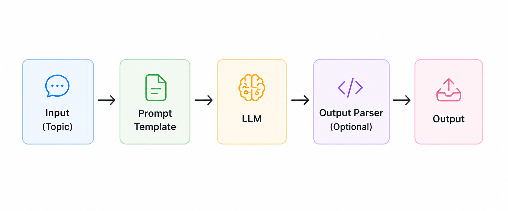

- **Example**:

  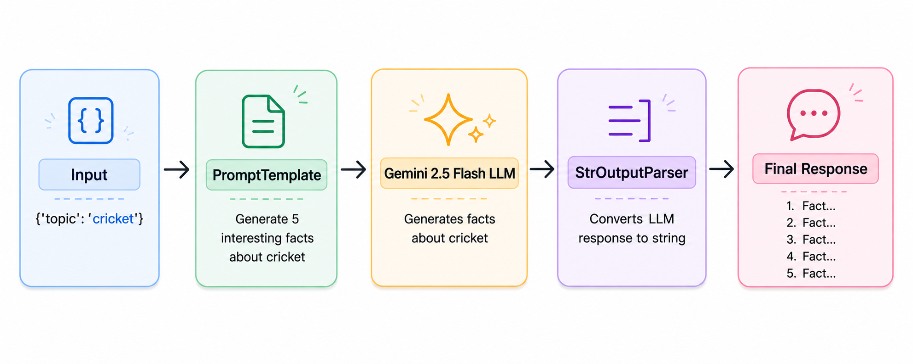

- We can visualize this flowchart using chain.get_graph().print_ascii() as shown below:

  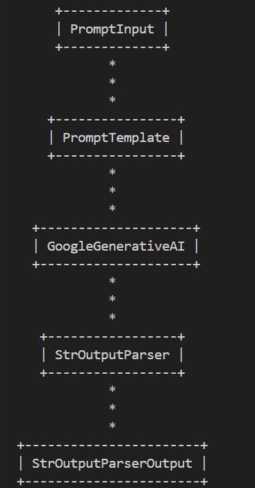

### Sequential Chains

- Shows a more complex workflow where an LLM is called multiple times in a sequence.
- Consider a use case, wherein we have to design a more complex pipeline that may involve multiple prompt templates, LLM calls, output parsers, vector databases, etc. This demands the need for a sequential chain.
- But note that, a sequential chain does not support any kind of branching or conditioning. So sequential chain is just an extension of a sequential chain where the output of the current component serves as an input to the next component.

**Example** — Consider a task that involves two phases: - 1. Generate a knowledge base about a certain topic. - 2. Get out a short summary of this knowledge base.

- That means the output of phase one is knowledge base that is input to phase two whose output is short summmary . Let us code this use case using sequential chaining.

- For example, generating a detailed report on a topic and then extracting a summary from that report.

- In this example, we have two prompt templates.
- The explaination_prompt generates the long text about the topic and this is fed to the LLM.
- The output of this LLM call becomes input to the next prompt template summary_prompt after being output parsed using StrOutputParser.
- Similarly, we can have more complex chains using sequential chains.
- We can also implement the same using the SequentialChain class of LangChain

- **Flow**:

  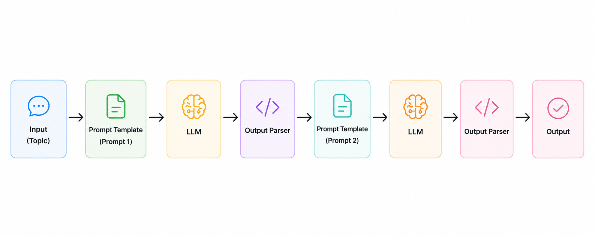

- **Example**:

  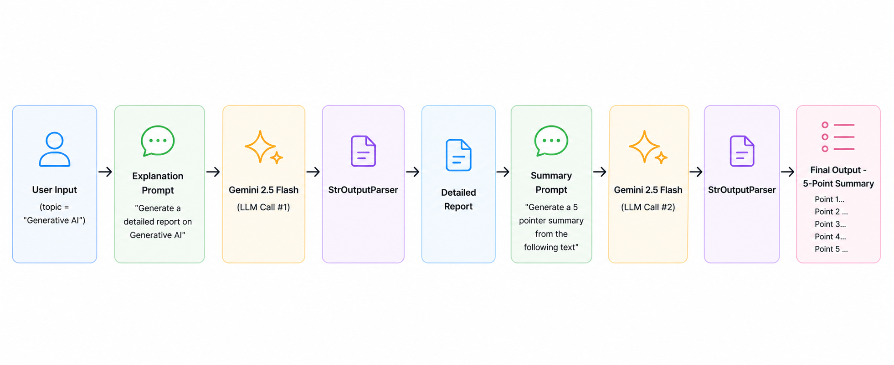

- We can visualize this flowchart using chain.get_graph().print_ascii() as shown below:

  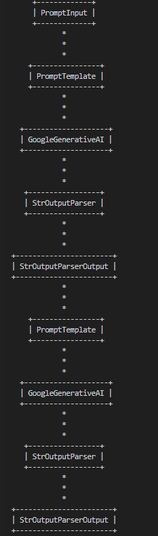

### Parallel Chains

- Parallel chain is a type of chain that allows parallel running of more than one number of sub-chains.
- A parallel chain consists of multiple sub-chains, which have their own input and output.
- Each sub-chain is an independent chain, wherein the output of one chain does not affect any other chain.
- The Parallel chain executes all these sub-chains simultaneously and waits until all chains are completely executed.
- Finally, the results of all chains are combined together and this is the final output of the parallel chain.

- In short, this is the workflow of the parallel chain:
  - Each sub-chain is independent having its input and output.
  - All sub-chains are executed simultaneously.
  - Wait until all sub-chains are executed completely.
  - Combine the output of all sub-chains.

- The output of parallel is a Dictionary, wherein key represents the name of the sub-chain and the value is its output.

- **Flow**:

  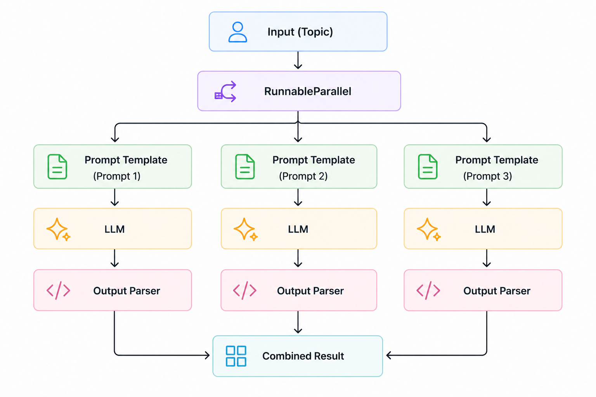

- **Example**:

  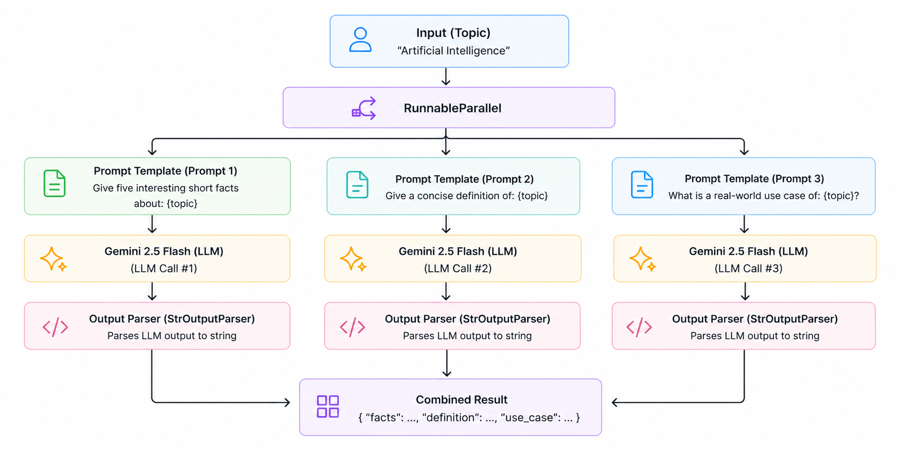

- We can visualize this flowchart using chain.get_graph().print_ascii() as shown below:

  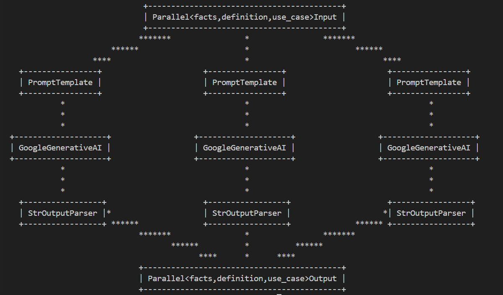

**Why use a Parallel Chain?**

- Briefly, two cases can be stated that demands parallel chain implementation.
  - **1. Speed Optimization**: Parallel chains run sub-chains simultaneously. So they are faster than simple or sequential chains. For example — we have three chains, each needing 2 seconds to execute. If run parallelly, all chains can be executed completely in 2 seconds. If executed sequentially, it takes 6 seconds. Hence, parallel chains are faster.
  - **2. Independent chains**: An Independent chain is a group of chains, wherein the output of one chain does not affect the output of other chains in the group. Each chain has a separate set of input, output, model, prompt, etc. For example — Generating a summary, key topics, and sentiments of the same document are independent tasks. Although the input (document) is the same for all the tasks, the output of one chain does not affect the other.

-For example, generating notes and a quiz from a single input document in parallel, and then merging those outputs using a third model.

**Code Example**

- Let’s implement the Parallel Chain for this use case —
- The input is a topic like AI, NLP, and GenAI. - Based on this topic we have three tasks to do:
  - Generating five facts about the topic
  - Defining this topic
  - Generating real-world use cases
- Each of these tasks is defined by different prompt templates and chains.
- These three chains are combined using RunnableParallel runnable class.
- This has a parameter chains which is a dictionary, wherein key is name of chain and value is chain itself .
- The data type of result is a dictionary
- We can visualize the parallel chain composition using chain.get_graph().print_ascii()

### Conditional Chains

- As the name suggests, the conditional chain is based on some condition . Depending on if the condition is satisfied, we execute that sub-chain.

- **RunnableBranch\*** class allows to create of conditional branching.
- Each chain is associated with some condition defined by a function.
- Depending on which condition holds, the corresponding chain is executed.
- This can be better understood with an example.
- For example, a sentiment analysis application that routes input to different chains based on whether the feedback is classified as 'Positive' or 'Negative'.

- For example — In the code, we define a function is_long_text(text) that returns if the number of words in texts is greater than 50. And conditional_chain we define which chain to execute and when. If the above function returns true, summary_chain is executed else extend_chain is executed.

- Since the text in above code is less not long, extend_chain is executed and the idea in text is extended.
- Suppose I add a long text, say the output in the image above in place of text in the code, the is_long_text(text) function will return the value true . So summary_chain will be executed and we get a short summary.

- **Flow**:

  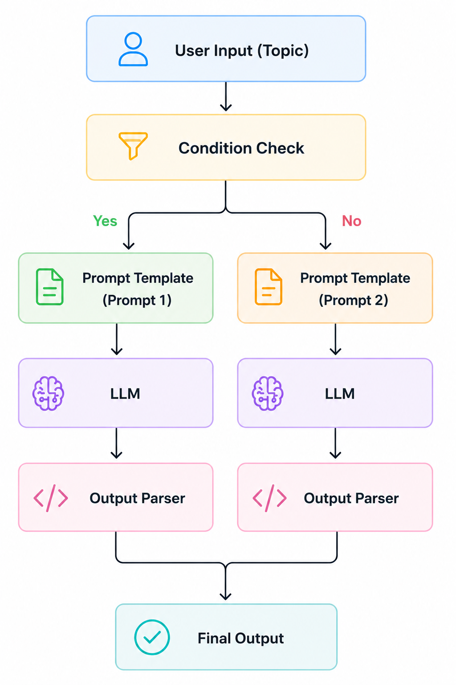

- **Example**:

  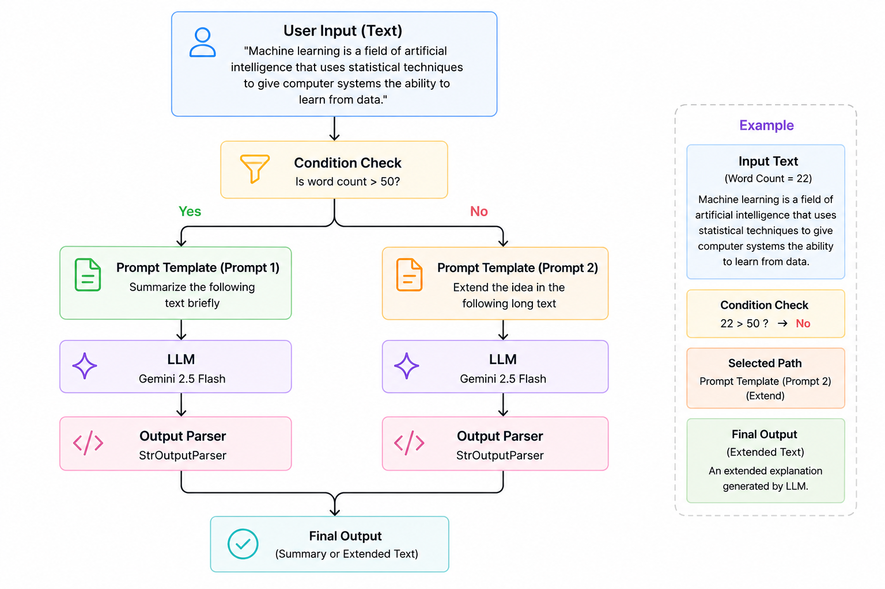

- We can visualize this flowchart using chain.get_graph().print_ascii() as shown below:

  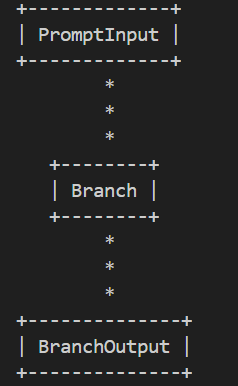
