# Runnables in LangChain

## Types of Runnables

There are two types of Runnables

- Task Specific Runnables
- Runnable Primitives

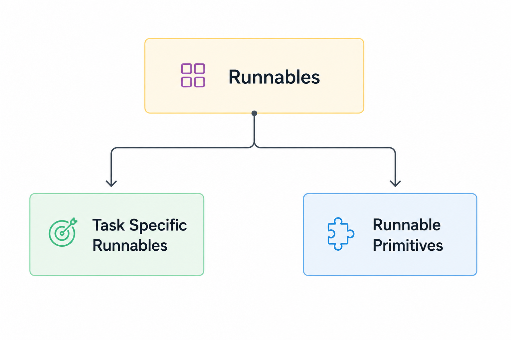

### Task Specific Runnables

- **Definition**: These are **core LangChain components** that have been converted into Runnables so they can be used in pipelines.
- **Purpose**: Perform **task-specific** operations like LLM calls, prompting, retrieval, etc.
- **Examples**:
  - `ChatOpenAI` :- Runs an LLM model
  - `PromptTemplate` :- Formats prompts dynamically
  - `Retriever` :- Retrievers relevant documents

### Runnable Primitives

- **Definition**: These are **fundamental building blocks** for structuring execution logic in AI workflows.
- **Purpose**: They **help orchestrate execution** by defining how different Runnables interact (sequentially, in parallel, conditionally, etc.).
- **Examples**:
  - `RunnableSequence`:- Runs steps **in order** (`|` operator)
  - `RunnableParallel`:- Runs multiple steps **simultaneously**.
  - `RunnableMap`:- Maps the same input across multiple functions.
  - `RunnableBranch`: Implements **conditional execution** (if-else logic).
  - `RunnableLambda`:- Wraps **custom Python functions** into Runnables.
  - `RunnablePassThrough`:- Just forwards input as output (acts as a placeholder).

### Runnable Sequence

- **RunnableSequence** is a sequential chain of runnables in LangChain that executes each step one after another, passing the output of one step as the input to the next.
- It is useful when we need to compose multiple runnables together in a structure workflow.
- **Flow**:

  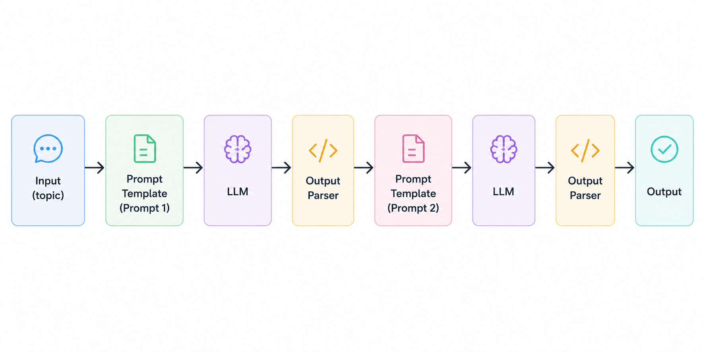

- **Example**:

  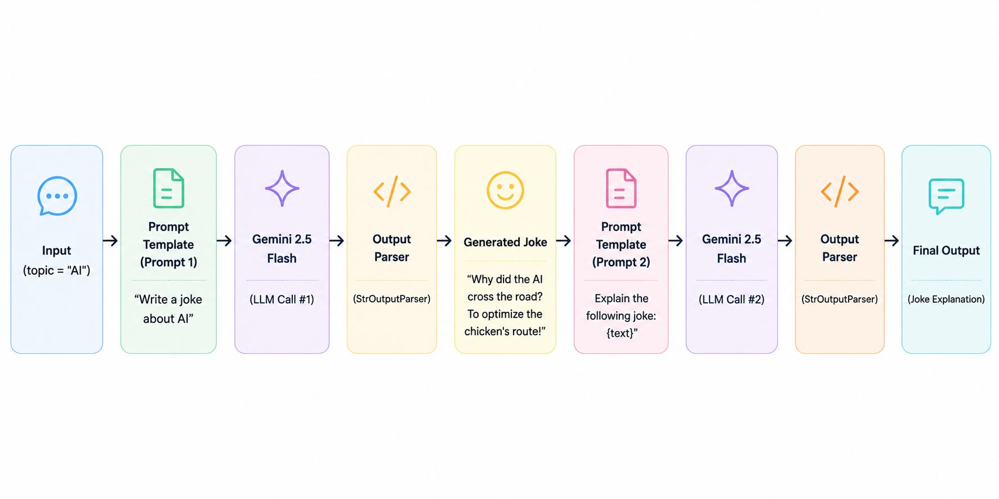

- We can visualize this flowchart using chain.get_graph().print_ascii() as shown below:

  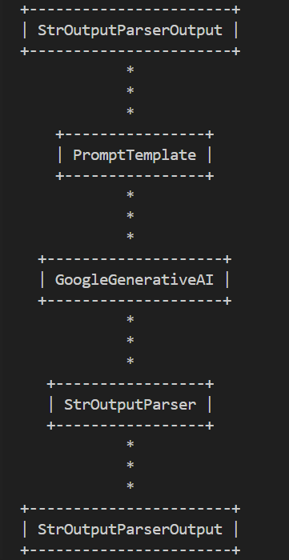

### Runnable Parallel

- **RunnableParallel** is a Runnable Primitive that allows multiple runnables to execute in parallel.
- Each runnable recieves the same input and processes it independently, producing a dictionary of outputs.
- **Flow**:

  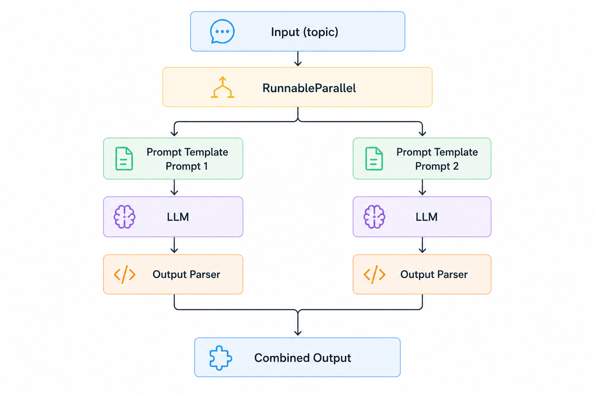

- **Example**:

  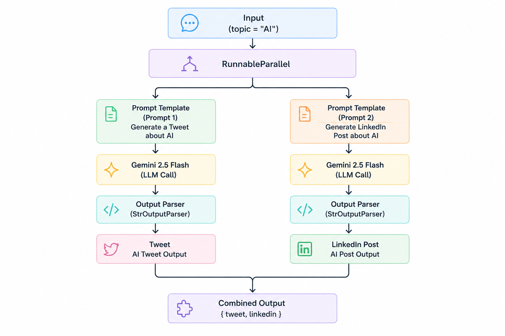

- We can visualize this flowchart using chain.get_graph().print_ascii() as shown below:

  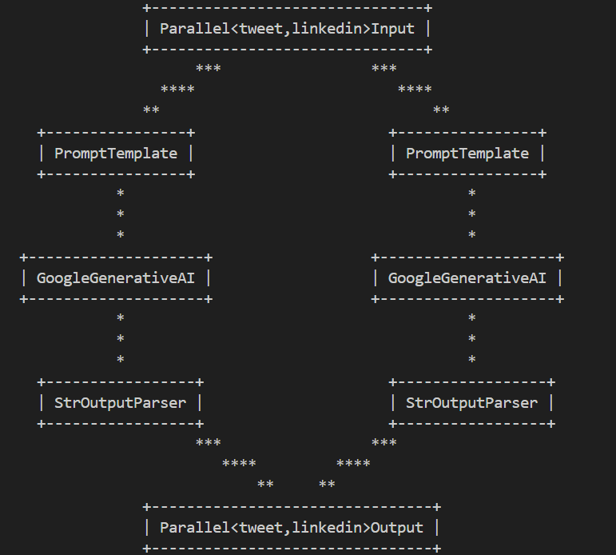

### Runnable Passthrough

- **RunnablePassthrough** is a special Runnable Primitive that simply **returns the input as output** without modifying it.
- This is particularly useful when you need to retain original input data (like a joke) while performing additional processing on it (like generating an explanation).
- **Flow**:

  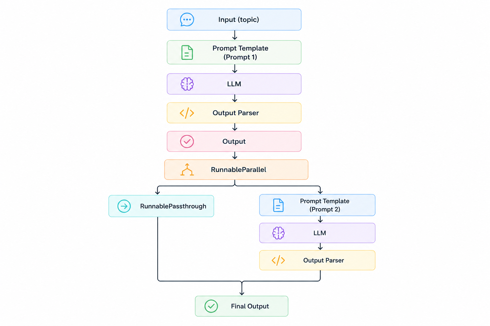

- **Example**:

  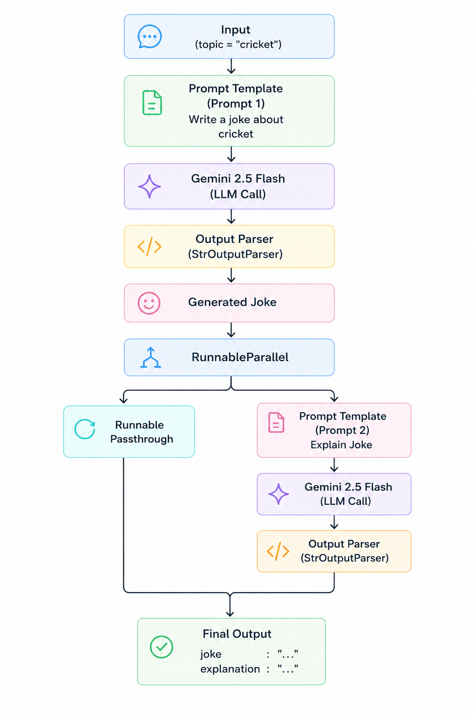

- We can visualize this flowchart using chain.get_graph().print_ascii() as shown below:

  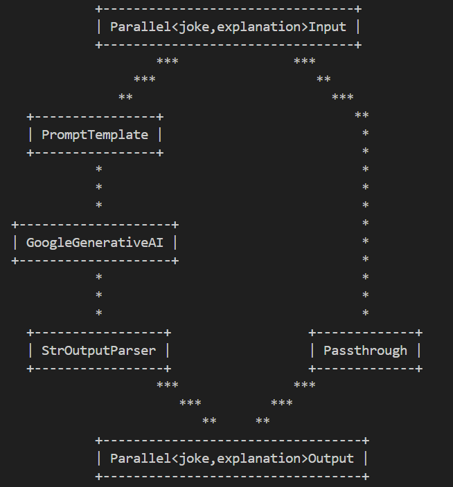

### Runnable Lambda

- RunnableLambda is a Runnable Primitive that allows you to apply custom Python functions within an AI pipeline.
- It acts as a middleware between differnt AI components, enabling preprocessing, transformation, API calls, filtering, and post-preprocessing in a LangChain workflow.
- **Flow**:

  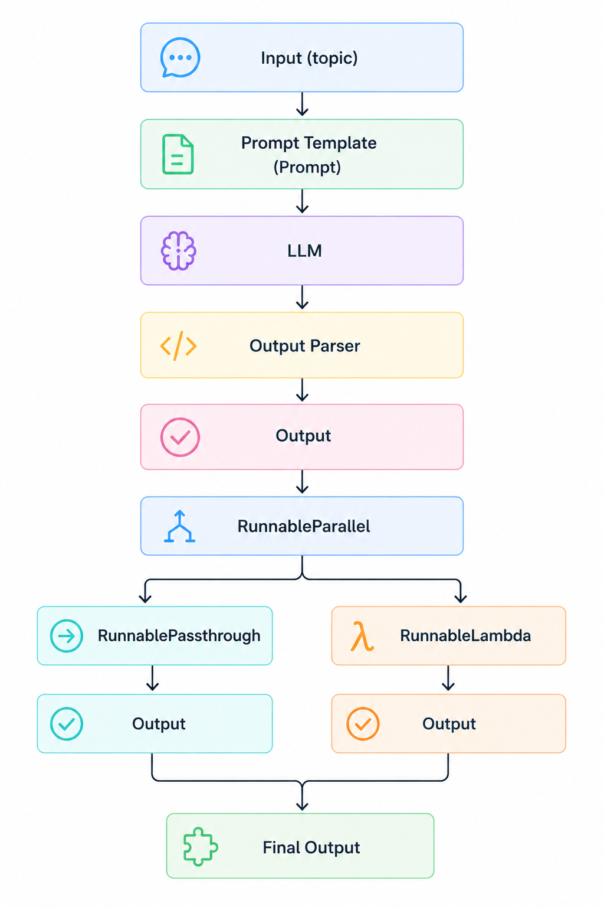

- **Example**:

  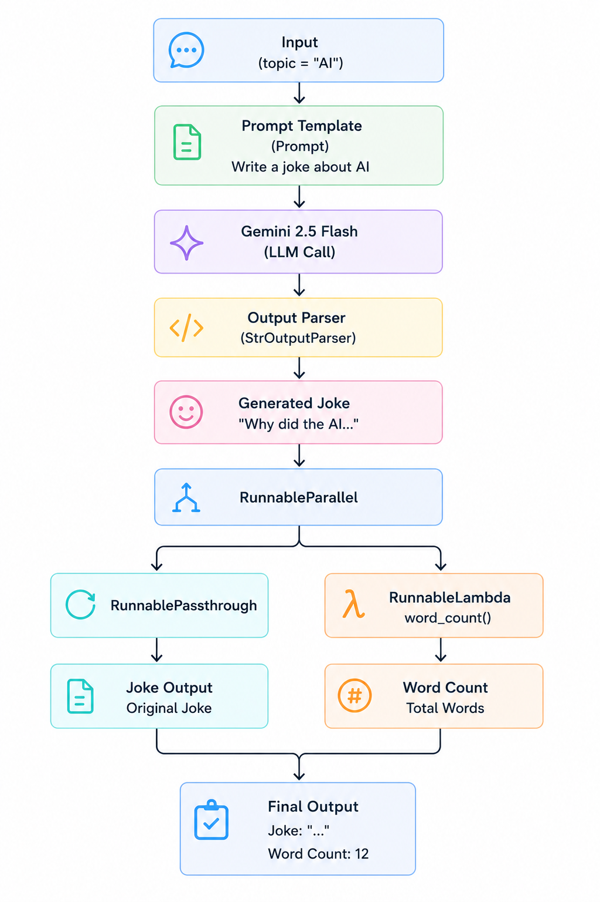

- We can visualize this flowchart using chain.get_graph().print_ascii() as shown below:

  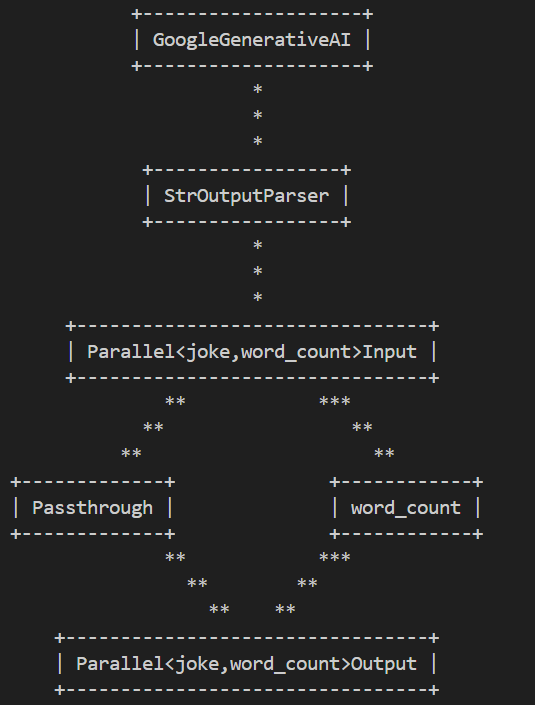

### Runnable Branch

- RunnableBranch is a control flow component in LangChain that allows you to conditionally route input data to different chains or runnable based on custom logic.
- It functions like an if/elif/else block for chains - where you define a set of condition functions, each associated with a runnable (e.g., LLM call, prompt chain, or tool). The first matching condition is executed. If no condition matches, a default runnable is used (if provided).
- **Flow**:

  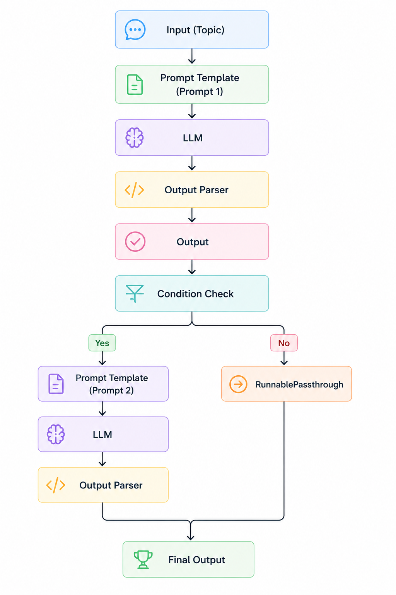

- **Example**:

  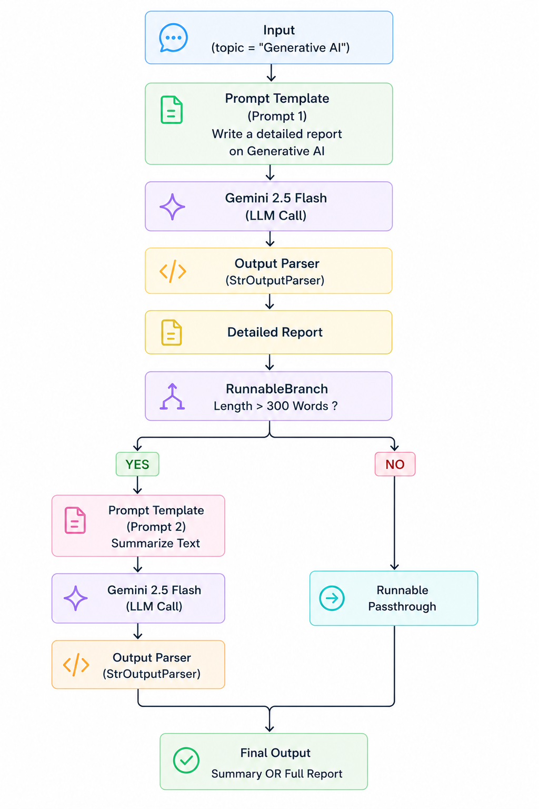

- We can visualize this flowchart using chain.get_graph().print_ascii() as shown below:

  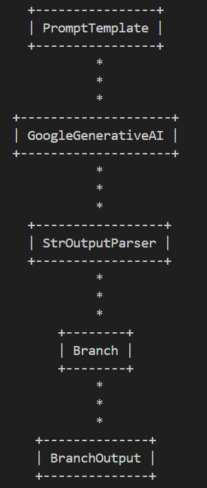

## LangChain Expression Language(LCEL)

LCEL or LangChain Expression Language is used to connect AI building blocks like prompts, models, data retrievers and parsers by using a “pipe” symbol (|) so that information flows smoothly from one part to another. Instead of writing complicated code, we just stack these blocks in the order we need and LCEL makes sure each step passes its output to the next. It’s designed to help developers build AI apps quickly, keep their code clean and modular and take advantage of features like parallel processing and easy debugging.

- **Runnable Interface**: At the heart of LCEL are Runnables, modular components encapsulating functions or operations that can be chained. Any two Runnables can be combined using the pipe | operator thanks to the overloaded **or** method, forming data flows where the output of one component becomes the input of the next.
- **Declarative Chains**: By using pipe operators, LCEL constructs chains differently from traditional LangChain objects, enhancing readability and developer experience.

### Key Features of LCEL

Let's see the key features of LCEL,

-**Declarative Syntax Using Pipe Operators**: Chains are constructed by connecting Runnables with the pipe | operator, creating a clear left-to-right data flow.

- **Parallel Execution**: Supports execution of independent tasks concurrently using RunnableParallel, reducing end-to-end latency.
- **Guaranteed Asynchronous Support**: All chains run asynchronously by default, supporting high-throughput use cases like web servers.
- **Streaming Output**: Supports incremental streaming to allow faster time-to-first-token from language models, enhancing responsiveness.
- **Seamless Deployment with LangServe**: Chains can be directly deployed in production environments with support for retries, fallbacks and scaling.

## LCEL Syntax

Using LCEL we create our chain differently using pipe operators (|) rather than Chains objects. A basic LLM Chain consists of following 3 components there can be many variations into this which we will learn later.

- **LLM**: An abstraction over the paradigm used in Langchain to create completions like Claude, OpenAI GPT3.5 and so on.
- **Prompt**: The LLM object uses this as its input to provide inquiries to the LLM and specify its goals. It is basically a string template which we define with certain placeholders for our variables.
- **Output Parser**: A parser defines how to extract output from response and display it as final response.
- **Chain** : A chain ties up all the above components. It is a series of calls to an LLM or any stage in the data processing process.
- **For Example**:
  `chain = prompt | llm | output_parser`

  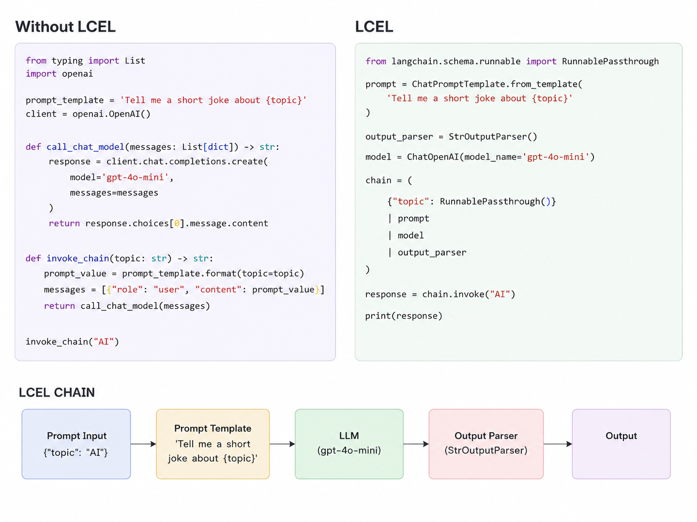
