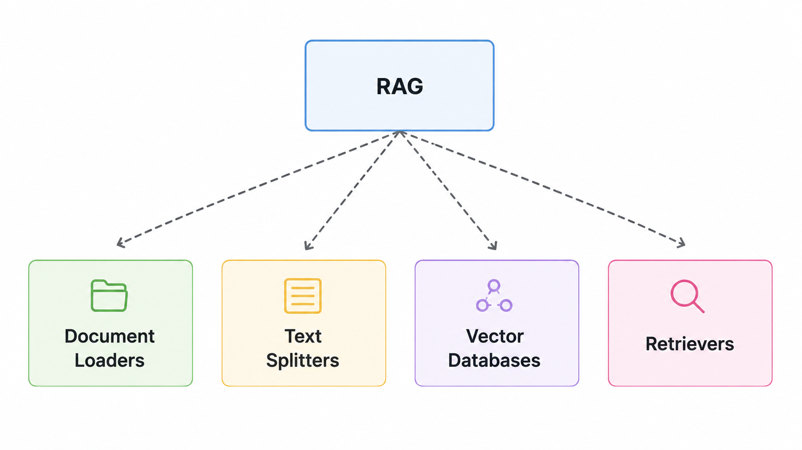
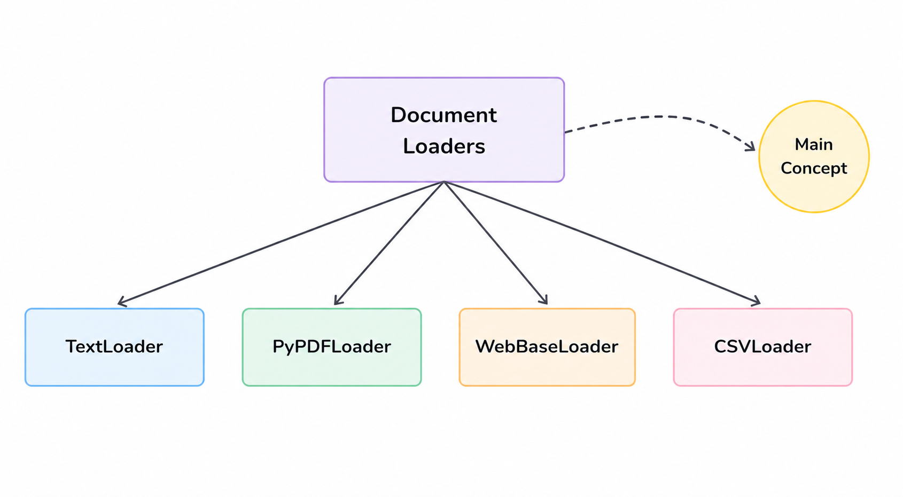
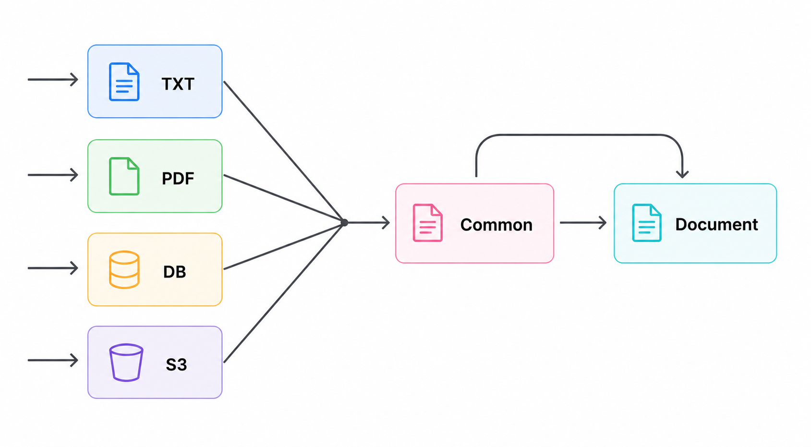
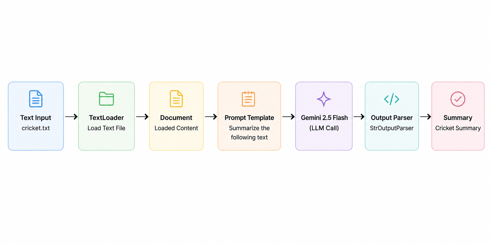
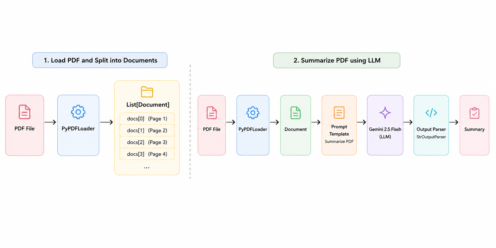
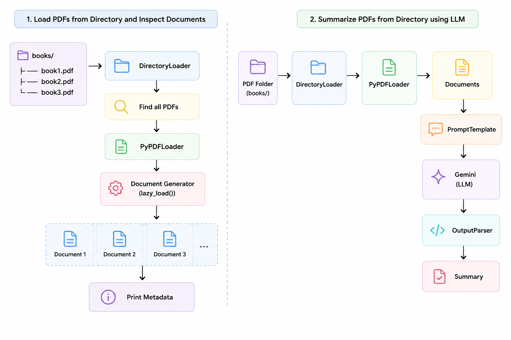
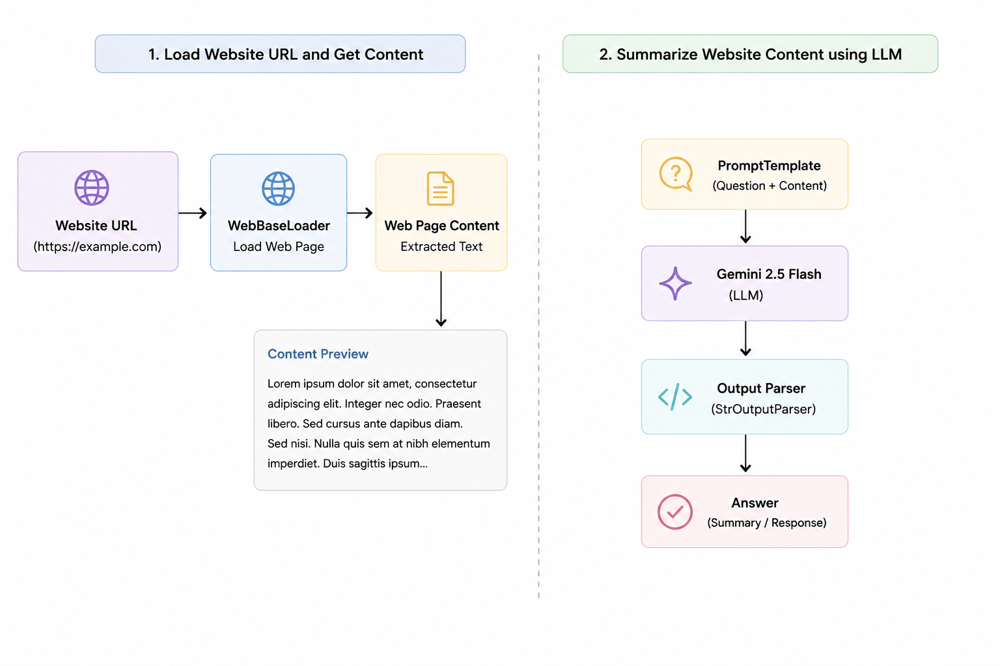
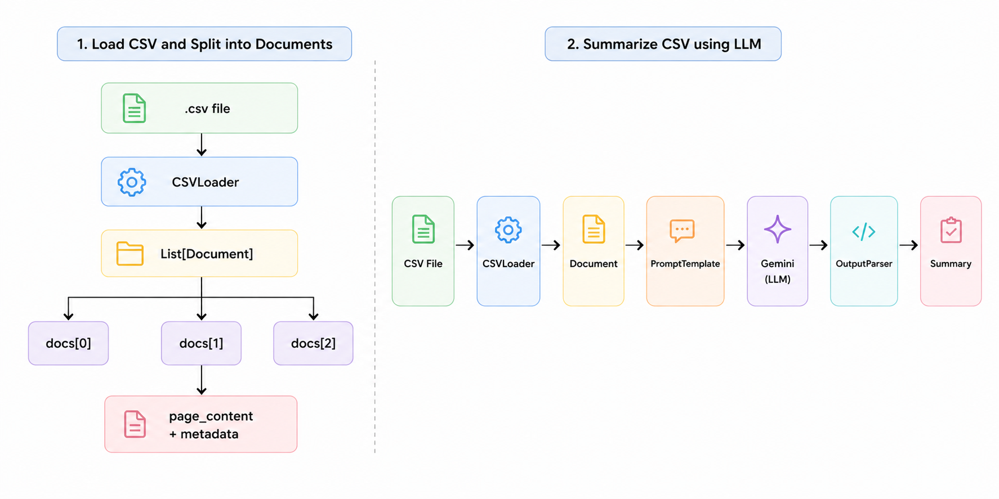

# Document Loaders in LangChain

## Retrieval-Augmented Generation (RAG)

- Retrieval-Augmented Generation (RAG) is a technique that combines information retrieval with language generation, where a model retrieves relevant documents from a knowledge base and then uses them as context to generate accurate and grounded responses.
- Benefits of using RAG
  - Use of up-to-date information
  - Better privacy
  - No limit of document size

- **Components of RAG**

  

## Document Loaders in LangChain

- Document Loaders are components in LangChain used to load data from various sources into a standardized format (usually as Document objects), which can then be used for chunking, embedding, retrieval, and generation.

```python
    Document(
        page_content="The actual text content",
        metadata={"source": "filename.pdf", ...}
    )
```

## Types of Document Loaders



---



### TextLoader

- **TextLoader** is a simple and commonly used document loader in LangChain that reads plain text (.txt) files and converts them into LangChain Document objects.
- **Use Case**:
  - Ideal for loading chat logs, scrapped text, transcripts, code snippets, or any plai text data into a LangChain pipeline.
- **Limitation**:
  - Works only with .txt files
- **Flow**:

  

### PyPDFLoader

- PyPDFLoader is a document in LangChain used to load content from PDF files and convert each page into a Document object.

```python
    {
        Document(page_content="Text from page 1", metadata={"page": 0, "source": "filename.pdf", ...}),
        Document(page_content="Text from page 2", metadata={"page": 1, "source": "filename.pdf", ...}),
        ...
    }
```

- **Limitations**:
- It uses the PyPDF library the hood - not great with scanned PDFs or complex layouts.

| Use Case                       | Recommended Loader                                   |
| ------------------------------ | ---------------------------------------------------- |
| Simple, clean PDFs             | `PyPDFLoader`                                        |
| PDFs with tables/columns       | `PDFPlumberLoader`                                   |
| Scanned/image PDFs             | `UnstructuredPDFLoader` or `AmazonTextractPDFLoader` |
| Need layout and image data     | `PyMuPDFLoader`                                      |
| Want best structure extraction | `UnstructuredPDFLoader`                              |

- **Flow**:

  

### DirectoryLoader

- DirectoryLoader is a document loader that lets you load multiple documents from a directory(folder) of files.

| Glob Pattern   | What It Loads                          |
| -------------- | -------------------------------------- |
| `"**/*.txt"`   | All `.txt` files in all subfolders     |
| `"*.pdf"`      | All `.pdf` files in the root directory |
| `"data/*.csv"` | All `.csv` files in the `data/` folder |
| `"**/*"`       | All files (any type, all folders)      |

**Note:** `**` = recursive search through subfolders

- **Flow**:

  

### Load vs LazyLoad

| Feature          | `load()`                                    | `lazy_load()`                                                         |
| ---------------- | ------------------------------------------- | --------------------------------------------------------------------- |
| Loading Type     | Eager Loading (loads everything at once)    | Lazy Loading (loads on demand)                                        |
| Return Type      | List of `Document` objects                  | Generator of `Document` objects                                       |
| Memory Usage     | Loads all documents immediately into memory | Documents are not all loaded at once; fetched one at a time as needed |
| Best For         | Small number of documents                   | Large documents or lots of files                                      |
| Processing Style | Everything loaded upfront                   | Stream processing (e.g., chunking, embedding)                         |

### WebBaseLoader

- **WebBaseLoader** is a document loader in LangChain used to load and extract text content from web pages (URLs).
- It uses BeautifulSoup under the hood to parse HTML and extract visible text.
- **When to Use**:
  - For blogs, new aeticles, or public websites where the content is primarily text based and static.
- **Limitations**:
  - Doesn't handle JavaScript heavy pages well (use SeleniumURLLoader for that).
  - Loads only static content (what's in the HTML, not what loads after the page renders).

- **Flow**:

  

### CSVLoader

- **CSVLoader** is a document loader in LangChain used to load CSV files into LangChain Document objects - one per row, by default.
- **Flow**:

  
