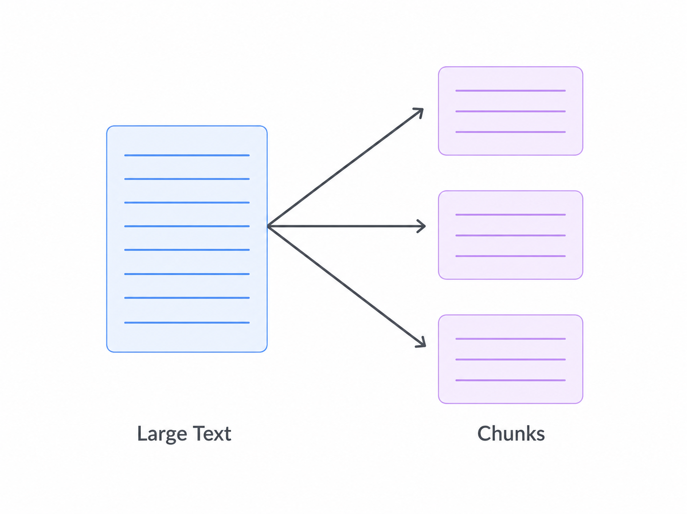
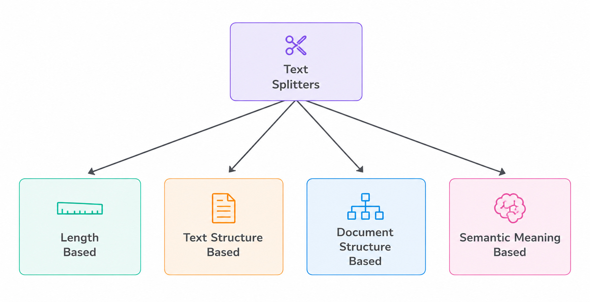
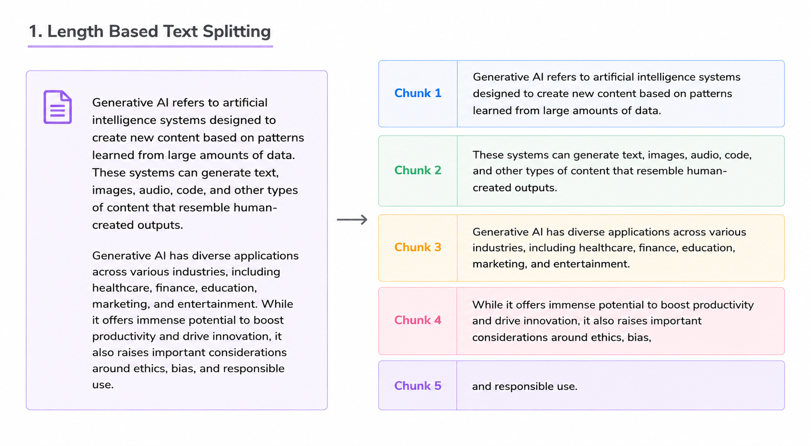
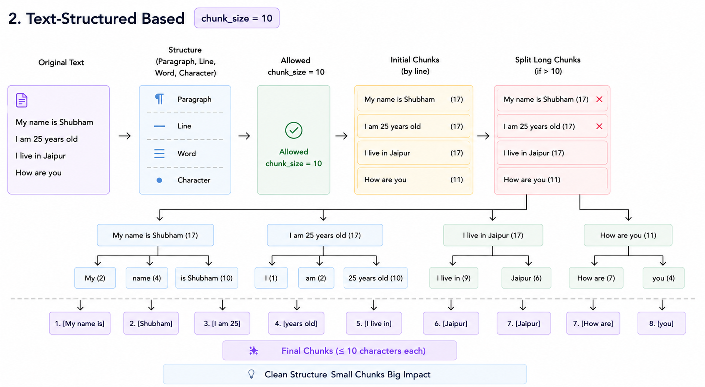
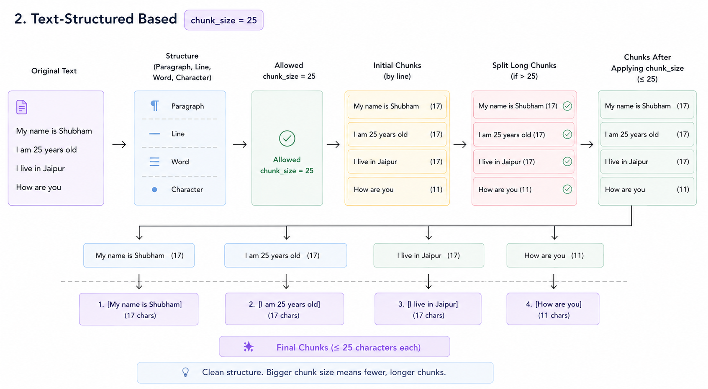
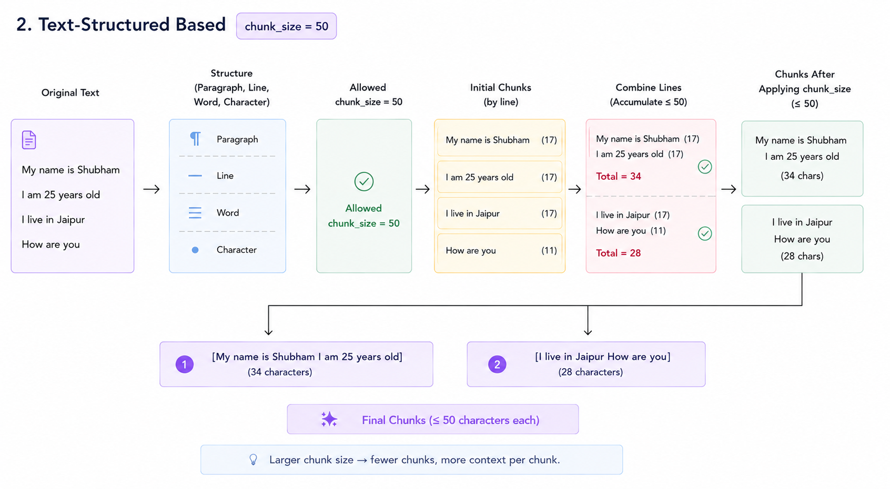
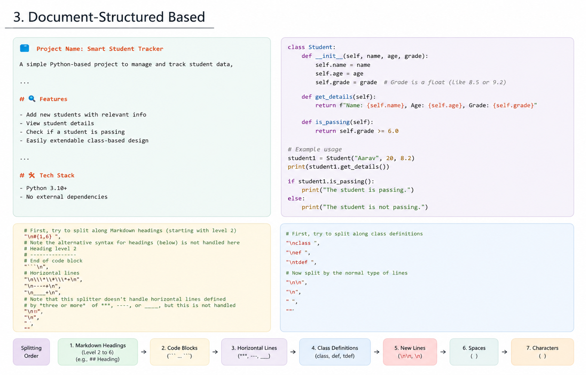
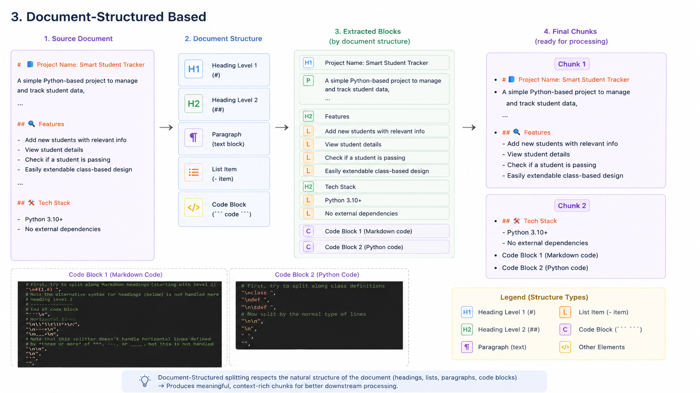
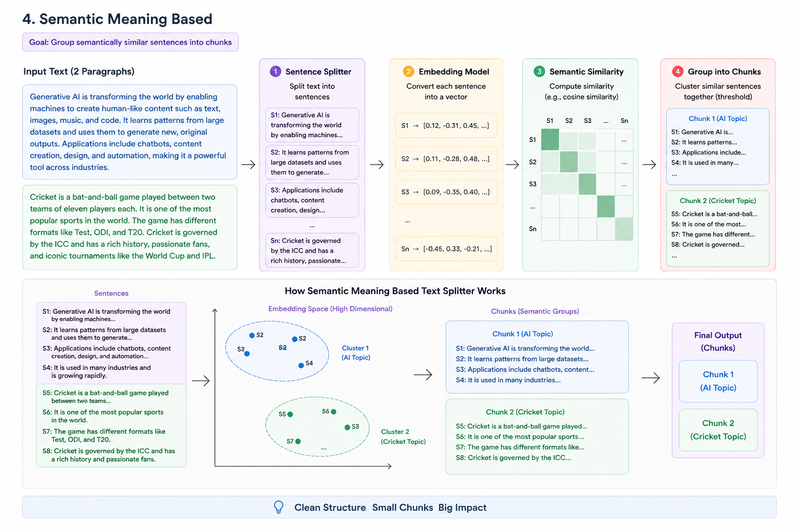

# Text Splitters in LangChain

## Text Splitting

- **Text Splitting** is the process of breaking large chunks of text (like articles, PDFs, HTML pages, or books) into smaller, manageable pieces (chunks) that an LLM can handle effectively.

-** Overcoming model limitations**: Many embedding models and language models have maximum input size constraints. Splitting allows us to process documents that would otherwise exceed these limits.

- **Downstream tasks**: Text Splitting improves nearly every LLM powered task

| Task            | Why Splitting Helps                             |
| --------------- | ----------------------------------------------- |
| Embedding       | Short chunks yield more accurate vectors        |
| Semantic Search | Search results point to focused info, not noise |
| Summarization   | Prevents hallucination and topic drift          |

- **Optimizing computational resources**: Working with smaller chunks of text can be more memory-efficient and allow for better parallelization of processing tasks.

## Types of Text Splitters

### 1. Length Based Text Splitters

- The simplest approach where text is divided based on a fixed number of characters or tokens. The video introduces the importance of chunk size and chunk overlap (retaining context between segments).

### 2. Text-Structured Based Text Splitters

- Uses the _RecursiveCharacterTextSplitter_, which respects the hierarchy of text (paragraphs, sentences, words) to prevent breaking context abruptly. This is the most recommended approach for general text.

### 3. Document-Structured based Text Splitters

- An extension of the previous technique tailored for structured formats like **Python code, HTML, and Markdown**, using language-specific separators.

### 4. Semantic Meaning Based Text Splitters

- An experimental approach that splits text based on the semantic similarity of content rather than fixed lengths, aiming to group related topics together.

