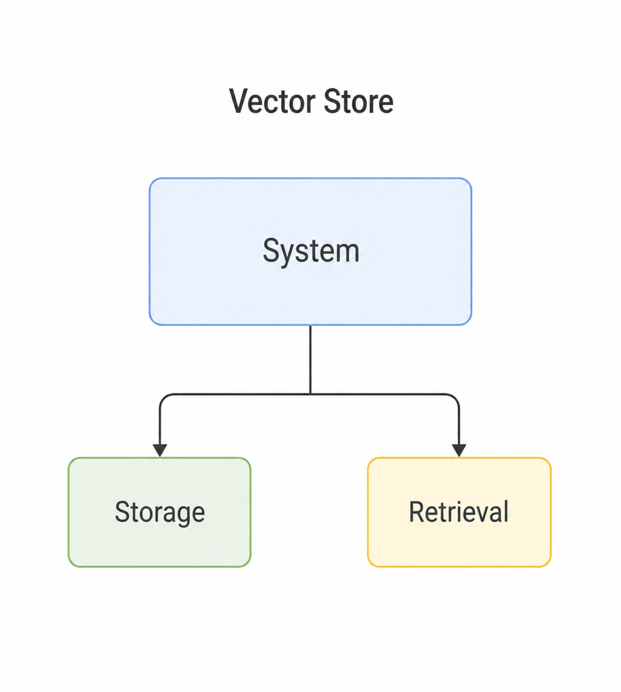
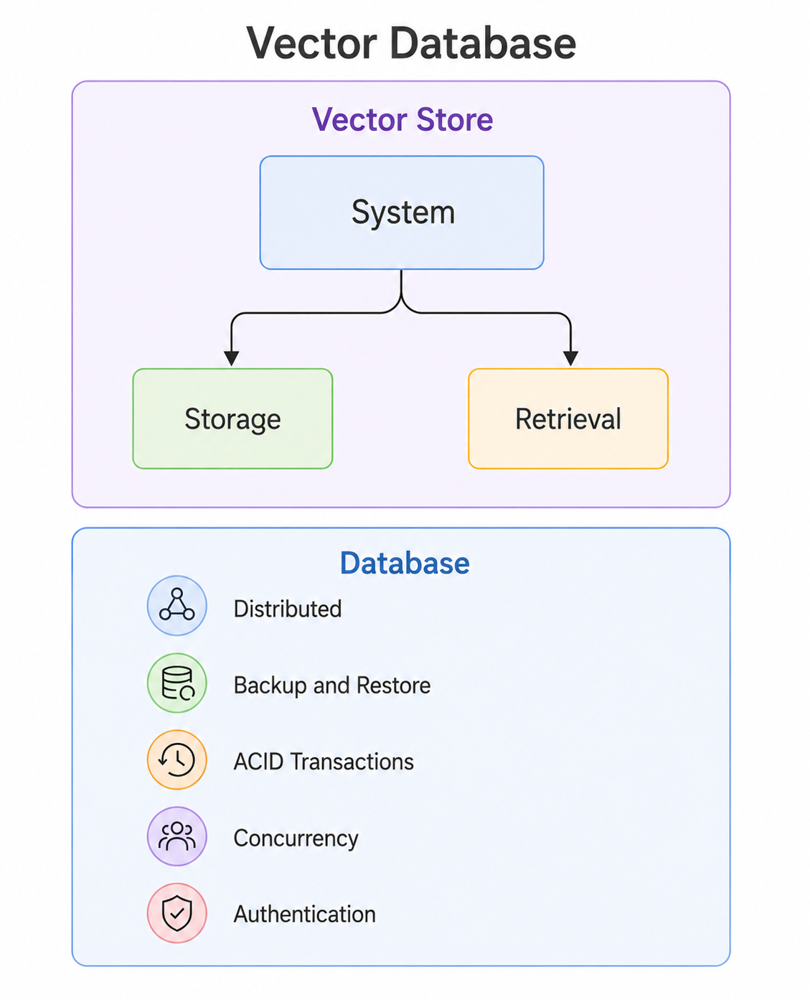
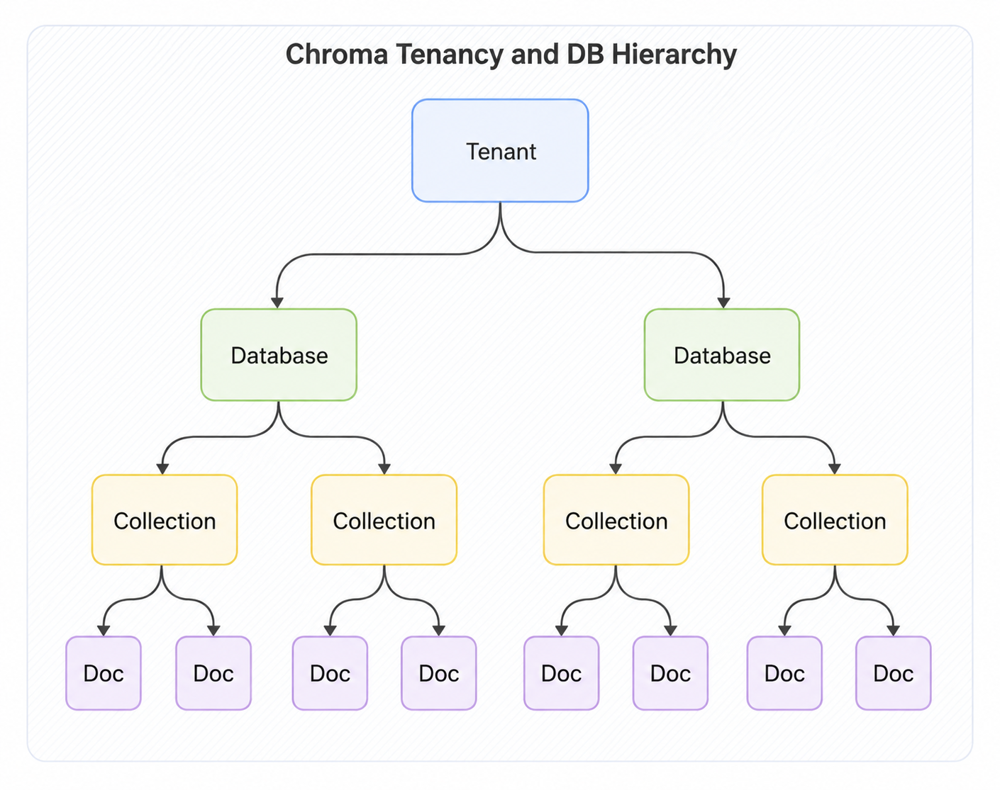

# Vector Stores in LangChain

## What are Vector Stores?

- A **vector store** is a system designed to store and retrieves data represented as numerical vectors.
- **Key Features**:
  - **Storage**: Ensures that vectors and their associated metadata are retained, whether **in-memory (RAM)** for quick lookups or **on-disk (Hard Disk)** for durability and large-scale use.
  - **Similarity Search**: Helps retrieve the vectors most similar to a query vector.
  - **Indexing**: Provide a data structure or method that enables fast similarity searches on high-dimensional vectors (e.g., approximate nearest neighbor lookups).
  - **CRUD Operations**: Manage the lifecycle of data - adding new vectors, reading them, updating existing entries, removing outdated vectors.
- **Use Cases**:
  - Semantic Search
  - RAG
  - Recommender Systems
  - Image/Multimedia Search

## Vector Store vs Vector Database

### Vector Store

- Typically refers to a lightweight library or service that focuses on storing vectors (embeddings) and performing similarity search.
- May not include many traditional database features like transactions, rich query languages, or role-based access control.
- Ideal for prototyping, similar-scale applications.
- Examples: FAISS(where you store vectors and can query them by similarity, but you handle persistence and scaling separately).



### Vector Database

- A full-fledged database system designed to store and query vectors.
- Offers additional "database-like" features:
  - Distributed architecture for horizontal scaling
  - Durability and persistence (replication, backup/restore).
  - Metadata handling (schemas, filters)
  - Potential for ACID or near-ACID guarantees
  - Authentication/authorization and more advanced security
- Geared for production environments with significant scaling, large datasets.
- Examples: Milvus, Qdrant, Weaviate, Pinecone
- **A vector database is effectively a vector store** with extra database features (e.g., clustering, scaling, security, metadata filtering, and durability).



## Vector Stores in LangChain

- **Supported Store**: LangChain integrates with multiple vector stores (FAISS, Pinecone, Chroma, Qdrant, Weaviate, etc.), giving you flexibility in scale, features, and deployment.
- **Common Interface**: A uniform Vector Store API lets you swap out one backend (e.g., FAISS) for another (e.g., Pinecone) with minimal code changes.
- **Metadata Handling**: Most Vector Stores in LangChain allow you to attach metadata (e.g., timestamps, authors) to each document, enabling filter-based retrieval.

```python
    from_documents(...) or from_texts(...)
    add_documents(...) or add_texts(...)
    similarity_search(query, k=...)
```

## Chroma Vector Store

- Chroma is a lightweight, open-source vector database that is especially friendly for local development and small-to medium-scale production needs.


