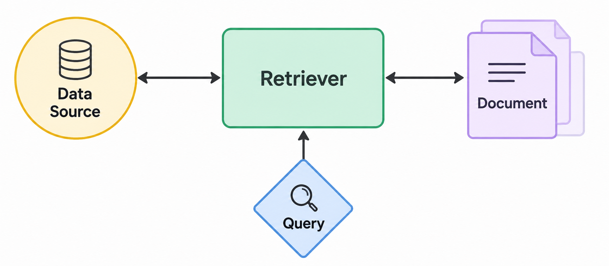
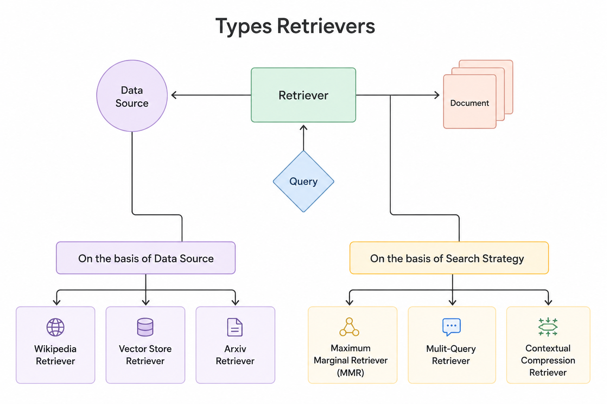
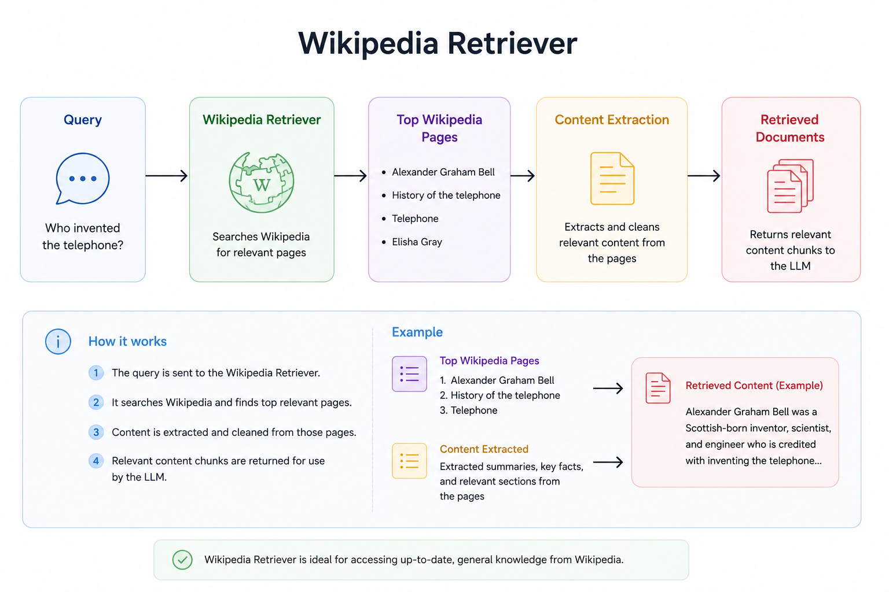
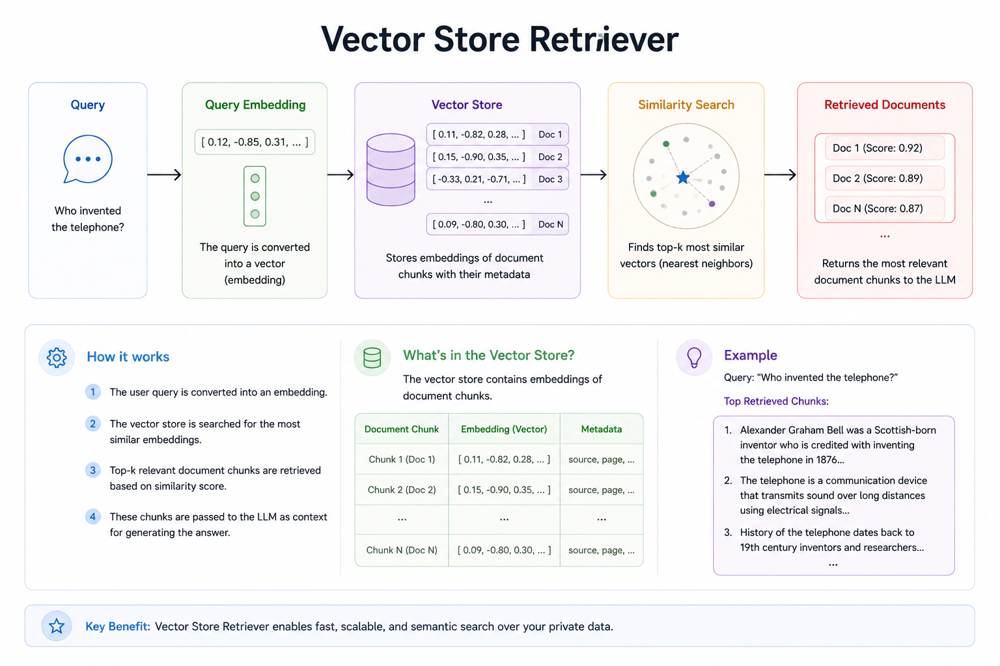
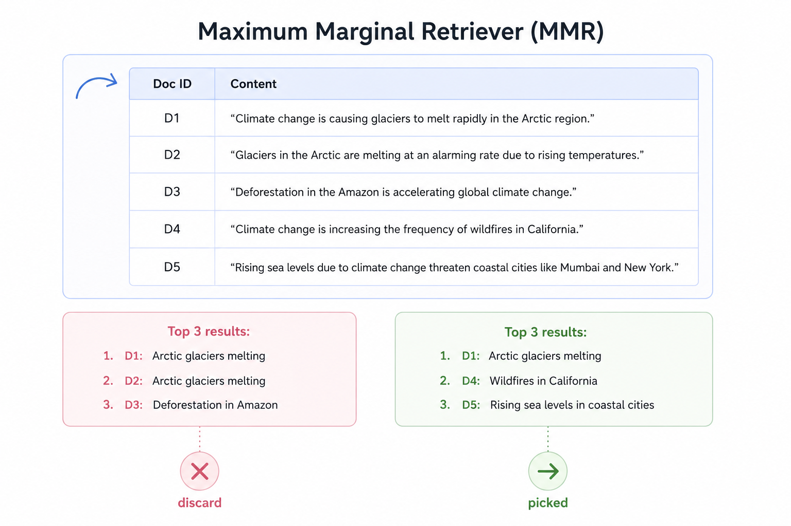
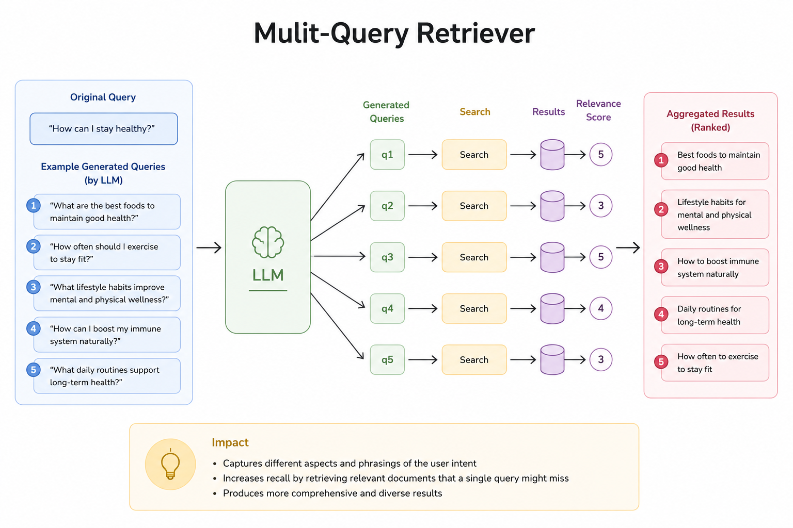
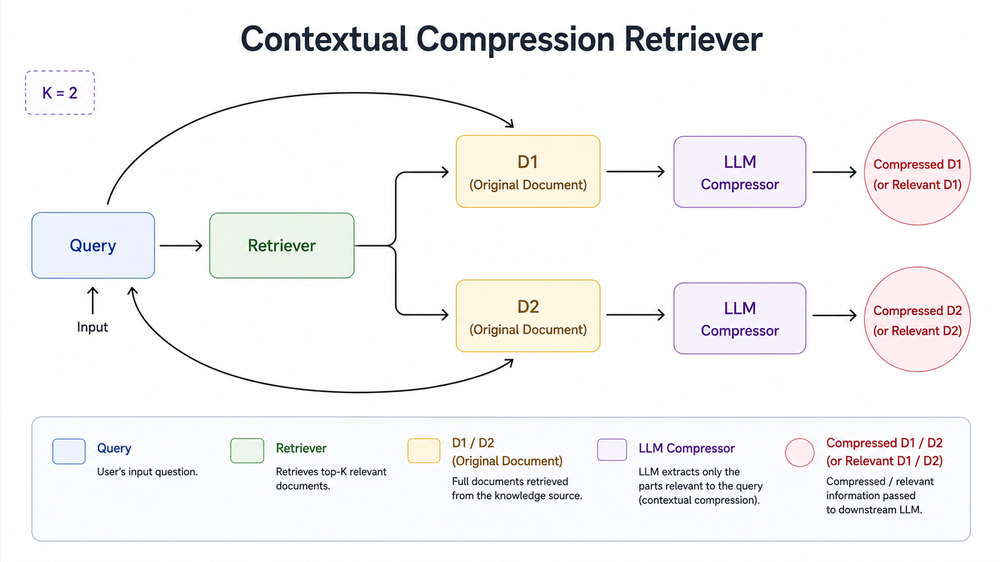

# Retrievers in LangChain

## What are Retrievers?

- A **retriever** is a component in LangChain that fetches relevant documents from a data source in response to a user's query.
- There are multiple types of retrievers.
- All retrievers in LangChain are runnables.

## Types of Retrievers

- Types of Retrievers can be divided into two categories
- On the basis of **Data Source**:
  - Wikipedia Retriever
  - Vector Store Retriever
  - Arxiv Retriever
- On the basis of **Search Strategy**:
  - Maximum Marginal Retriever (MMR)
  - Mulit-Query Retriever
  - Contextual Compression Retriever

### Wikipedia Retriever

- A **Wikipedia Retriever** is a retriever that queries the **Wikipedia API** to fetch relevant content for a given query.
- **How it Works**:
  - You give it a query (e.g., "Alexander Graham Bell")
  - It sends the query to Wikipedia's API
  - It retrieves the **most relevant articles**
  - It returns them as LangChain `Document` objects

### Vector Store Retriever

- A **Vector Store Retriever** in LangChain is the most common type of retriever that lets you search and fetch documents from a vector store based on **semantic similarity using vector embeddings**.
- **How it Works**:
  - You store your document in a vector store (like FAISS, Chroma, Weaviate).
  - Each document is converted into a dense vector using an embedding model.
  - When the user enters a query
    - It's also turned into a vector
    - The retriever compares the query vector with the stored vectors
    - It retrieves the top k most similar ones

### Maximum Marginal Retriever (MMR)

> "How can we pick results that are not only relevant to the query but also different from each other?"

- **Maximum Marginal Retriever (MMR)** is an information retrieval algorithm designed to reduce redundancy in the retrieved results while **maintaining high relevance to the query**.
- **Why MMR Retriever?**
  - In regular similarity search you may get documents that are
    - All very similar to each other
    - Repeating the same info
    - Lacking diverse perspectives

- MMR Retriever avoids that by:
  - Picking the most relevant document first
  - Then picking the next most relevant and least similar to already selected docs
  - And so on...

- This helps especially in RAG pipelines where:
  - You want your contect window to contain diverse but still relevant information
  - Especially useful when documents are semantically overlapping

### Mulit-Query Retriever

> Sometimes a single query might not capture all the ways information is phrased in yout documents.

For example:
**Query**:

> "How can I stay healthy?"
> Could mean:

- What should I eat?
- How often should i exercise?
- How can I manage stress?

- A simple similarity search might miss documents that talk about those things but don't use the word "healthy".

- **How it Works?**
  - Takes your original query
  - Uses an LLM (e.g., gpt-4o-mini or gemini-2.5-flash) to generate multiple semantically different versions of that query
  - Performs retrieval for each sub-query
  - Combines and deduplicates the results

### Contextual Compression Retriever

- The **Contextual Compression Retriever** in LangChain is an advanced retriever that improves retrieval quality by compressing documents after retrieval - keeping only the relevant content based on the user's query.

**Query**

- "What is photosynthesis?"

Retrieval Document (by a traditional retriever):
"The Grand Canyon is a famous natural site.
Photsyntesis is how plants convert light into energy.
Many tourists visit every year.

**Problem**

- The retriever returns the **entire paragraph**
- Only **one sentence** is actually relevant to the query.
- The rest is **irrelevant noise** that wastes context window and may confuse the LLM.

**What Contextual Compression Retriever does?**

- Returns only the relevant part e.g.,
  `Photsyntesis is how plants convert light into energy.`

**How It Works?**

- **Base Retriever** (e.g., FAISS, Chroma) retrieves N documents.
- A **compressor** (usually an LLM) is applied to each documents.
- The compressor keeps **only the parts relevant to the query**.
- Irrelevant content is discarded.

**When to Use**

- Your documents are **long and contain mixed information**
- You want to **reduce context length** for LLMs.
- You need to **improve answer accuracy** in RAG pipelines.

