# Retrieval-Augmented Generation (RAG)

## What is RAG?

- **Retrieval-Augmented Generation (RAG)** is a technique that combines information retrieval with language generation, where a model retrieves relevant documents from a knowledge base and then uses them as context to generate accurate and grounded responses.
- Benefits of using RAG
  - Use of up-to-date information
  - Better privacy
  - No limit of document size

- RAG is a way to make a language model (like ChatGPT) smarter by giving it extra information at the time you ask your question.

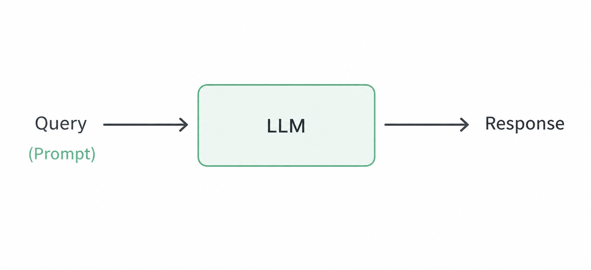

## Why RAG is Necessary?

- The standard LLMs, while powerful due to their vast parametric knowledge, struggle with three main issues:
- **Private Data**: They cannot answer questions about data they were not trained on.
- **Outdated Information**: They have a "knowledge cutoff date," making them unable to answer questions about recent events.
- **Hallucinations**: They may confidently provide factually incorrect information.

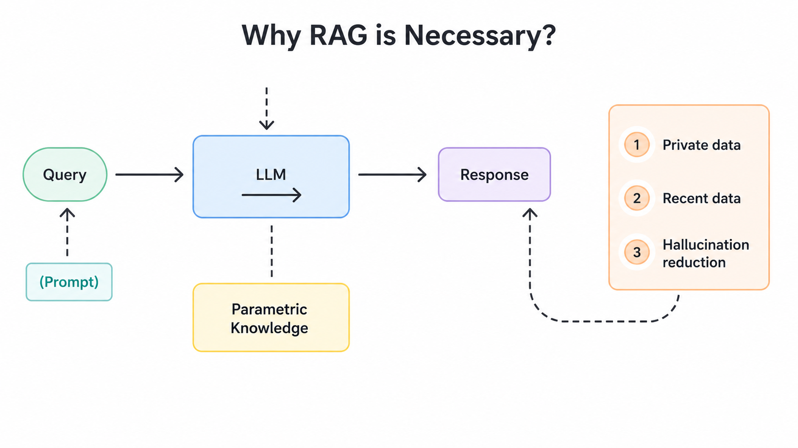

> The **fine-tuning** as a potential solution but highlights its high cost, complexity, and difficulty in keeping the model updated. RAG is presented as a cheaper, more flexible alternative

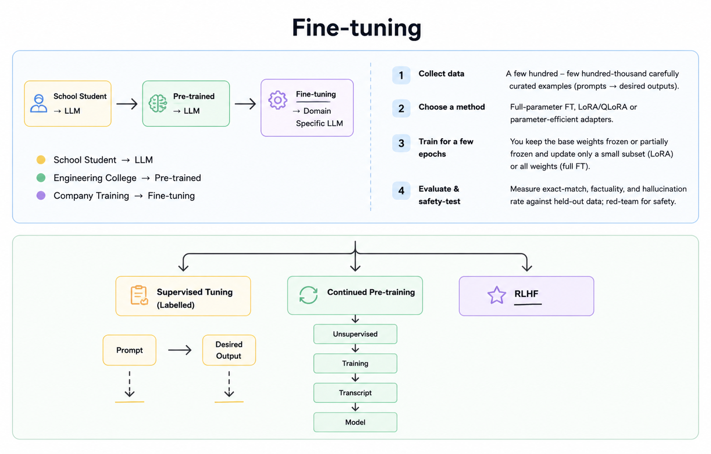

## Components of RAG

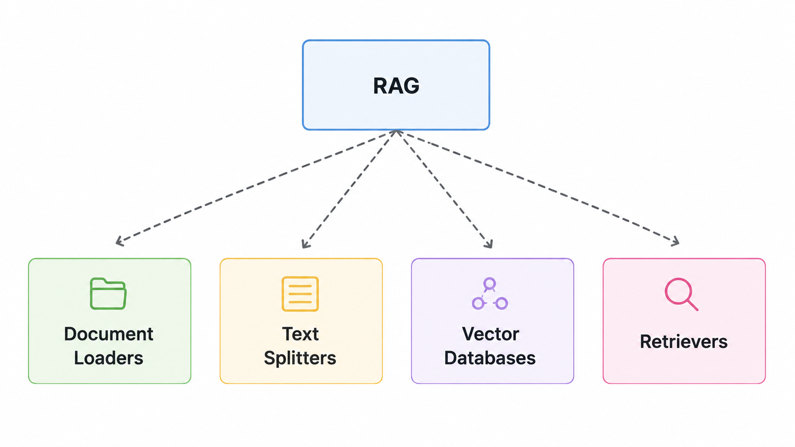

## In-Context Learning

- **In-Context Learning** is a core capability of Large Language Models (LLMs) like GPT-3/4, Claude, and Llama, where the model learns to solve a task purely by seeing examples in the prompt - without updating its weights.

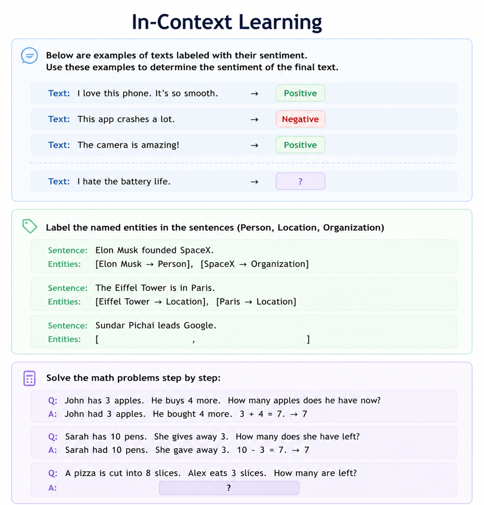

## Emergent Property

- An **emergent property** is a behaviour or ability that suddenly appears in a system when it reaches a certain scale or complexity - even though it was not explicitly programmed or expected from the individual components.

## Context

- Instead of just example tasks, retrieves **background information, facts, documents, product manuals,** etc.
  -Inject that into the prompt to **augment the model's knowledge**.

```python
"""You are a helpful assistant.
Answer the question ONLY from the provided context.
If the context is insufficient, just say you don't know.

{context}
Question: {question}
"""
```

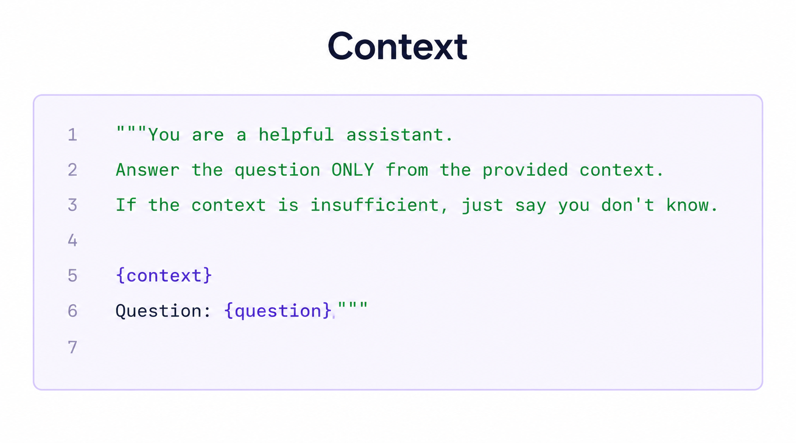

## Understanding RAG or How RAG Works?

- RAG operates through a four-step pipeline:
  - Indexing
  - Retrieval
  - Augumentation
  - Generation

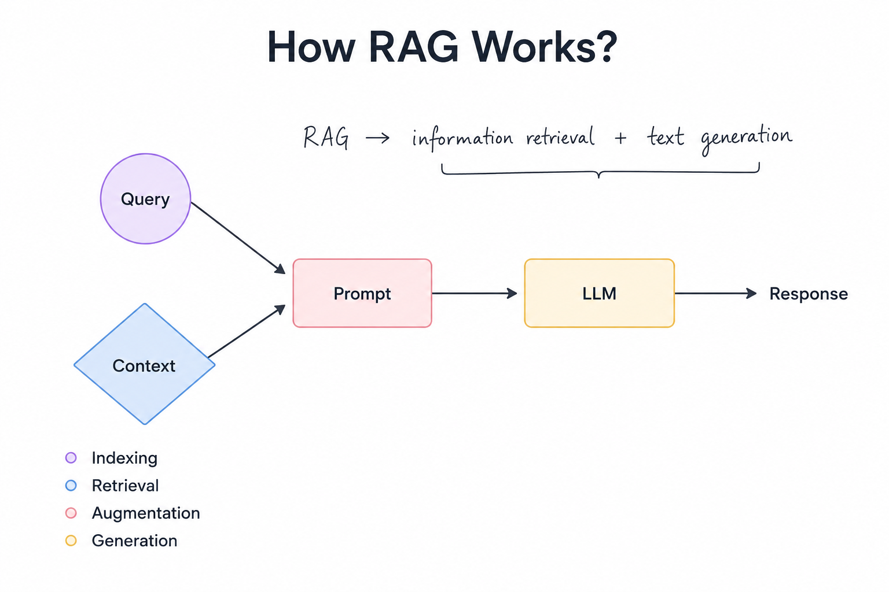

### Indexing:

- **Indexing** is the process of preparing your knowledge base so that it can be efficiently searched at query time.
- In simple words, loading source documents, splitting them into manageable chunks, converting them into vector embeddings, and storing them in a vector database.
- This steps consists of 4 sub-steps:

**1. Document Ingestion**: You load your source knowledge into memory

**Example:** - PDF reports, Word documents - YouTube transcripts, blog pages - GitHub repos, internal wikis - SQL records, scraped webpages

**Tools:** - LangChain Loaders (`PyPDFLoader`, `YouTubeLoader`, `WebBaseLoader`, `GitLoader,` etc.)

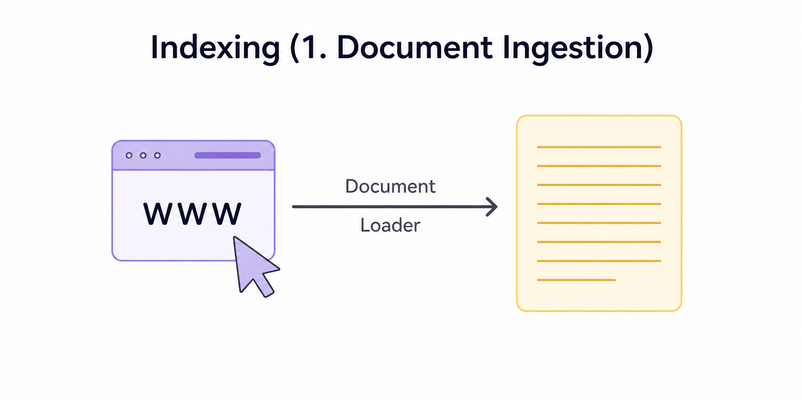

**2. Text Chunking**: Break large documents into small, sematically meaningful chunks

**Why chunk?**
- LLMs have context limits (e.g., 256k-1M tokens)
- Smaller chunks are more focused -> better semantic search

**Tools**: 
- `RecursiveCharacterTextSplitter`, `MarkdownHeaderTextSplitter`, `SemanticChunker`

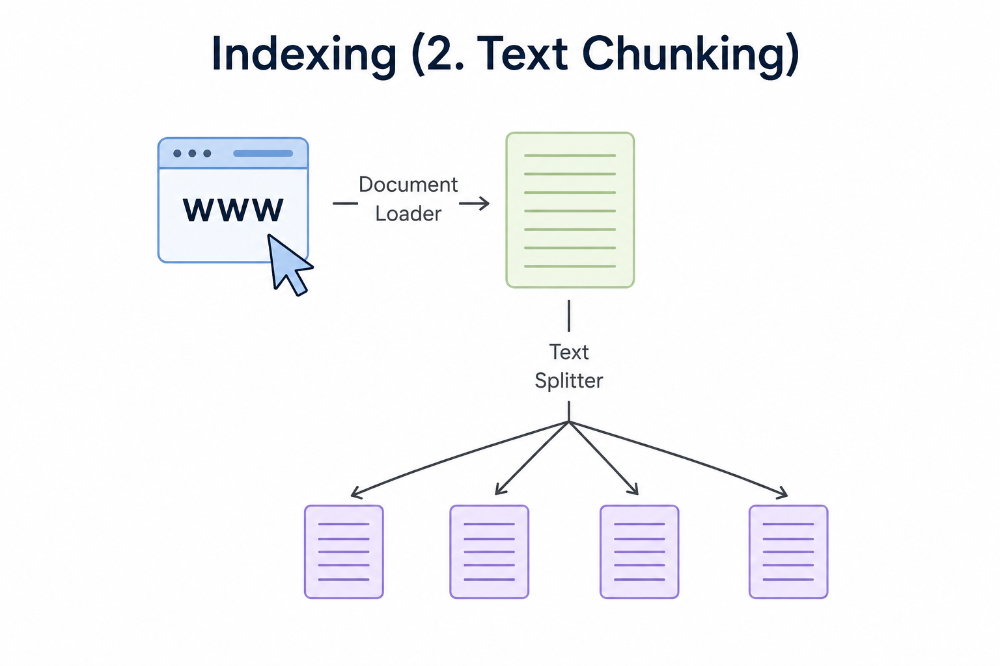

**3. Embedding Generation**: Convert each chunk into a dense vector (embedding) that captures its meaning.

**Why embeddings?**
- Similar ideas land close together in vector space
- Allows fast, fuzzy semantic search

**Tools**:
- `OpenAIEmbeddings`, `SentenceTransformerEmbeddings`, `InstructorEmbeddings,` etc.

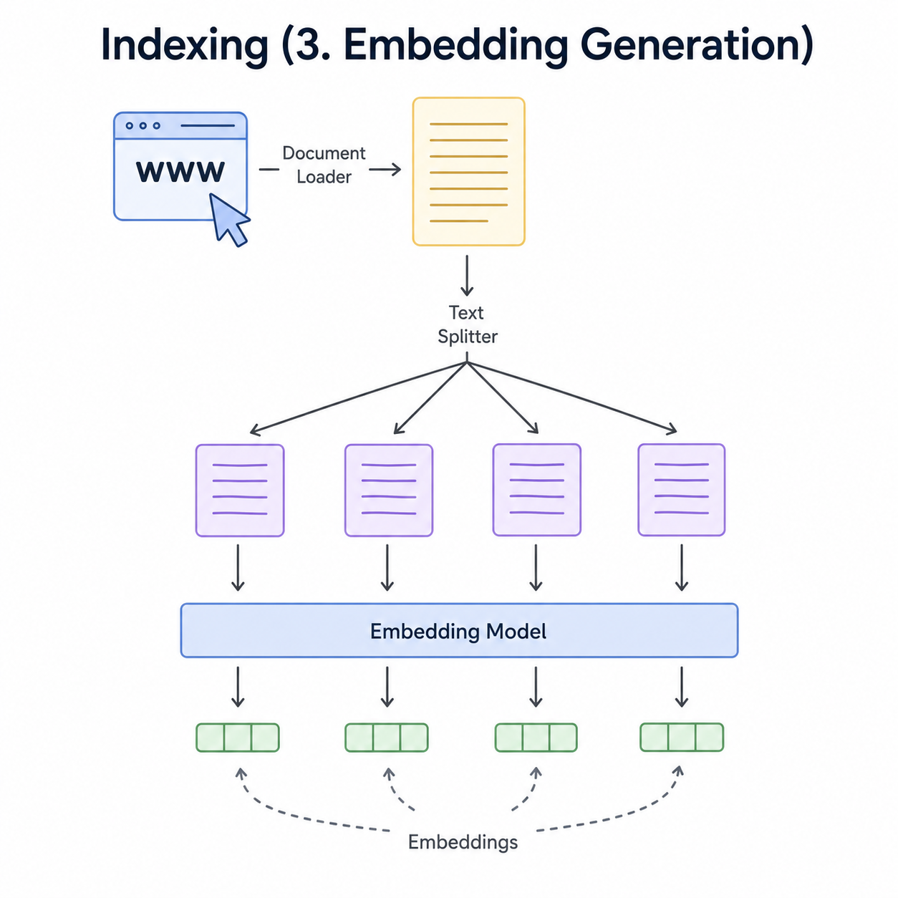

**4. Storage in a Vector Store**: Store the vectors along with the original chunk text + metadata in a Vector Database.

**Vector Database Options**:

- **Local**: `FAISS`, `Chroma`
- **Cloud**: `Pinecone`, `Weaviate`, `Milvus`, `Qdrant`

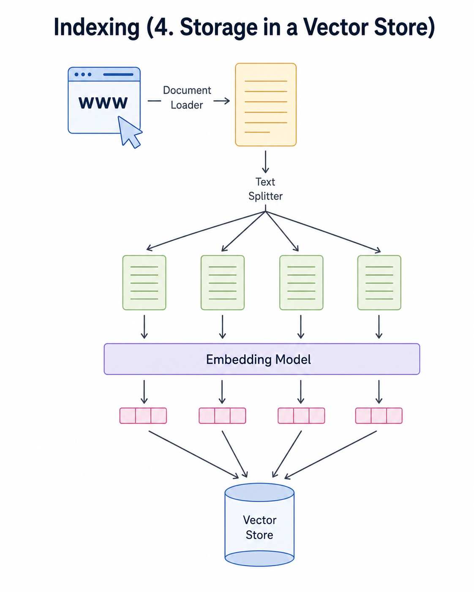

### Retrieval

- **Retrieval** is the real-time process of finding the most relevant places of information from a pre-built index (created during indexing) based on the user's question.
- In simple words, when a user asks a query, the system retrieves the most relevant chunks from the database using semantic search.

**It's like asking**

> "From all the knowledge I have,which 3-5 chunks are most helpful to answer this query?"

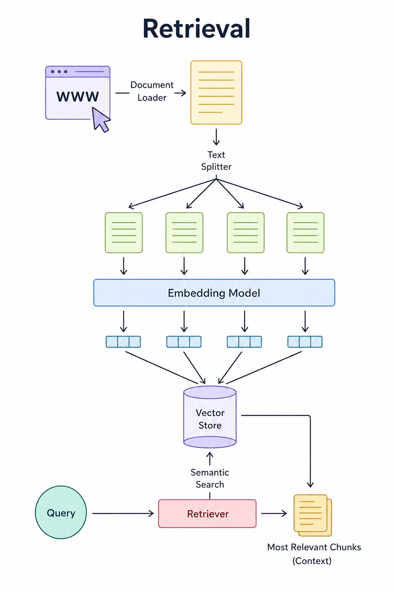

### Augmentation

- **Augmentation** refers to the step where the retrieved documents (chunks of relevant context) are combined with the user's query to form a new, enriched prompt for the LLM.
- In simple words, the retrieved chunks are combined with the user's query to create a context-rich prompt.

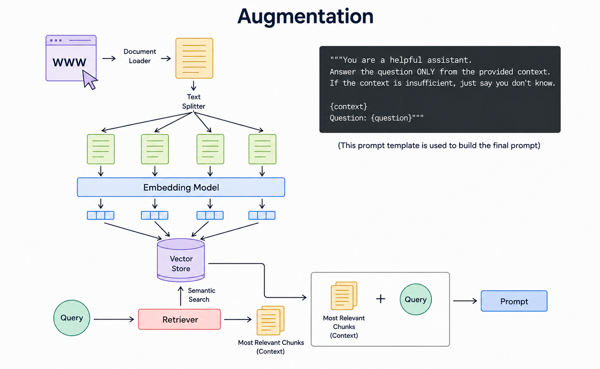

### Generation

- **Generation** is the final step where a Large Language Model(LLM) uses the user's query and the retrieval & augumented context to generate a response.
- In simple words, the LLM uses this augmented prompt to generate a grounded, accurate response.

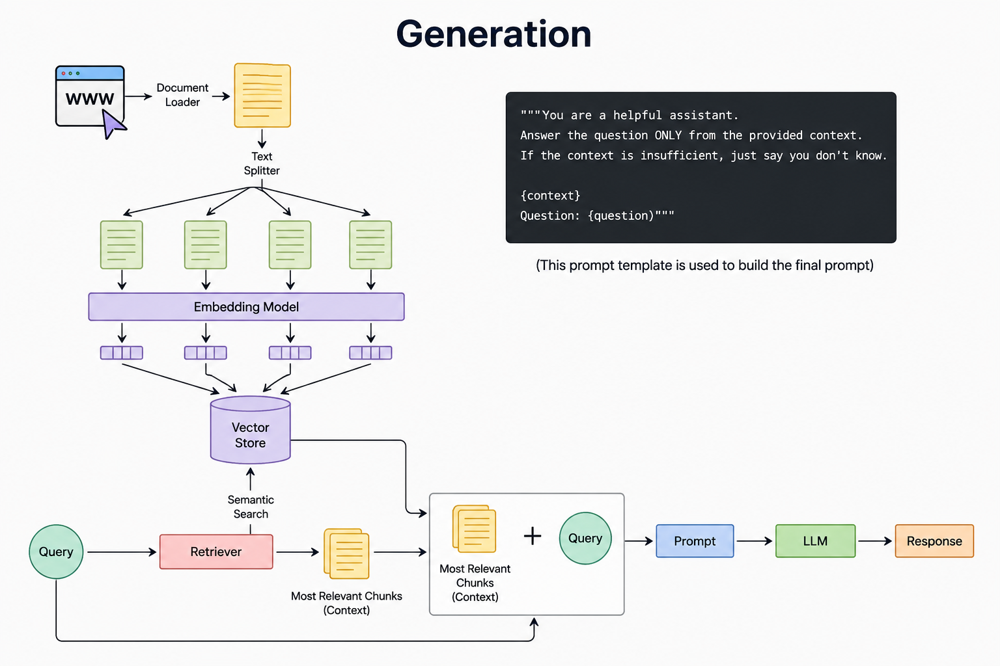

## Retrieval Augmented Generation (RAG) Complete Flow

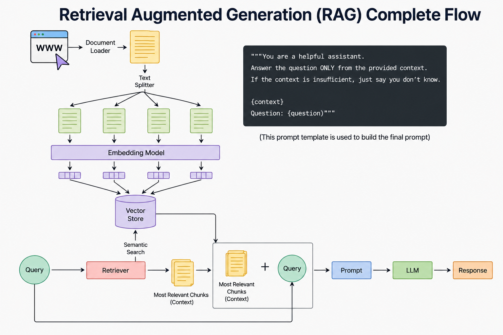

> **Key Takeaway**: By providing the model with specific context at query time, RAG minimizes hallucinations and allows models to work with private or up-to-date information without the need for constant, expensive retraining.
