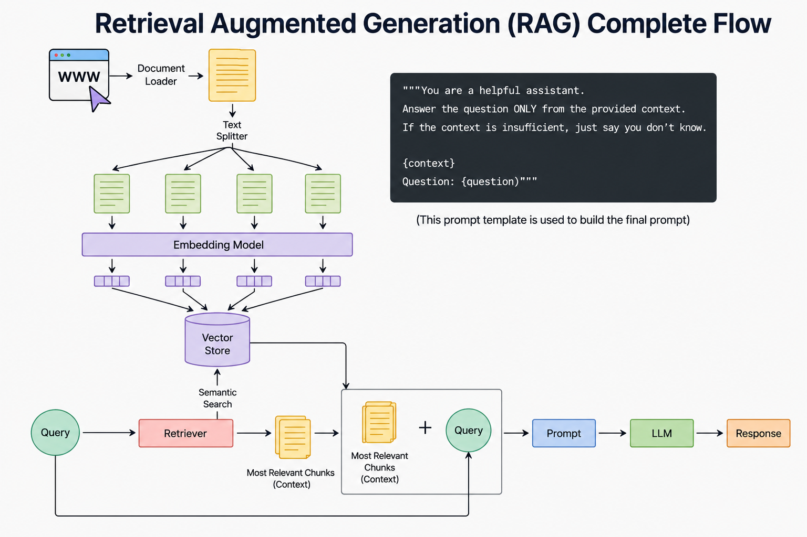
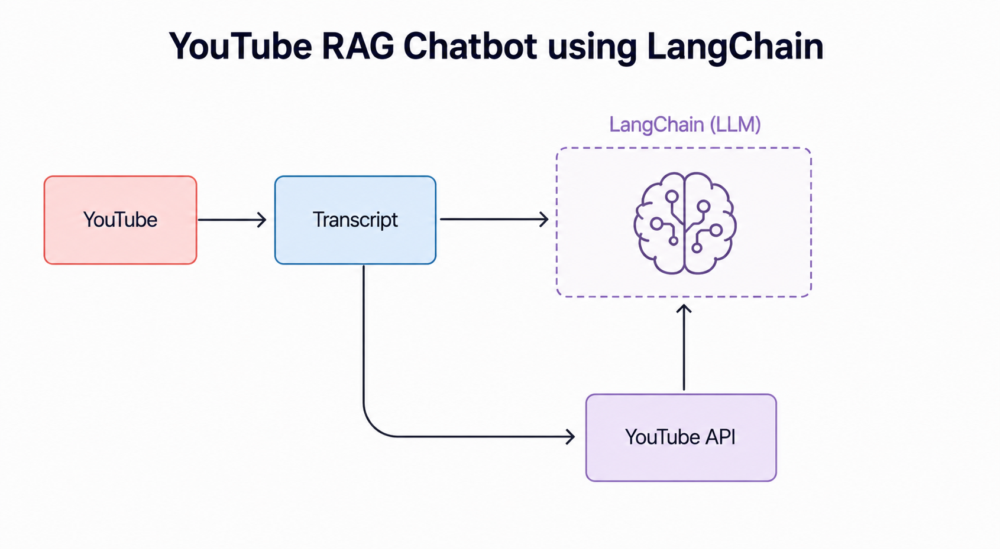

# Building a RAG system in LangChain | YouTube RAG Chatbot using LangChain

## Retrieval-Augmented Generation (RAG) Complete Flow

## YouTube RAG Chatbot using LangChain

## Improvements

- **1. UI based enhancements**
- **2. Evaluation**
  - a. Ragas
  - b. LangSmith
- **3. Indexing**
  - a. Document Ingestion
  - b. Text Splitting
  - c. Vector Store
- **4. Retrieval**
  - **a. Pre-Retrieval**
    - i. Query rewriting using LLM
    - ii. Multi-query generation
    - iii. Domain aware routing
  - **b. During Retrieval**
    - i. Maximum Marginal Retriever (MMR)
    - ii. Hybrid Retrieval
    - iii. Reranking
  - **c. Post-Retrieval**
    - Contextual Compression Retriever
- **5. Augmentation**
  - a. Prompt Templating
  - b. Answer grounding
  - c. Context window optimization
- **6. Generation**
  - a. Answer with Citation
  - b. Gaurd railing
- **7. System Design**
  - a. Multimodal
  - b. Agentic
  - c. Memory based

## RAG Evaluation Metrics

| Metric            | What It Measures                                      |
| ----------------- | ----------------------------------------------------- |
| faithfulness      | Is the answer grounded in the retrieved context?      |
| answer_relevancy  | Is the answer relevant to the user's question?        |
| context_precision | How much of the retrieved context is actually useful? |
| context_recall    | Did we retrieve all necessary information?            |

| Metric                | Description                                                                                           |
| --------------------- | ----------------------------------------------------------------------------------------------------- |
| **faithfulness**      | Measures whether the generated answer is supported by the retrieved context and does not hallucinate. |
| **answer_relevancy**  | Measures how relevant the generated answer is to the user's query.                                    |
| **context_precision** | Measures the proportion of retrieved context that is actually useful for generating the answer.       |
| **context_recall**    | Measures whether all important information needed to answer the question was successfully retrieved.  |
