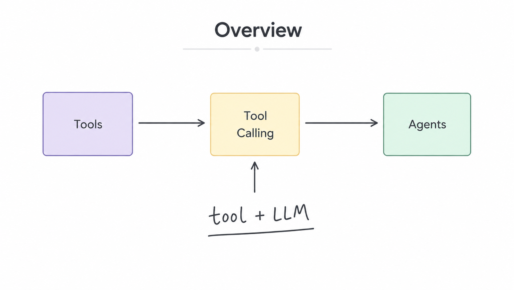
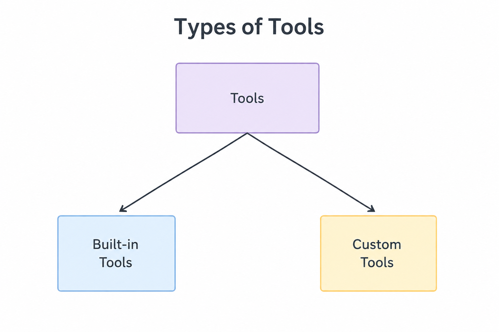
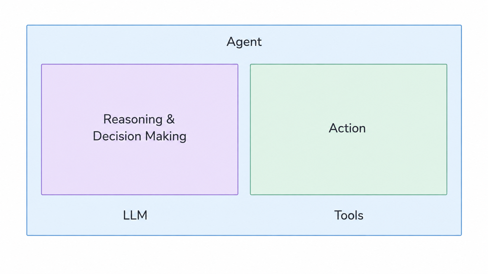
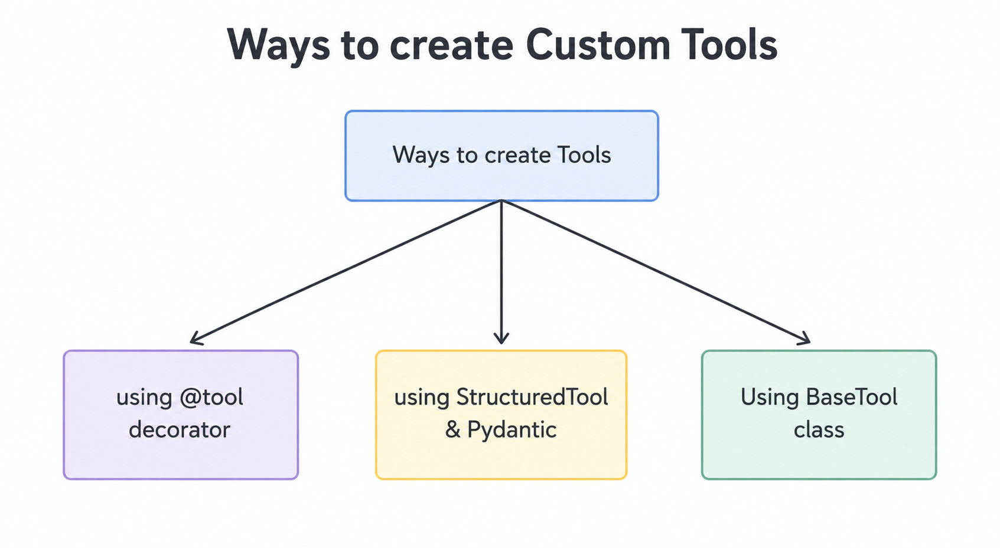

# Tools in LangChain

## Overview

## What is a Tool?

- A tool is just a Python function (or API) that is packaged in a way the LLM can understand and call when needed.
- LLMs (like GPT) are great at:
  - Reasoning
  - Language generation
- But they **can't do things like**:
  - Access live data (weather, news)
  - Do reliable math
  - Call APIs
  - Run code
  - Interact with a database

## Types of Tools

- There are two types of Tools in LangChain:
  - Built-in Tools
  - Custom Tools

**How Tools fits into the Agent ecosystem?**

- An AI agent is an LLM-powered system that can autonomously think, decide, and take actions using external tools or APIs to achieve a goal.

### Built-in Tools

- A **built-in tool** is a tool that LangChain already provides for you - it's pre-built, production-ready, and requires minimal or no setup.
- You don't have to write the function logic yourself - you just import and use it.

**LangChain Built-in Tools**
| Tool Name | Description |
|------------------------|---------------------------------|
| DuckDuckGoSearchRun | Web search via DuckDuckGo |
| WikipediaQueryRun | Wikipedia summary |
| PythonREPLTool | Run raw Python code |
| ShellTool | Run shell commands |
| RequestsGetTool | Make HTTP GET requests |
| GmailSendMessageTool | Send emails via Gmail |
| SlackSendMessageTool | Post messages to Slack |
| SQLDatabaseQueryTool | Run SQL queries |

### Custom Tools

- A **custom tool** is a tool that you define yourself.
- Use them when:
  - You want to call own APIs.
  - You want to encapsulate business logic.
  - You want the LLM to interact with your database, product, or app.

## Ways to create Custom Tools

### Structured Tool

- A **Structured Tool** in LangChain is a special type of tool where the input to the tool follows a structured schema, typically defined using a Pydantic model.

### Base Tool

- A Base Tool is the abstract base class for all tools in LangChain.
- It defines the core structure and interface that any must follow, whether it's a simple one-liner or a fully customized function.

> **Note**: All other tool types like **@tool, StructuredTool** are built on top of **BaseTool**.

## Toolkits

- A toolkit is just a collection (bundle) of related tools that serve a common purpose - packaged together for convenience and **reusability**.
- In LangChain:
  - A toolkit might be: GoogleDriveToolKit
  - And it can contain the following tools
- For Example:
  - `GoogleDriveCreateFileTool`: Upload a file
  - `GoogleDriveSearchTool`: Search for a file by name/content
  - `GoogleDriveReadFileTool`: Read contents of a file
