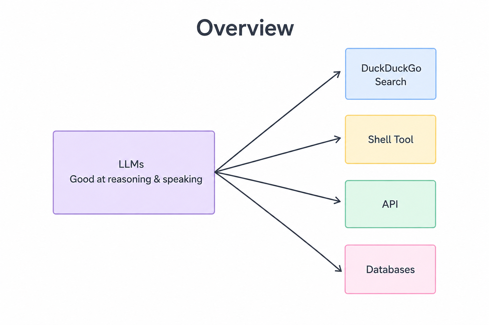
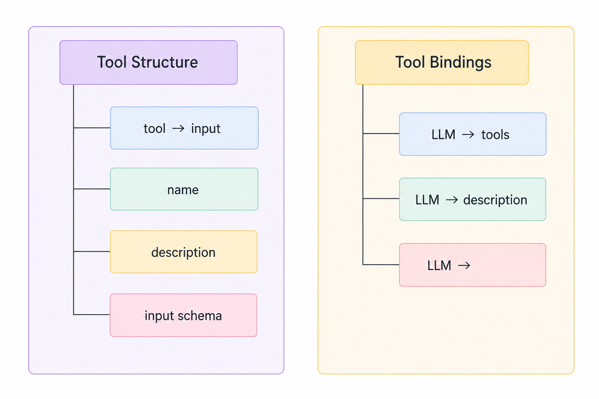
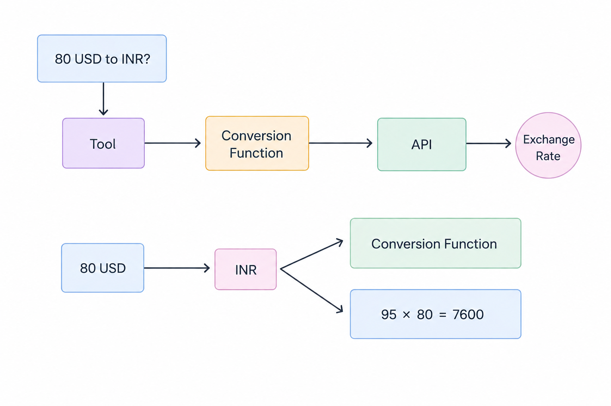

# Tool Calling in LangChain

## Overview



## Tool Binding

- **Tool Binding** is the step where you **register tools with a Language Model (LLM)** so that:
  - The LLM knows **what tools are available**
  - It knows **what each tool does** (via description)
  - It knows **what input format to use** (via schema)



## Tool Calling

- **Tool Calling** is the process where the **LLM (Large Language Model)** decides, during a conversation or task, that it needs to **use a specific tool (function)** - and generates a structured output with:
  - the **name of the tool**
  - and the **arguments** to call it with

- The LLM **does not actually run the tool** - it just **suggests** the tool and the input arguments.
- The **actual execution is handled by LangChain or you**.

> What's 8 multiplied by 7?

- The LLM responds with a tool call:

```json
{
  "tool": "multiply",
  "args": { "a": 8, "b": 7 }
}
```

## Tool Execution

- **Tool Execution** is the stop where the **actual Python function (tool)** is run using the input arguments that the **LLM suggested during tool calling**.
- In simple words:
  - The LLM says:
  - _Hey call the `multiply` tool with a=8 and b=7_
  - Tool Execution is when you or LangChain actually run: `multiply(a=8, b=7)`
  - and get the result: `56`

## Currency Conversion Tool

> "LLM do not try to fill this argument".
> "I (the developer/runtime) will inject this value after running earlier tools."



### How AI Agent convert the Currency?

- 1. **User says**: "Convert 80 USD to INR"
- 2. **LLM thinks**: "I don't know the rate. First lett me call the `get_conversion_factor`.
- 3. **Tool result comes**: 95
- 4. **LLM looks at result, THINKS again**: "Now I know the rate, next i should call `convert` with 80 and 95."
- 5. **Tool result comes**: 7600 INR
- 6. **LLM summarizes**: "80 USD is 7600 INR at current rate."
