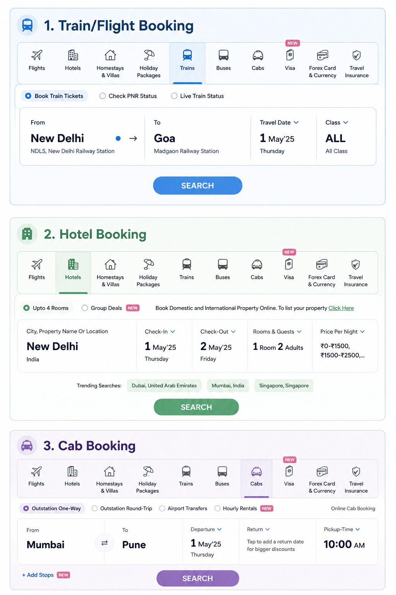
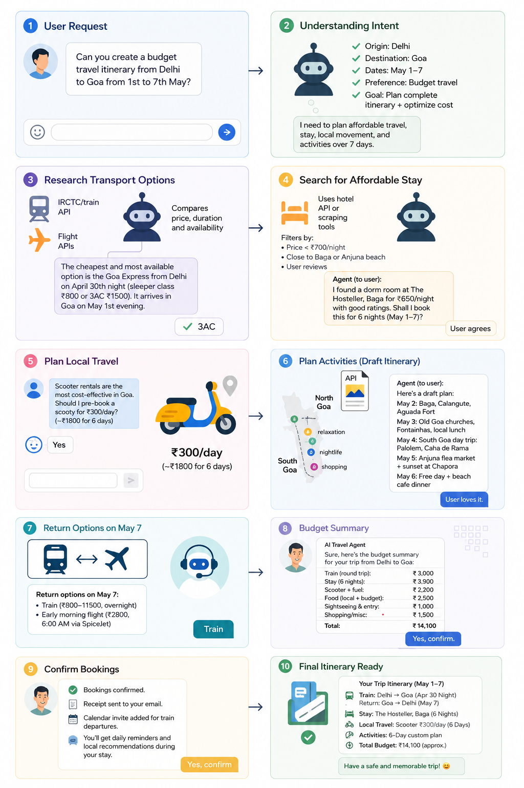
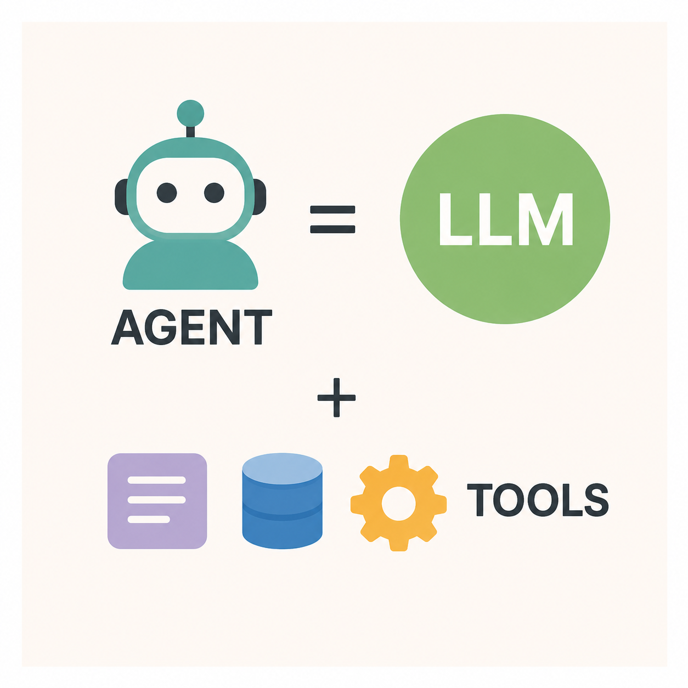
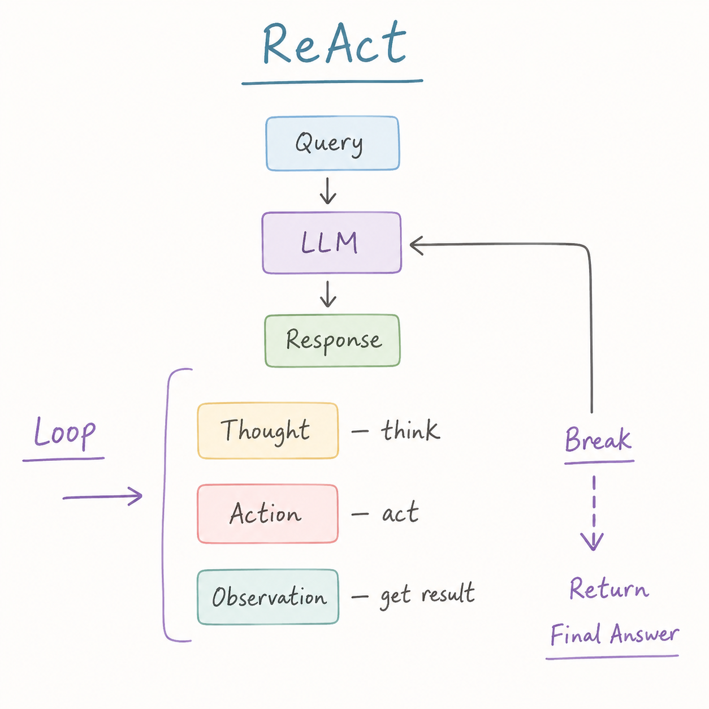
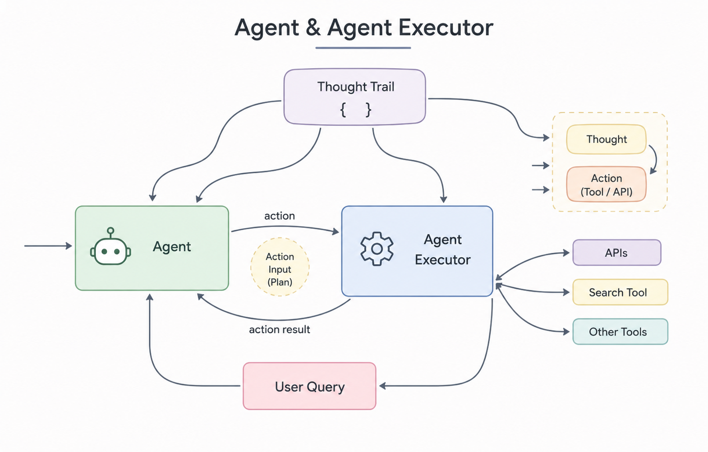
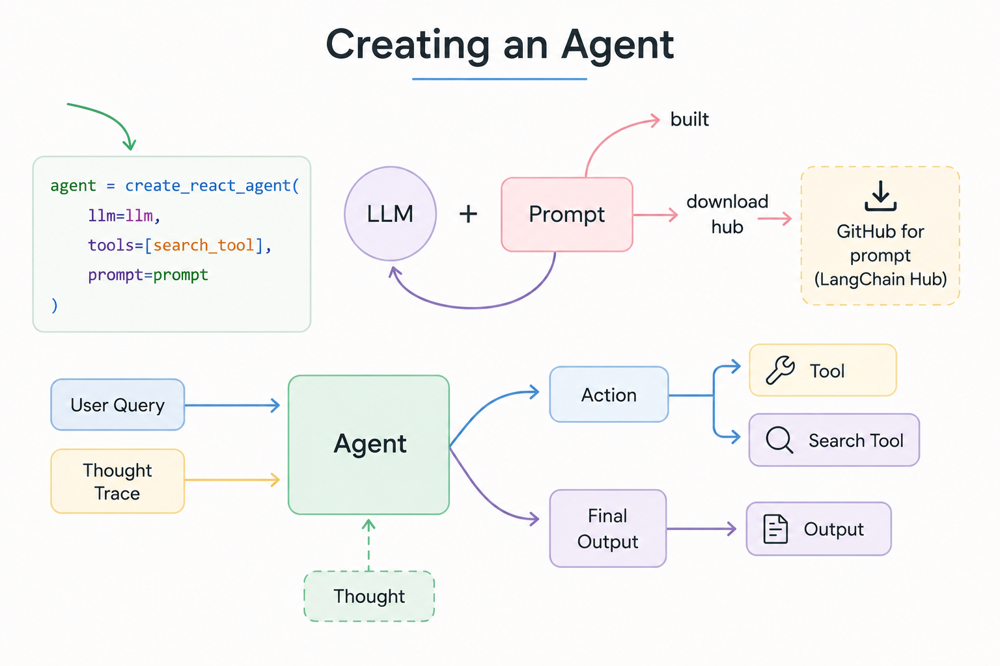
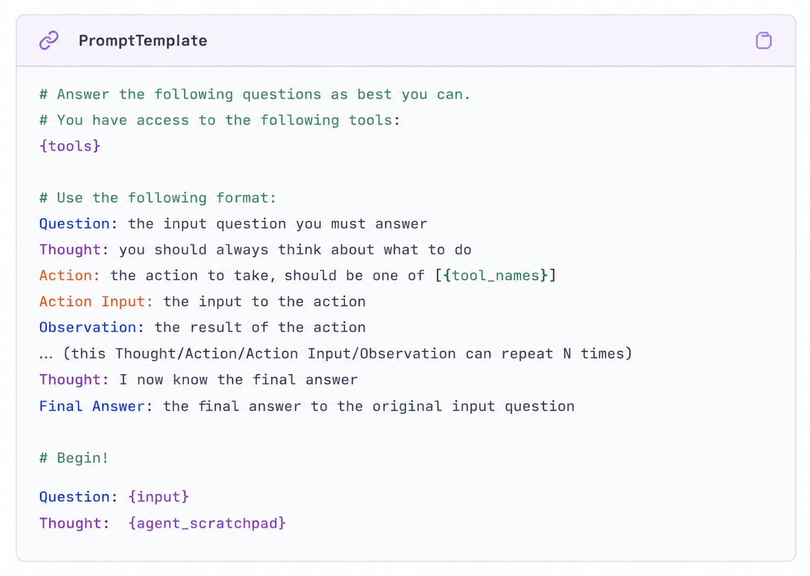
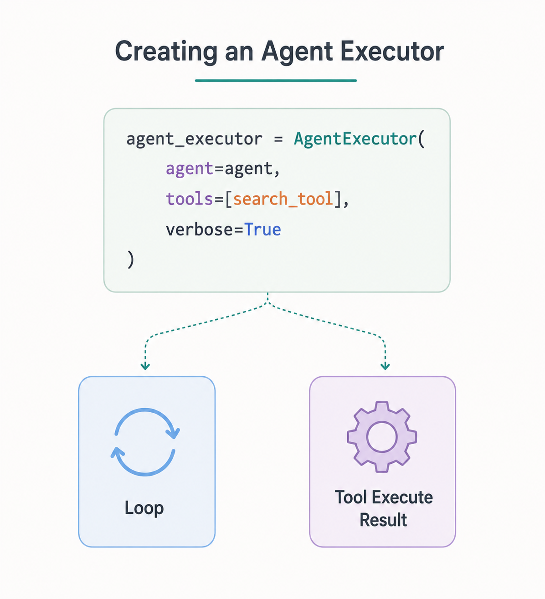
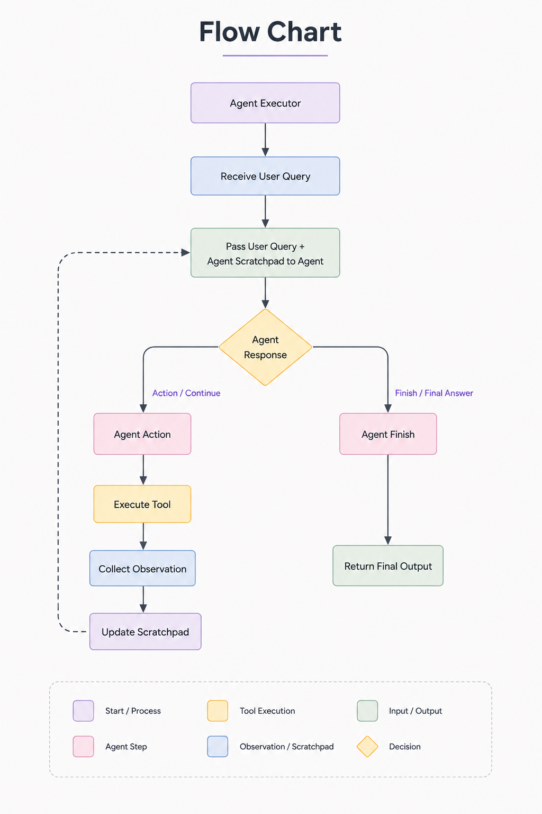
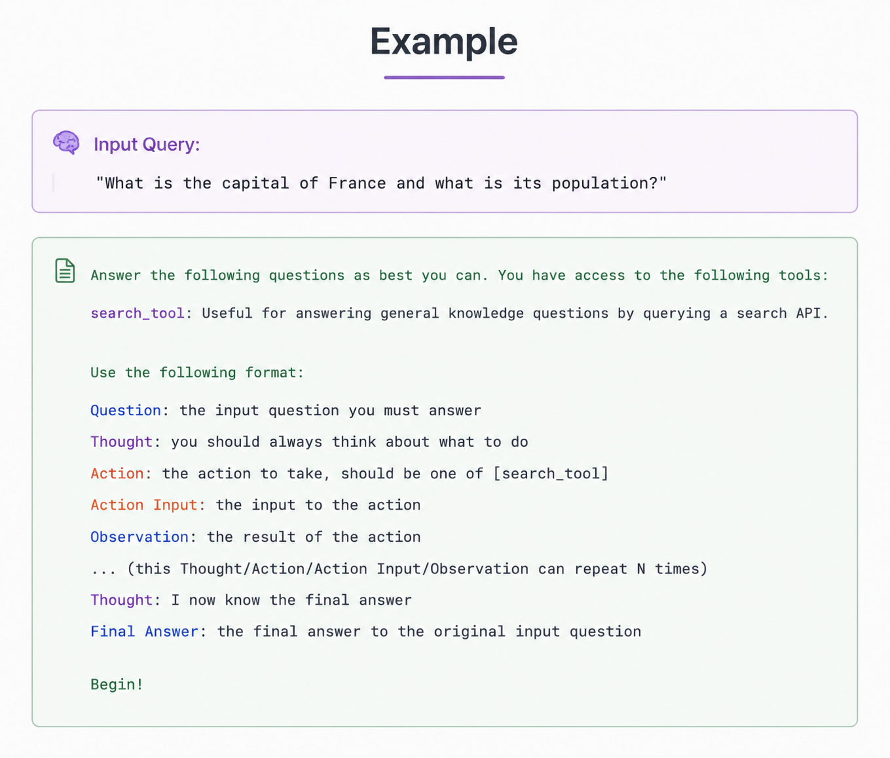

# Building end-to-end AI Agent in LangChain

## AI Agent Demo

**AI-Powered End-to-End Travel Booking Agent**

### Problem Statement

- Travel planning often requires users to visit multiple platforms to book transportation, accommodation, and local travel. This process is time-consuming, repetitive, and prone to errors due to manual data entry across different booking systems.
- Design and develop an AI Agent that can understand a user's travel requirements in natural language and autonomously perform a sequence of bookings, including:
  - Train/Flight Booking
  - Hotel Booking
  - Cab Booking

- The agent should collect user preferences, make decisions, coordinate bookings in the correct order, and provide a complete travel itinerary.



### Solution

- **Step 1 — User Request**
  - The user asks the AI Travel Agent to create a budget-friendly travel itinerary from Delhi to Goa, including transportation, accommodation, local travel, sightseeing, and overall trip planning.

- **Step 2 — Understanding Intent**
  - The agent extracts key travel details such as origin, destination, travel dates, budget preference, trip duration, and overall objective to create a personalized itinerary.

- **Step 3 — Research Transport Options**
  - Using train and flight APIs, the agent compares ticket prices, travel duration, seat availability, and convenience to identify the most cost-effective travel option.

- **Step 4 — Search for Affordable Stay**
  - The agent queries hotel booking APIs, applies budget and location filters, analyzes ratings and reviews, and recommends suitable accommodations for approval.

- **Step 5 — Plan Local Travel**
  - The agent evaluates transportation choices such as scooters, cabs, and public transport, recommending the most economical option based on travel requirements.

- **Step 6 — Plan Activities (Draft Itinerary)**
  - Using maps, travel APIs, and local recommendations, the agent generates a day-wise itinerary covering attractions, beaches, food spots, cultural sites, and leisure activities.

- **Step 7 — Return Journey Planning**
  - The agent analyzes available train and flight options for the return trip, comparing schedules, costs, and comfort levels before presenting recommendations.

- **Step 8 — Budget Summary**
  - The agent consolidates all estimated expenses, including transport, accommodation, food, local travel, sightseeing, and miscellaneous costs into a single budget report.

- **Step 9 — Confirm Bookings**
  - After user approval, the agent proceeds with booking transportation, accommodation, and other selected services while generating confirmations and reservation details.

- **Step 10 — Final Itinerary Ready**
  - The agent delivers a complete travel package containing bookings, itinerary, budget breakdown, reminders, travel documents, and personalized trip recommendations.



## What is an AI Agent?

- An **AI Agent** is an intelligent system that receives a high-level goal from a user, and autonomously plans, decides, and executes a sequence of actions by using external tools, APIs, or knowledge sources - all while maintaining context, reasoning over multiple steps, adapting to new information, and optimizing foe the intended outcome.



## Characteristics of AI Agent

- **Goal-driven**: Tell the agent what you want, not how to do it.
- **Autonomous planning**: Agent breaks down the problem and sequence tasks on its own.
- **Tool-using**: Agent calls APIs, calculators, search tools, etc.
- **Context-aware**: Maintains memory across steps to inform future actions
- **Adaptive**: Rethinks plan when things change (e.g., API fails, no data)

## 1. ReAct

- **ReAct** is a design pattern used in AI agents that stands for **Reasoning + Acting**.
- It allows a Large Language Model (LLM) to interleave internal reasoning (Thought) with external actions (like tool use) in a structured, multi-step process.

- Instead of generating an answer in one go, the model thinks step by step, deciding what it needs to do next and optionally calling tools (APIs, calculators, web search, etc.) to help it.



- **Example**:

```bash
Thought: I need to find the capital of France.
Action: search_tool
Action Input: "capital of France"
Observation: Paris

Thought: Now I need the population of Paris.
Action: search_tool
Action Input: "population of Paris"
Observation: 2.1 million

Thought: Now, I know the final answer.
Final Answer: Paris is the capital of France and has a population of 2.1 million.
```

- **ReAct is useful for**:
  - Multi-step problems
  - Tool-augmented taks (web search, database lookup, etc.)
  - Making the agent's reasoning **transparent and auditable**

- It was first introduced in the paper:
  > "ReAct: Synergizing Reasoning and Acting in Language Models" (Yao et al., 2022)

## 2. Agent & Agent Executor

- `AgentExecutor` orchestrates the entire loop:
  - 1. Sends inputs and previous messages to the agent
  - 2. Gets the next `action` from agent
  - 3. Executes that tool with provided input.
  - 4. Adds the tool's `observation` back into the history.
  - 5. Loops again with updated history until the agent says `Final Answer`.



## 3. Creating an Agent

```python
agent = create_react_agent(
    llm=llm,
    tools=[search_tool],
    prompt=prompt
)
```



- **Example**:



## 4. Creating an Agent Executor

```python
agent_executor = AgentExecutor(
    agent=agent,
    tools=[search_tool],
    verbose=True
)
```



## Complete Flow Chart



## Example


